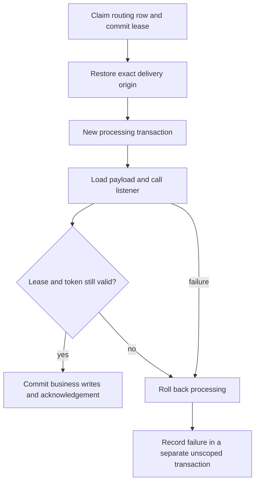

# Durable tenant event routing

Status: **implemented for current generated storage and the production worker**.
The original seven-case experiment remains feasibility evidence; the separate real
module/JAR/pool tests verify the production paths. This does not complete identity,
authorization or the integrated SaaS release acceptance gates.

This refines [the tenant execution contract](tenant-technical-contract.md#8-events-callbacks-and-global-runtime-coordination).
The existing [event contract](../contracts/events.md) remains authoritative for
implemented functionality. The candidate applies to explicit module activation and
ordinary application events alike; it introduces no provider-specific syntax.

## Origin belongs to the internal envelope

A durable publication captures its origin from the trusted execution context, not
from a business field or a caller-supplied tenant parameter:

| Execution at publication | Captured origin |
| --- | --- |
| Verified tenant selected | TENANT with that nominal TenantId |
| Intentionally unscoped execution | GLOBAL |
| Missing/contradictory required context or stale transaction/session binding | Technical failure; never a global fallback |

The same event type may have global and tenant-origin instances. Tenant identity is
not added to DomainEvent, its factory arguments, business getters or DTO payloads.
Actor credentials, sessions, bearer tokens and snapshots of human permissions MUST
NOT be stored. Tenant routing is not authentication or authorization. Deferred work
will require the separately specified technical-actor policy when authorization is
integrated; an event does not grant unrestricted rights.

A production publication API MUST capture origin itself. The experiment's explicit
Origin argument is test setup, not a proposed application API.

## Persist payload, children and recipients atomically

Payload rows, recursively stored VO/collection rows and one delivery per initial
listener MUST commit with the publishing business transaction. A rollback leaves
none of those writes committed. Per-type event identity remains unique across
origins. Republishing an already recorded identity requires the same origin and
payload; it MUST NOT retag the event or add newly registered receivers retroactively.
Each recipient retains its own attempts, lease, acknowledgement and terminal state.

Payloads remain immutable through the supported storage API. This is an architecture
contract, not a sandbox against arbitrary privileged Java/SQL or artifact authors.

## Nullable tenant keys need an additional relationship key

Payload storage needs to represent an explicit GLOBAL origin alongside TenantId.
The implemented relational representation is:

| Technical component | Representation |
| --- | --- |
| Tenant discriminator | Nullable UUID; NULL encodes the explicit GLOBAL origin |
| Relationship scope key | Non-null text: GLOBAL or TENANT followed by the canonical UUID |
| Consistency check | Scope key must correspond exactly to the discriminator |
| Root identity | Existing per-type global event-id primary key, plus a scope/event-id unique key |
| Child relationships | Scope-qualified, non-null foreign-key components throughout the owned graph |

Exact generated names remain technical mapping details. The experiment uses ordinary
SQL identifiers for readability; it is not a production migration to copy.

**Why both components?** PostgreSQL's normal MATCH SIMPLE foreign key skips checking
when any referencing component is NULL. A nullable `(tenant_id, parent_id)` FK therefore
does not stop a GLOBAL child referencing a tenant parent. A non-null scope key plus
parent id closes that gap for both GLOBAL and tenant relationships. CHECK constraints
prevent a scope key and UUID from disagreeing. Composite aggregate-style tenant FKs
alone cannot be copied unchanged to mixed-origin event graphs.

The complete owned payload graph MUST use the same origin. The schema model MUST
represent this protection explicitly, separately from aggregate classification, and
round-trip existing schema formats/fingerprints without reinterpretation.

## RLS and exact-origin loading are separate checks

Read policies permit deliberately global payloads and the selected tenant's payloads.
Unscoped reads cannot see tenant payloads. Write checks require exact correspondence
with the current transaction origin: a tenant-bound write cannot quietly insert a
GLOBAL row. ENABLE/FORCE policy and restricted runtime-role requirements apply to
tenant-origin operations; no general BYPASSRLS worker role is introduced.

Delivery loading is stricter than general read visibility. It MUST match the event's
identity/type **and the exact claimed origin**, even when a tenant's read policy would
also allow global rows. Forging a GLOBAL or foreign-tenant routing row therefore never
loads the original tenant payload and never reaches the listener body. Missing or
inconsistent payload/origin is a classified technical failure, not an empty successful
delivery or a fallback to global execution.

Global publication/delivery still requires no tenant selection. Compatibility tests
must preserve existing global semantics and explicitly verify fresh/upgrade behavior;
the presence of a tenant-capable event type must not invent a tenant for global code.

## Control-plane claim, scoped processing, independent bookkeeping

Delivery routing is control-plane metadata: event type/id, listener id, origin,
status, attempts and lease/token. It contains no readable business payload. The
internal coordinator may claim eligible routing rows across tenants through narrowly
scoped infrastructure. It cannot bypass RLS on payload or aggregate tables.

The lifecycle retains the existing independent transactions:

Tenant processing establishes trusted selection before payload loading or usecase
execution, binds the runtime connection transaction-locally, then clears selection
and transaction resources on every exit. Nested REQUIRED usecases join that scoped
processing transaction. A global delivery uses the explicit global path; it cannot
borrow a surrounding tenant or a stale pool setting.

A worker entrypoint MUST reject an ambient business transaction or tenant selection
rather than suspend, reinterpret or silently replace it. Claim and failure bookkeeping
are unscoped control-plane work; the processing context ends before failure is stored.
A restarted worker uses persisted routing, never an in-memory request context.

## Retry, lease fencing and delivery progress

The current production lease/retry contract remains the target: per-recipient claims,
SKIP LOCKED coordination, configured attempts/backoff, attempt-limit cleanup and
claim-token fencing. Origin is immutable routing metadata; successful acknowledgement
and failure updates MUST also match the expected origin. Other due recipients/events
may continue while a failed delivery waits for backoff. There is no new strict global
ordering or head-of-line guarantee.

If an expired worker continues, its local writes MUST roll back when acknowledgement
loses the lease/token. The replacement claim remains intact. This does not undo an
external effect already performed by the old callback: external delivery remains
at-least-once and requires the previously documented idempotency/reconciliation.
A crash on the final attempt must eventually reach a terminal state rather than
remain PROCESSING forever.

Persist only safe error classifications/correlation identifiers, not arbitrary
exception messages, payloads, credentials, tenant values or claim tokens in logs.
The experiment verifies class-only failure storage; complete production observability
and exception sanitization remain implementation acceptance requirements.

## Migration and module requirements

Implementation MUST extend schema generation, mapping metadata, ingestion, generated
storage capabilities, runtime schema validation, schema-check and module activation
together. Schema format 3 describes payload origin, and current generated adapters advertise
EventStorage tenantDeliveryVersion 1. The queue carries nullable tenantId; existing
rows remain GLOBAL. Older storage capabilities are not upgraded by inference.

Old global payloads/deliveries need an explicitly reviewed upgrade that preserves
their GLOBAL meaning. Do not silently interpret an old adapter or unknown metadata
as tenant-capable. Modules carrying old storage implementations must be rejected for
tenant publication with a clear rebuild diagnostic while retaining supported global
behavior. New capability metadata participates in compatibility checks.

Migration candidates must contain the normal responsibility header and any required
specific origin/backfill warnings. The application developer/operator alone reviews,
tests and approves deployment suitability, ordering, existing data and recovery.
The tooling does not guarantee safe migration or infer historical tenant attribution.
Required producer/dependent module histories run before application history as usual.

## Evidence and remaining production acceptance

The test-only experiment under `experiments/tenant-isolation-spike` proves:

- The nullable-FK gap and the non-null relationship-scope solution.
- Mixed GLOBAL/tenant RLS visibility, exact-origin loading and forged routing rejection.
- Atomic payload/children/recipient rollback, immutable publication and fixed receivers.
- Per-recipient retry after worker/pool recreation; other deliveries progress.
- Old-token rollback, replacement ownership and final-attempt crash cleanup.
- Two parallel worker claims with independent physical tenant transactions.
- Rejection of ambient execution and contaminated global pooled sessions.

It uses real PostgreSQL, owner/runtime roles, Hikari pooling, Spring transactions and
production TenantContext/JdbcTenantCoordinator. Its event schema, store and worker are
handwritten experimental code. It does **not** prove generated adapters, actual runtime
worker integration, event evolution/module compatibility, packaged activation,
migration replay, schema-check or external-effect exactly-once behavior.

Production acceptance now additionally covers generated tenant payloads, module JAR
consumption, restricted Hikari pools, shared REQUIRED writes, rollback, restart/retry,
forged routing, weakened policies, concurrent tenants, lease replacement and pending
GLOBAL queue upgrades. The implementation preserves legacy GLOBAL storage and blocks
older adapters explicitly for tenant work. The [event contract](../contracts/events.md)
is authoritative; [tenant event operations](../tutorials/tenant-events.md) explains use
and deployment. The original experiment alone does not prove any of those paths.
A19/A20/A21 stay OPEN pending the complete SaaS execution/identity/UI lifecycle.
