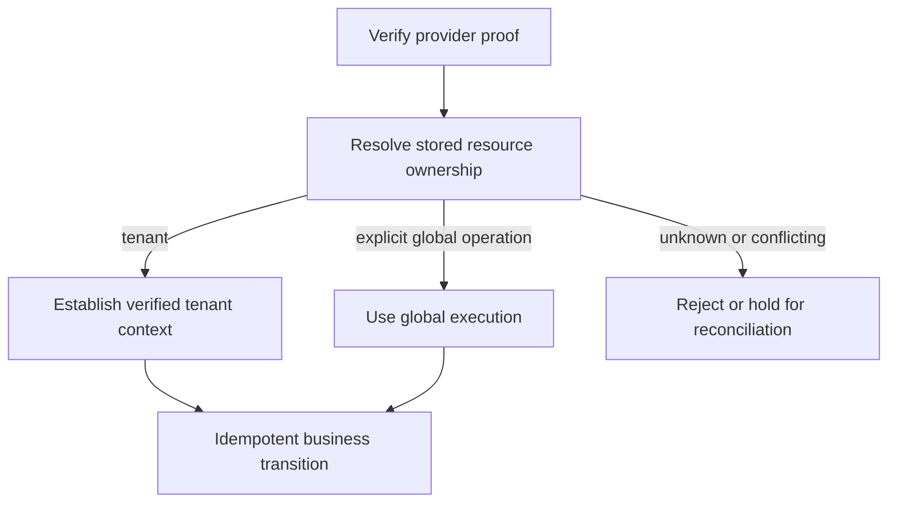

# Tenant-safe ingress and persistence extensions

Status: **required 0.6.0 follow-up; not implemented extension APIs or syntax**.
This records two acceptance gaps alongside the existing tenant/event foundations.
It does not claim completed webhook routing, repository delegates, return guards or
an arbitrary-SQL verification system. See the [release ledger](release-0.6.0.md),
[tenant persistence](tenant-persistence-integration.md) and [event routing](tenant-event-routing-contract.md).

## 1. Provider callbacks need a trusted ownership route

A provider callback normally has no logged-in application user and no selected tenant.
It cannot start by calling a tenant repository to discover which tenant owns the
payment: that repository correctly requires selection first. Conversely, reading a
`tenantId` from a callback/header and opening a verified context would invert the trust
boundary. A signed provider envelope does not by itself establish our application's
ownership of every value it contains.

The payment/integration module must maintain a minimal technical correlation registry,
written from trusted application state when establishing the external relationship.
The lookup scope must distinguish provider, stable provider-connection identity,
environment, resource kind and external resource identity where required by the provider
contract. Do not assume that a payment ID alone identifies the owner across providers,
merchant connections, resource types or test/production modes. Credential rotation
must not change ownership; do not derive identity from a secret's contents.

The registry is bootstrap/control-plane infrastructure, not a bypassing repository for
invoices or subscriptions. It must expose only the routing/proof information required
to select the correct context, never all tenants' business graphs. Any credential
locator is a protected opaque reference, not credentials in a log or payload.

The diagram states trust dependencies, not a universal vendor request sequence.
Some provider modes require an authenticated API lookup; selecting its configured
connection/credential handle can precede final ownership verification. Specify that
provider-specific bootstrap explicitly. Never solve this by disabling RLS, trying
all tenants, using migration credentials or treating missing routing as GLOBAL.

Before domain processing, verify that the authoritative provider resource, configured
connection/environment and stored ownership agree. Callback-supplied correlation
metadata may locate a candidate, but cannot authorize its tenant assignment by itself.
A technical dispatcher can then restore the verified tenant before invoking the
business usecase or queueing tenant-bound work, reusing the execution principles of
the event worker. Context must be cleared on every exit and across pool/thread reuse.
A batch covering several tenants must be split into independently scoped operations.

### Races and operational outcomes

Provider delivery can race the transaction that stores our external reference.
Unknown routing therefore needs an explicit durable hold/retry/reconciliation path;
it must not cause an unscoped lookup or a guessed owner. Registry ownership must not
silently move a known external resource between tenants. Explicitly global provider
operations require their own declared processing path.

Define idempotency scope, authenticated proof, durable acceptance, acknowledgement,
retry and replay behavior for each provider adapter. Do not prescribe one HTTP status
or signature mechanism for all vendors. Acknowledging before durable acceptance can
lose work; replying with success is not evidence that the business transaction committed.
Duplicate, out-of-order and concurrent notifications must not repeat payment/invoice
side effects or move a completed state backwards. Re-read authoritative state where
required and use the ordinary optimistic-locking/idempotency mechanisms.

Required negative cases include forged proof, unknown connection/resource, conflicting
ownership, two providers/connections sharing an external ID, early callback, replay,
out-of-order state, simultaneous delivery and restart after acceptance. Results must
be actionable: rejected proof, unresolved route, duplicate, deferred reconciliation,
completed processing or retryable/terminal failure. Logs must use safe internal
correlation/classification and omit raw bodies, credentials, proof material, personal
payment data and tenant identifiers. Seed such values in log-safety tests.

This is required by A04/A09/A18/A20 and the explicit A23 release gate. Provider-specific
verification/transport belongs with the adapter/module; trusted routing/context and
inbox/worker integration should reuse general Vernac mechanisms. No new webhook keyword
is committed by this document.

## 2. Handwritten repository methods must retain the persistence contract

### What exists today

The repository grammar currently accepts declarative `find` methods. There is no
supported repository `behavior` / `implemented by` extension declaration yet.
Java can implement/wrap an interface, but this is not automatically a verified Vernac
repository extension. The generated JDBC adapter keeps its store/bindings private;
subclassing/editing generated files is not the intended extension mechanism.

The canonical `JdbcAggregateStore` already performs scoped CRUD and complete graph
loading, root-version checks, ownership-aware restoration, shared-entity identity,
list ordering and current scalar/VO mappings. Its generated bindings carry the
technical version/tenant state without exposing business getters for those fields.
TenantContext selection alone does not bind arbitrary JdbcTemplate SQL: the physical
transaction/connection must be checked and initialized before its first tenant query.

A freshly created tenant aggregate can have a selected owner while still being NEW.
Public tenant `reconstitute` produces DETACHED state; it is not the canonical loaded
state. `PersistenceState` / `TenantOwnership` are technical provenance, not ordinary
fields to fill opportunistically from current context. Restored aggregate state has
known ownership and a positive persisted version. A result check must not silently
claim a NEW/DETACHED object for the current tenant or reset its version to make it fit.

### Required supported path

Design one explicit, consistent delegate/extension boundary before adding syntax.
Prefer the existing generated-wrapper/access-context style. It should provide:

- A runtime-only scoped read facility that checks MANDATORY transaction, actual runtime
  DataSource, verified tenant/pin and database binding before SQL. No migration DataSource
  or hidden tenant captured in a singleton. Framework-owned SQL/parameters enforce scope;
  do not attempt generic textual injection of a tenant clause into arbitrary SQL.
- A controlled way to select root identities or predicates and let the canonical loader
  hydrate complete aggregates in batches. Preserve declared ordering/cardinality,
  collection/page/count behavior and absence/precision semantics. Avoid requiring users
  to rebuild flattened VOs, aliases and entity graphs in bespoke RowMappers.
- Canonical save/delete and metadata handling. Keep tenant/origin/expected version in
  writes; exactly one expected root update or the normal optimistic-lock result.
  Child-only SQL must not evade the root's concurrency boundary. Preserve createdAt,
  current modify-driven updatedAt behavior, and ownership across version/rollback changes.
- Generated return-boundary guards for every supported aggregate-bearing shape: single
  value, Optional, collection and page. For query results require the declared aggregate
  type, current tenant, RESTORED provenance, valid persisted version and a complete
  consistent owned graph, including entity aliases and contained collections. Empty
  results still require a valid transaction/binding; absence must not mask missing scope.
- Checks that run in tests **and production**, before invalid results escape the supported
  boundary. Do not rely only on optional test assertions, HTTP filters or proxy interception.
  Preserve technical metadata visibility through approved infrastructure helpers, not
  newly public domain setters/getters for tenant/version/timestamps.

Returned-object validation is necessary but insufficient. A correct-looking owner
cannot prove where arbitrary Java obtained the field values. An extension could create
an object under tenant A from data read with an unsafe connection. Prevent that at the
query boundary through binding/RLS and canonical hydration; do not merely stamp results
with the current tenant. Counts/scalars expose no aggregate ownership metadata at all,
so they need scoped execution too. Application-owned extra tables require their own
explicit protection contract; Vernac cannot infer their ownership model.

Arbitrary Java/SQL cannot be fully proved safe at compile time. Reject unsupported
declarations, types and registrations where knowable; use generated guards, actual
restricted-role integration tests and useful IDE/build diagnostics for the supported
path. No reflection sandbox, universal SQL parser or false proof of arbitrary user code
is requested. Define any advanced raw-SQL/write escape hatch explicitly rather than
quietly treating an interface replacement as equally protected.

The existing rollback behavior stays unchanged: database changes roll back, but in-memory
aggregate/technical state is not automatically rewound. Do not promise a restored old
version or reusable object after a failed transaction.

### Required developer guide and executable examples

Ship the supported extension API together with an end-to-end tutorial and examples:
custom tenant search using canonical hydration; Optional/list/page and count results;
update through normal aggregate behavior/save; stale snapshot conflict; safe missing
and foreign-tenant results. Explain ID/version/timestamps, NEW/RESTORED/DETACHED,
child ownership/aliasing and failed-transaction object state. Reuse the public
NullMarked/Nullable/Optional conventions instead of introducing a parallel contract.

Negative tests must deliberately return a foreign tenant, unowned/DETACHED/NEW state,
invalid version, inconsistent child ownership or aliases, wrong/partial graphs and
mismatched result shapes. Cover omitted filters, empty results without context, wrong
DataSource, bypassing roles, pooled/parallel requests, scalar/count queries and a stale
write touching children. An invalid result must be rejected, never repaired silently.
Some failures are runtime invariants; tests must exercise those paths before release.

This is required by A15/A18/A19/A20 and the explicit A22 release gate. Exact delegate
syntax, facade names, advanced SQL/write scope and diagnosable registrations remain
open design decisions. This document does not declare those APIs implemented.
