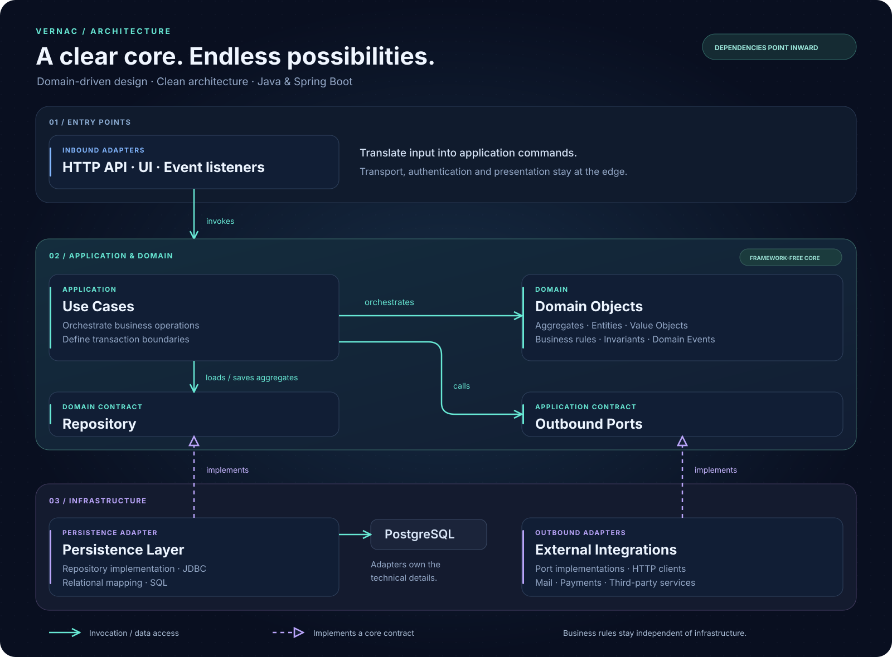
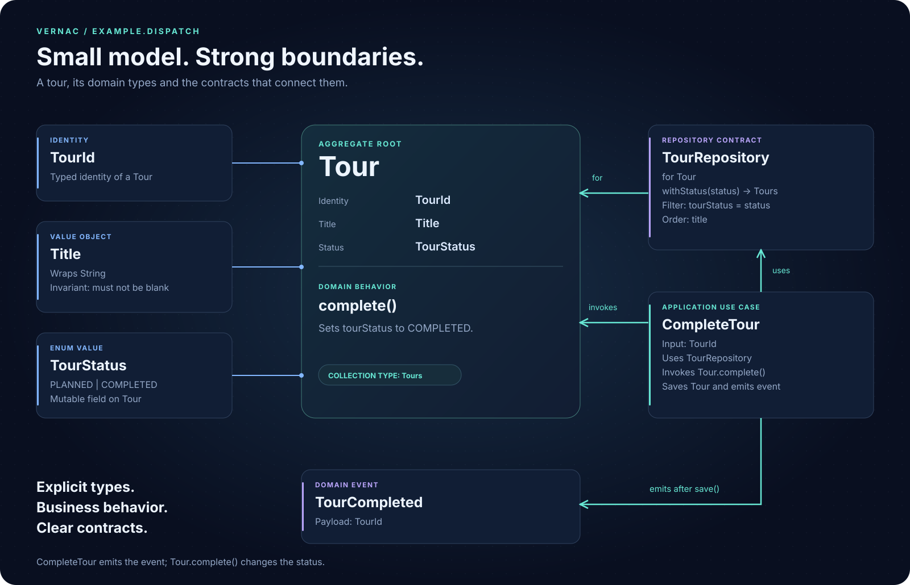
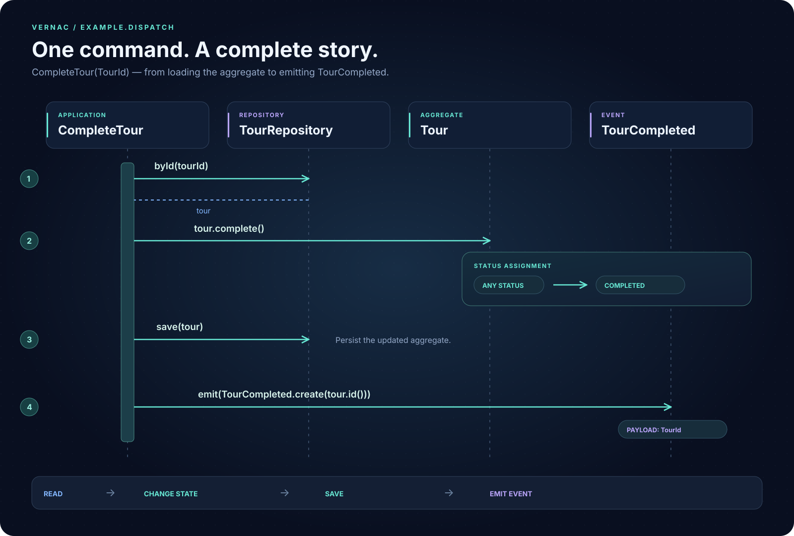

<p></p>

# Architecture, expressed.

**Vernac is a Domain‑Driven Architecture Language.  
It turns your domain model into a working Java application.**

Modern systems grow fast — and architecture often decays just as fast.  
Domain logic spreads across layers, persistence leaks into business code, REST DTOs
creep into aggregates, and events become an afterthought.

Vernac prevents this by making architecture explicit.

It describes IDs, values, aggregates, behavior, usecases, events, ports, adapters,
repositories, persistence and integration in one language — then generates clean Java
and Spring infrastructure without hidden framework magic.

---

## Why Vernac?

- Architecture stays consistent as your system grows
- Domain rules remain visible and enforceable
- Usecases are transactional and explicit
- Persistence is predictable and reviewable
- Events are durable and coordinated
- Integration is typed and controlled
- Java implementations remain ordinary and testable

Vernac is designed for long‑lived systems where correctness, clarity and maintainability matter.

---

## The architecture at a glance

<p>

</p>

**Domain → Usecases → Repositories → Persistence**  
**Usecases → Ports → Adapters**  
**Usecases / Adapters → Events**

One language connects all of them.

---

## A complete operation, expressed

A domain model like this one  can be expressed in Vernac like
this:

```vernac
namespace example.dispatch;

id TourId;
value Title(String) validates {
    require(!self.string().isBlank(), "Title must not be blank");
};
value TourStatus = PLANNED | COMPLETED;
event TourCompleted(TourId);

aggregate Tour[TourId](Title, mut TourStatus) behavior {
    modify void complete() {
        self.tourStatus(TourStatus.COMPLETED);
    }
} list Tours;

repository TourRepository for Tour {
    find Tours withStatus(TourStatus status)
        where tourStatus = :status order by title;
}

usecase CompleteTour(TourId) uses TourRepository tourRepository behavior {
    execute {
        var tour = self.tourRepository().byId(tourId);
        tour.complete();
        self.tourRepository().save(tour);
        self.emit(TourCompleted.create(tour.id()));
    }
}
```

Follow `CompleteTour`: load a complete aggregate, invoke domain behavior, save under
optimistic locking, and publish a fact inside the usecase transaction. A listener
chooses synchronous participation or durable deferred handling.



---

## Designed for AI‑assisted development

Vernac’s language reference is deterministic and self‑contained.  
It avoids hidden defaults, ambiguous semantics and framework‑specific magic.

See the **AI‑specific language reference**:  
[ai-language-reference.md](ai-language-reference.md)

---

## Choose your next step

| Your goal                                                | Start here                           |
|----------------------------------------------------------|--------------------------------------|
| Get a model compiling in minutes                         | [Your first model](tutorials/your-first-domain-model.md) |
| Use the editor and project wizard                        | [IntelliJ setup](tutorials/intellij-plugin.md)         |
| See persistence, events and external calls work together | [Database walkthrough](tutorials/database-persistence.md)    |
| Find exact syntax                                        | [Language reference](language-reference.md)                |
| Understand guarantees and limits                         | [Specification](specification/index.md)               |
| Solve a common problem                                   | [FAQ](faq/index.md)                         |

---

## Version and prerequisites

These pages describe the **Vernac 0.4.0-SNAPSHOT development language and API**.
The next development checkout uses **0.4.0-SNAPSHOT**; published consumers use
matching **0.3.0** artifacts and its earlier single-collection contract.
Use JDK 25 to build the repository; generated applications target Java 21.  
Persistence examples use PostgreSQL 17.

The tutorials start without a database and gradually add architecture.  
The example guide contains build commands and separates database‑free tests from PostgreSQL checks.

Vernac is under active development. Migration review, external‑call idempotency and
business invariants remain application responsibilities.

---

## Explore a complete application

**Vernac Dispatch** puts the delivery story on screen.  
Balance tour capacity, release a plan and follow a durable event through a simulated
carrier outage and retry.

Generated HTTP endpoints and handwritten Java adapters connect the browser to
Vernac usecases. Business decisions stay in the domain.

[Run the Dispatch showcase](tutorials/dispatch.md).

---

[GitHub](https://github.com/DannyReinhold/vernac) ·  
[Contributing](development/index.md) ·  
[Apache License 2.0](https://www.apache.org/licenses/LICENSE-2.0) ·  
[Impressum](impressum.md) ·  
[Privacy](privacy.md)
