# Betrieb und Wiederherstellung

[Anwendungsfälle](index.md) · [Kundenabläufe](kundenablaeufe.md) ·
[Entwicklerentscheidungen](entscheidungen.md)

## Zahlungsausgänge und Wiederherstellung



| Zustand / Beleg | Erlaubte nächste Aktion | Was verhindert wird |
| --- | --- | --- |
| Auftrag noch sicher nicht finanziell gestartet | Zulässiges Schließen des unbezahlten Auftrags | Ein unnötiger Ersatzauftrag parallel zum bestehenden Auftrag |
| Provider bestätigt fehlgeschlagen, abgebrochen oder abgelaufen | Vorgesehenen, begrenzten Wiederholungsweg am vorhandenen Auftrag nutzen | Falsches Weiterverwenden eines bereits bezahlten Versuchs |
| Provider meldet ausstehend | Vorhandene Ressource später erneut authentifiziert lesen | Behauptete Aktivierung durch Browser-Rückkehr |
| Antwort auf finanziellen Aufruf verloren | Ergebnis unbekannt halten; dieselbe Operation innerhalb ihrer sicheren Grenzen prüfen | Freigeben von Budget oder neuer Auftrag nur wegen Timeout |
| Ressource vorhanden, Rückmeldung verspätet | Registrierte Zuordnung und Provider-Fakten vergleichen; idempotent anwenden | Zuordnung über vom Aufrufer behauptete Konto-/Tenant-ID |
| Vollständige Abrechnungsperiode verpasst | Prüffall bearbeiten und Kundenlage klären | Automatisches nachträgliches Abbuchen verpasster Perioden |
| Provider-Fakten widersprüchlich oder Ressource fremd | Nicht zuordnen; Betreiberprüfung | Ersetzen einer bekannten Bindung durch eine fremde Ressource |

Die Kundenoberfläche erlaubt das erneute Ansehen, zulässige Wiederholen und Prüfen
einer bereits vorhandenen Providerreferenz. „Prüfen“ ist ein authentifizierter
Lesevorgang, keine neue Belastung. Höchstzahlen, Wiederanlaufabstände und finanzielle
Unsicherheitsgrenzen sind im [Zahlungsvertrag](../contracts/saas-payment-processing.md)
und im Code festgehalten. Nach Ablauf einer sicheren Idempotenzgrenze wird ein
unbekannter finanzieller Ausgang nicht automatisch erneut gesendet.

## Erstattungen durch den Betreiber



Eine Erstattung ist eine ausdrückliche Betreiberaktion, keine Berechtigung eines
Kunden-Owners und keine automatische Folge der Kündigung. Ein Kundenanliegen kann
über den jeweiligen Supportkanal eingehen; eine solche Support-Oberfläche wird
von der Vorlage nicht behauptet.

Vor der Auslösung werden Zahlung, Betrag und stabile Erstattungskennung gewählt.
Der Betrag muss positiv und durch den noch verfügbaren Zahlbetrag gedeckt sein.
Offene und unbekannte Erstattungen halten ihre Reservierung; bereits extern
beobachtete Erstattungen werden ebenfalls berücksichtigt. Wiederholtes Absenden
der gleichen Kennung mit identischen Fakten liefert denselben Vorgang zurück.
Widersprüchliche Wiederverwendung wird abgewiesen.

Nach Bestätigung bleiben bei einer Teil-Erstattung die gekauften Leistungen bestehen.
Bei vollständiger Erstattung wird die Leistungszuordnung widerrufen. Eine dauerhafte
Widerrufsmarkierung verhindert auch eine erst später eintreffende Aktivierung.
Rechnungen erhalten referenzierte Korrekturen; Originaldokumente bleiben unverändert.
Ein fremder oder zusätzlicher Zahlungsversuch darf nicht den gültigen Gewinner
widerrufen.

**Unbekannt bedeutet weiterhin unbekannt.** Reservierungen bleiben bestehen, bis
geeignete Provider-Fakten den Vorgang klären. Eine frei erratene Refund-ID oder
bloße Gleichheit des Betrags beweist nicht die Identität eines Erstattungsvorgangs.
Der Wiederanlauf darf deshalb nicht einfach die Reservierung löschen und eine
neue Erstattungskennung erfinden.

### Mitgelieferter Betreiberzugang

Die unabhängige Vorlage enthält einen ausdrücklich aktivierbaren, zustandslosen
HTTPS-Betreiberzugang. `billing.operator.enabled` ist ohne explizite Konfiguration
aus; der lokale Demonstrationsmodus aktiviert ihn mit einer eigenen zufälligen
Capability. Diese ist von Kundenpasswörtern und der Mailvorschau-Capability getrennt.
Produktiv gehören Betreiberzugang, Netzfreigabe, Geheimnisverwaltung und Wechsel der
Capability in das eigene Betriebskonzept. Ein bloßer Kundenlogin reicht nie aus.

Lokal können berechtigte Betreiber im Anwendungsverzeichnis aufrufen:

```sh
./mvnw exec:java -Dexec.args=status
./mvnw exec:java -Dexec.args="refund ACCOUNT_ID PAYMENT_ORDER_ID 300 STABLE_OPERATION_UUID"
```

`300` bedeutet 300 Cent. Die Vorgangskennung ist für denselben fachlichen
Erstattungsauftrag beizubehalten. Der Helfer erzeugt keine Ersatzkennung bei
unklarer Antwort. Im lokalen Profil ist die Zahlung ausdrücklich simuliert.
Die HTTP-Integration lautet `POST /__operator/refunds` mit einer begrenzten
vierzeiligen Nutzlast (Konto, Auftrag, Vorgangs-UUID, Centbetrag) und separater
Authorization-Capability. Sie ist eine Betreiber-Schnittstelle, keine öffentliche
Kunden-Webseite.

`POST /__operator/billing-status` gibt ausschließlich eine feste Menge von Worker-
Stufen mit lokalen Erfolgs-/Fehleraufrufzählern zurück. Diese Zähler sind kein
persistenter Rückstand und kein Nachweis, dass eine Zahlung oder E-Mail erfolgreich
beim Empfänger ankam. Kunden-, Konto-, Sitzungs-, Token- und Providerpayloads gehören
nicht in die Metriklabels.

## System-E-Mails



| Anlass | Empfänger / Zweck | Dauerhafte Wahrheit |
| --- | --- | --- |
| Registrierung | Verfügungsberechtigten an der Adresse nachweisen | Einmalige Bestätigung, kein automatischer Login |
| Passwort-Recovery | Inhaber kann neue Zugangsdaten setzen | Gültiger Einmalnachweis; alte Sitzungen werden widerrufen |
| Einladung | Vorgesehener Empfänger soll einem Konto beitreten | Empfängerbindung, Ablauf und Widerruf bleiben maßgeblich |
| Rechnung / Korrektur | Berechtigter Kunde soll das bereitstehende Dokument finden | Nummer, Snapshot und Originalbytes bestehen unabhängig vom Mailausgang |

Dauerhafte Versandaufträge werden begrenzt wiederholt. Nach verlorener Antwort kann
eine Nachricht mehrfach ankommen; dadurch entstehen weder eine zweite Rechnung
noch eine zweite Zahlung. „Provider hat angenommen“ wird nicht zu „Mailbox hat
zugestellt“ umgedeutet. Das lokale Fangpostfach ist nur mit eigener Capability
zugänglich und ist keine öffentliche Kundentoken-Liste.

## Konto und Identität schließen



Kontoschließung ist eine weiche fachliche Zustandsänderung, kein Löschen aller Daten.
Sie verlangt aktuelle Owner-Berechtigung und wird gemeinsam mit neuen
Finanzvorgängen koordiniert:

1. Offene oder ungeklärte Zahlungs- und Erstattungsvorgänge verhindern die Schließung.
2. Eine aktive kostenpflichtige nächste Verlängerung muss zuerst gekündigt werden.
3. Ein noch wirksamer bezahlter Zeitraum bleibt bestehen. Der Kunde wartet bis zum
   Ende oder der Betreiber bearbeitet einen ausdrücklichen Erstattungsfall.
4. Ist keine solche Verpflichtung mehr offen, kann das Konto geschlossen werden.
   Neue Belastungen prüfen den aktiven Kontozustand innerhalb ihres Writers.
5. Produktzugriff endet. Ausgestellte Originale und Korrekturen bleiben erhalten.
   Ein weiterhin aktiver Benutzer mit gültiger zurückbehaltener Owner-Mitgliedschaft
   darf seine Rechnungen über deren bestehende Links abrufen.

Identität deaktivieren/schließen ist davon getrennt: Die Identität darf kein aktives
Konto ohne weiteren aktiven Owner zurücklassen. Eigentum muss gegebenenfalls vorher
übertragen werden. Eine geschlossene Identität kann sich nicht mehr anmelden;
Rechnungsaufbewahrung und gesetzliche Lösch-/Auskunftspflichten werden dadurch nicht
pauschal als erledigt erklärt. Das konkrete Aufbewahrungs- und Bereitstellungskonzept
verantwortet der Betreiber.

## Neustart und Wiederanlauf



Die Beispielanwendung verarbeitet pro Tick begrenzte Schritte für Verlängerung,
Zahlung, Erstattung, Rechnungssynchronisation, Rendering und Mail. Scheitert eine
Stufe, laufen die anderen weiter. Eine fehlende Rechnungsadresse eines Kontos soll
nicht dauerhaft alle späteren Kunden oder bereits bereitstehende Nachrichten
blockieren. Die begrenzte Rechnungssuche läuft in wiederkehrenden Durchgängen;
fehlgeschlagene Quellen werden später erneut besucht.

| Erhalten / prüfen | Warum es gebraucht wird | Verhalten nach Neustart |
| --- | --- | --- |
| Datenbank inklusive Migrationshistorien | Konten, Abos, Reservierungen, Aufträge und Providerzuordnungen | Dieselben Vorgänge und historischen Fakten weiterverwenden |
| Verschlüsselungsschlüssel und Kennungen | Geschützte bestehende Identity-/Mailaufträge lesen | Keine neuen Schlüssel als stiller Ersatz für verlorene alte verwenden |
| Providerprofil und Umgebung | Bedeutung historischer Ressourcen | Profil nicht unter gleichem Namen auf einen anderen Anbieter umhängen |
| Rechnungssnapshots und Dokumentbytes | Unveränderliche Ausgaben, Nummern und Korrekturbezug | Vorhandene Bytes bleiben identisch; fehlendes Rendering nutzt dieselben Fakten |
| Getrennte Migration-/Runtime-Zugänge | Eigentum an Schema und eingeschränkte Geschäftsoperationen | Migrationen vor Runtime prüfen; keine Superuser-Runtime als Reparaturabkürzung |
| Lokale Geheimnisse und Datenvolume | Wiederholbarer lokaler Demonstrationsbetrieb | Spring Boot/Java verwenden `.local` und das Compose-Volume weiter |

### Betreiberentscheidungen pro Störung

| Störung | Zuerst prüfen | Danach zulässiger Weg |
| --- | --- | --- |
| Zahlung / Erstattung unbekannt | Bestehende Vorgangskennung, registrierte Ressourcen und Providerkonto | Belegte Wahrheit anwenden; Budget bis dahin halten |
| Dokumentrendering fehlgeschlagen | Festgeschriebene Verkäufer-/Käufer-/Steuerdaten und Renderer | Bestehendes Dokument erneut rendern; Nummer nicht wiederverwenden |
| Mail dauerhaft abgelehnt | Absender-/Empfänger-/Providerkonfiguration und sicheren Fehlercode | Zulässigen bestehenden Auftrag erneut bearbeiten lassen |
| Schlüssel oder Datenbank nicht verfügbar | Zugang, Schlüsselversion und Sicherungslage | Dienst sicher wiederherstellen; keine neuen erfolgreichen Zustände erfinden |
| Providerkonfiguration geändert | Profilidentität, Umgebung und historische Bindungen | Bewusst migrieren oder neues Profil anlegen; alte Zuordnung erhalten |
| Workerfortschritt bleibt aus | Prozess, Stufenzähler und sichere dauerhafte Vorgangszustände | Ursache beheben; vorhandene Aufträge fortsetzen |

## Spätere Abnahme durch den Maintainer

Echte Mollie-/Stripe-/Brevo-Tests, umfassende Fehler-/Last-/Upgrade-Abnahme,
installiertes IntelliJ und die endgültige produktive Archivierungs-/Verkäuferprüfung
stehen separat aus. Die dokumentierten Abläufe werden dadurch nicht als bestanden
markiert. [Prüfstand und Freigabe-Gate](../development/release-0.6.0.md)
halten diese Arbeit sichtbar; nur der tatsächlich geprüfte Kandidat darf freigegeben
werden.
