# Entscheidungen und Integration

[Anwendungsfälle](index.md) · [Kundenabläufe](kundenablaeufe.md) · [Betrieb](betrieb.md)

## Vom Projekt zur eigenen SaaS-Anwendung

Die SaaS-Vorlage ist ausdrücklich wählbar. Das Kernprodukt wird weiterhin mit
normalen DDD-Bausteinen modelliert: Werte beschreiben Begriffe, Aggregate schützen
Invarianten, Usecases beschreiben erlaubte Aktionen und Ports trennen externe
Dienste. Das Dokumentprodukt der Vorlage darf durch ein eigenes Produkt ersetzt
werden; generierte Dateien werden dafür nicht von Hand verändert.

Die Anwendung aktiviert die gewünschten SaaS-Module und bindet Provider explizit in
`vernac-application.vapplication`. Identität, Abo und Rechnung sind globale Metadaten;
die Dokumente des Beispielprodukts sind Tenant-Daten. Diese Einordnung steht im
Modell. Datenbankabfragen müssen keine vom Kunden gelieferten Kontofilter nachbauen.

## Entscheidungen des Entwicklers vor der Implementierung

| Entscheidung | Konkrete Frage | Mitgelieferter Ausgangspunkt | Was die Anwendung festhalten muss |
| --- | --- | --- | --- |
| Fachlicher Produktumfang | Was speichert und tut der Kunde? | Dokumente anlegen, lesen, löschen und exportieren | Eigene Begriffe, Aggregate und Usecases |
| Kontomodell | Werden persönliche und gemeinsame Konten benötigt? | Persönliches Konto plus anlegbare Organisationen | Bedeutung und Darstellung von Arbeitsbereichen |
| Produktrechte | Welche Aktionen darf ein Leser, Editor oder weiterer Spezialist ausführen? | Expliziter Rollen-/Berechtigungskatalog | Rollenvergabe und erforderliche Usecase-Rechte |
| Eigentum / Objektregeln | Reicht ein kontoweites Recht oder gibt es zusätzliche fachliche Besitzregeln? | Kontoweite Dokumentrechte; kein behaupteter persönlicher Dokumentbesitz | Explizite Objektregel, falls das Produkt sie braucht |
| Aktionsgrenzen | Welche einzelne Größe ist abrechnungsrelevant? | Zeichenlänge des Dokumenttexts | Tatsächliche fachliche Größe; keine UI-only-Prüfung |
| Kapazität | Welcher aktuelle Bestand begrenzt die Nutzung? | Reale Repository-Anzahl der Dokumente | Was Aktivierung, Löschung oder Archivierung für den Bestand bedeutet |
| Zeitverbrauch | Welche Aktion verbraucht welches Kontingent und in welchem Zeitraum? | Exporte pro UTC-Kalendermonat | Zeitgrenze, Maßeinheit und Zuordnung zur fachlichen Operation |
| Externe Wirkung | Kann eine Wirkung trotz Timeout schon eingetreten sein? | Separate dauerhafte Reservierungs-API | Idempotenz, Unbekannt-Zustand und belegbare Freigabe-/Bestätigungsregeln |
| Tarife | Welche Leistungen und Preise gehören zusammen? | Free und Pro; explizite Angebotsrevisionen | Unverwechselbare Angebotsversionen und unveränderliche bestellte Konditionen |
| Tarifwechsel | Ab wann wirkt ein anderes Angebot? | Explizite nächste Konditionen; bestätigte bezahlte Zeiträume | Kommunikation von Zeitraum, Preis und verbleibenden Leistungen |
| Kundenoberfläche | Welche Bezeichnungen und Abläufe passen zum Produkt? | Wiederverwendbare Abrechnungsseiten und API-Orchestrierung | Fachliche Sprache, passende Hinweise und alternative eigene UI |
| Eigene Queries | Wird eine handgeschriebene Abfrage benötigt? | Generierte JDBC-Erweiterungsfähigkeit mit kanonischem Laden | Root-ID-Auswahl, scoped Counts und kanonische Schreibwege; keine rohen Fremdaggregate zurückgeben |

Ein komplexeres Preismodell, additive Zuteilungen oder individuelle Kulanzregeln
entstehen nicht automatisch durch neue Rollen oder Schlüssel. Sie müssen als
explizite Fachregeln implementiert werden. Die Vorlage behauptet insbesondere
keine automatische anteilige Erstattung oder allgemeine Grace-Period.

## Entscheidungen des Betreibers vor der Inbetriebnahme

| Bereich | Entscheidung / notwendige Angaben | Sichere technische Grenze |
| --- | --- | --- |
| Verkäufer und Rechnungsumfang | Verkäuferidentität, vollständige Kontaktdaten, Steuerkennung, unterstützte Behandlung und Rechnungsserie | Nur tatsächlich unterstützten inländischen EUR-Umfang konfigurieren; keine pauschale rechtliche Freigabe aus einem grünen Renderer ableiten |
| Zahlung | Mollie oder Stripe, Profil, Test-/Produktionsumgebung, Zugangsdaten und geeignete Mandats-/Webhook-Konfiguration | Persistierte Profile nicht unter gleichem Namen einem anderen Anbieter oder einer anderen Umgebung zuweisen |
| Mail | Brevo oder expliziter lokaler Fangprovider, Absender-/Domainkonfiguration, zugelassene Testempfänger | Lokaler Provider ist keine automatische Produktionsausweichlösung |
| URLs und Netz | Öffentliche HTTPS-Origin, Anbieter-Rückkehr und begrenzter Webhook-Eingang, Vertrauensgrenze zum Proxy | Weder Kundenparameter noch ungeprüfte Proxy-Header bestimmen Kontoberechtigung |
| Verschlüsselung | Dauerhafte Schlüssel, Kennungen, Aufbewahrung alter Schlüssel und geplanter Wechsel | Pending-Aufträge müssen mit den für sie benötigten Schlüsseln weiter lesbar bleiben |
| Datenbank | Migrationen, eingeschränkte Runtime-Rolle, Pools und Sicherungen | Runtime besitzt keine Migrationen und umgeht keine Tenant-Isolation |
| Betreiberzugang | Getrennte Identität bzw. separat verwaltete Capability für Betreiberfunktionen | Kunden-Owner ist kein Erstattungsoperator; Endpunkte bleiben ohne explizite Aktivierung deaktiviert |
| Erstattungsentscheidung | Wer darf welchen Fall und Betrag ausdrücklich freigeben? | Jede Auslösung hat stabile Kennung, Deckungsprüfung und gehaltene Reservierung bei unbekanntem Ausgang |
| Archivierung | Aufbewahrung, Sicherung, Wiederherstellung, Berechtigung und Löschkonzept für Originale/Korrekturen | Kontoschließung überschreibt oder löscht keine ausgestellten Rechnungsbytes |
| Betriebsüberwachung | Wer bearbeitet unbekannte Zahlungen, Rendering-Fehler und Mail-Störungen? | Sichere Fehlerkategorien und begrenzte Wiederanläufe; keine Zugangsdaten in Logs |

Diese Angaben sind Betriebsentscheidungen der jeweiligen Anwendung. Für die
Weiterentwicklung der Vorlage sind echte Provider-Zugänge nicht nötig. Ihre spätere
Validierung bleibt ein eigener Testschritt des Maintainers.

## Bewusste Kundenentscheidungen

| Entscheidung | Vor dem Auslösen sichtbar machen | Ergebnis |
| --- | --- | --- |
| Konto wählen | In welchem persönlichen oder gemeinsamen Arbeitsbereich handelt der Benutzer? | Aktuelle Mitgliedschaft bestimmt den Produktkontext |
| Einladung senden | Welche Person erhält welche Produktrollen? | Empfängergebundene Einladung, kein frei übertragbares allgemeines Zugriffsrecht |
| Kostenpflichtig bestellen | Angebot, Preis, Leistungszeitraum und Rechnungsdaten | Registrierter Zahlungsauftrag; noch keine unbestätigten Leistungen |
| Nächsten Tarif wählen | Gewählte nächste Konditionen und Wirksamkeitsgrenze | Bestehende zugesagte Fakten bleiben erhalten |
| Kündigen | Ende der Verlängerung und verbleibendes Leistungsfenster | Keine automatische Erstattung |
| Konto schließen | Offene Finanzvorgänge und noch wirksame bezahlte Leistungen | Erst nach erfüllten Voraussetzungen geschlossen; Dokumente bleiben erhalten |
| Identität beenden | Verantwortung für weitere aktive Konten und Verlust künftiger Anmeldung | Letzten aktiven Owner zuerst ersetzen oder Konten ordentlich schließen |

## Technische Integrationspunkte

| Baustein | Verantwortung | Stelle in der Vorlage |
| --- | --- | --- |
| `IdentityAccounts` | Aktuelle Mitgliedschaft, Owner-Regeln, Konten und zurückbehaltenes Rechnungseigentum | `IdentitySetup` |
| `SubscriptionLedger` / `PlanCatalog` | Festgehaltene Angebotsrevisionen, Zeiträume und Leistungen | `BillingSetup` |
| `PaymentLifecyclePolicy` | Benutzergerichtete Abo-Änderungen gegen ungeklärte Zahlungsaufträge absichern | Explizit am Subscription-Ledger binden |
| `BillingAccountLifecycle` | Kontoschließung und neue Belastungen mit derselben Datenbank koordinieren | An `IdentityAccounts` und `PaymentFlow` binden |
| `PaymentFlow.RefundAuthority` | Separate Betreiberberechtigung für Erstattung und deren Status | Standardkonstruktor verweigert Erstattungen; explizite Bindung erforderlich |
| `InvoiceLedger` / `InvoiceMail` | Original/Korrektur und unabhängige Benachrichtigung | Zurückbehaltene Owner-Berechtigung für Dokumentzugriff |
| `BillingMaintenance` | Begrenzter Tick für Zahlung, Erstattung, Dokumente und Mail; Fehler einer Stufe verhungern andere nicht | Expliziter Lifecycle-Worker der Anwendung |

Die Closure- und Status-Hooks laufen innerhalb des jeweiligen Writers und prüfen
die gemeinsame DataSource. Sie führen dort weder Netzwerkaufrufe noch verschachtelte
Ledger-Aufrufe aus. Die Reihenfolge der Sperren ist Identity-Konto, Abo und
Zahlungskonto. Das verhindert, dass ein zwischenzeitlich geschlossenes Konto noch eine neue
Belastung aus einem alten Formular erhält.
Eine geschlossene Identität und ein geschlossenes Konto sind unterschiedliche Zustände.

## Vorbereitete, aber noch nicht freigegebene Veröffentlichung

Die technische Arbeit wird mit gezielten Prüfungen abgesichert. Der Maintainer führt
später die echten Provider-Tests, die umfassende Gesamtabnahme und den IDE-Smoke-Test
durch. Ein fehlender Test wird nicht als Erfolg eingetragen. Das Release-Gate bindet
Quellstand, Abhängigkeiten, Originalartefakte und Freigabe; ein grüner Teiltest ersetzt
diese Abnahme nicht. Die aktuelle Liste steht im
[Release-Prüfstand](../development/release-0.6.0.md).
