# SaaS mit Vernac

Diese Übersicht beschreibt die fachlichen Abläufe der optionalen SaaS-Bausteine
für 0.6.0. Sie richtet sich an Entwickler, Betreiber und Personen, die das
Kundenerlebnis beurteilen. Die Diagramme zeigen unterstützte Abläufe und
Fehlerentscheidungen; sie sind kein Nachweis einer abgeschlossenen Gesamtabnahme.
Echte Provider-Tests und umfassende Tests führt der Maintainer später durch.

## Drei Einstiegspunkte

| Perspektive | Leitfrage | Dokument |
| --- | --- | --- |
| Kunde / Kontoinhaber | Wie komme ich in die Anwendung, verwalte Mitglieder, zahle und erhalte meine Rechnungen? | [Kundenabläufe](kundenablaeufe.md) |
| Entwickler / Produktverantwortlicher | Welche fachlichen Regeln muss ich festlegen und was übernimmt Vernac? | [Entscheidungen und Integration](entscheidungen.md) |
| Betreiber / Support | Was tue ich bei Störungen, Erstattungen, Neustarts und Kontoschließungen? | [Betrieb und Wiederherstellung](betrieb.md) |

## Gesamtbild

Ein Benutzer ist eine anmeldbare Identität. Ein Konto ist ein persönlicher oder
organisatorischer Arbeits- und Abrechnungskontext. Eine Mitgliedschaft verbindet
beide. Die technische Tenant-ID wird aus einer frisch geprüften Kontozuordnung
bestimmt; sie wird nicht aus einem Formular oder einem Provider-Callback übernommen.

**Mitgliedschaftsrechte und bezahlte Leistungen sind getrennt.** Ein Pro-Tarif
verleiht einem Leser kein Bearbeitungsrecht. Umgekehrt hebt eine Owner-Rolle keine
Kapazitätsgrenze auf. Betreiber-Erstattungsrechte gehören ebenfalls nicht zu den
Kundenrollen eines Kontos.

## Fachlicher Anwendungsfallkatalog

Die Kennungen sind Orientierungsanker, keine neuen DSL-Schlüsselwörter. Details und
Fehlerzweige stehen in den verlinkten Ablaufkapiteln.

| ID | Anwendungsfall | Wer handelt? | Voraussetzung / fachliches Ergebnis | Ablauf |
| --- | --- | --- | --- | --- |
| S01 | Registrieren und E-Mail bestätigen | Interessent | Neutrale Anforderung; gültiger Einmal-Link richtet Identität und persönliches Konto ein; kein automatischer Login | [Identität](kundenablaeufe.md#registrieren-und-anmelden) |
| S02 | Anmelden / abmelden | Benutzer | Geprüfte Zugangsdaten; geschützte, widerrufbare Sitzung bzw. beendete Sitzung | [Identität](kundenablaeufe.md#registrieren-und-anmelden) |
| S03 | Passwort wiederherstellen / ändern | Benutzer | Gültige Wiederherstellung oder aktuelles Passwort; alte Sitzungen verlieren ihre Gültigkeit | [Passwort](kundenablaeufe.md#passwort-und-sitzungen) |
| S04 | Konto wählen / Organisation anlegen | Mitglied | Aktuelle Mitgliedschaft; separater Arbeitskontext; Free-Bereitstellung beim ersten expliziten Einstieg | [Konten](kundenablaeufe.md#konten-mitglieder-und-eigentum) |
| S05 | Mitglied einladen / Einladung annehmen | Owner, Empfänger | Rollen werden explizit gewählt; Empfängerbindung, Ablauf, Widerruf und einmalige Annahme | [Einladung](kundenablaeufe.md#konten-mitglieder-und-eigentum) |
| S06 | Rollen ändern / Mitglied entfernen | Owner, ggf. austretendes Mitglied | Rechte werden bei späteren Aktionen neu geprüft; letzter aktiver Owner bleibt geschützt | [Mitglieder](kundenablaeufe.md#konten-mitglieder-und-eigentum) |
| S07 | Eigentum übertragen | Bisheriger Owner, vorhandenes Mitglied | Nachfolger übernimmt Owner-Verantwortung; Konto verliert nicht seinen letzten aktiven Owner | [Eigentum](kundenablaeufe.md#konten-mitglieder-und-eigentum) |
| S08 | Fachliche Produktaktion ausführen | Berechtigtes Mitglied | Rechte, aktueller Tenant und erworbene Leistungen müssen gemeinsam passen | [Produktnutzung](kundenablaeufe.md#rechte-kapazitäten-und-kontingente) |
| S09 | Kapazität / Kontingent verbrauchen | Produktanwendung | Reale Bestandszahlen oder zeitlich gebuchter Verbrauch; Parallelität und Rückabwicklung sind definiert | [Limits](kundenablaeufe.md#rechte-kapazitäten-und-kontingente) |
| S10 | Rechnungsadresse pflegen | Konto-Owner | Künftige Rechnungen verwenden neue Daten; ausgestellte Dokumente ändern sich nicht | [Rechnung](kundenablaeufe.md#rechnungen-korrekturen-und-benachrichtigungen) |
| S11 | Bezahlten Tarif bestellen | Konto-Owner | Preis/Leistungszeitraum sind festgehalten; erst bestätigte Provider-Fakten aktivieren Leistungen | [Bestellung](kundenablaeufe.md#bezahlten-tarif-bestellen) |
| S12 | Fehlgeschlagene Zahlung erneut versuchen / Zahlung zuordnen | Owner, bei unklarem Ausgang Betreiber | Keine zweite unkontrollierte Belastung; bekannter Vorgang wird geprüft oder ein zulässiger Versuch angelegt | [Störung](betrieb.md#zahlungsausgänge-und-wiederherstellung) |
| S13 | Abonnement verlängern | Hintergrundverarbeitung | Verifiziertes Mandat, passende Konditionen und fälliger Zeitraum; keine nachträglich erfundenen Belastungen | [Verlängerung](kundenablaeufe.md#tarifwechsel-verlängerung-und-kündigung) |
| S14 | Wechsel vormerken / kündigen / fortsetzen | Konto-Owner | Explizite Wirksamkeit am Zeitraumwechsel; Kündigung ist keine Erstattungsanweisung | [Abo](kundenablaeufe.md#tarifwechsel-verlängerung-und-kündigung) |
| S15 | Teil- / Vollerstattung veranlassen | Betreiber mit separater Berechtigung | Positive, gedeckte und idempotente Erstattung; unklarer Ausgang bleibt reserviert | [Erstattung](betrieb.md#erstattungen-durch-den-betreiber) |
| S16 | Rechnung / Korrektur ausstellen und herunterladen | Hintergrundverarbeitung, berechtigter Owner | Unveränderliche Fakten und Nummer; autorisierter Download von PDF/ZUGFeRD und XML | [Dokumente](kundenablaeufe.md#rechnungen-korrekturen-und-benachrichtigungen) |
| S17 | System-E-Mail versenden / erneut bearbeiten | Hintergrundverarbeitung, autorisierter Wiederanlauf | Dauerhafter Auftrag; Annahme durch den Provider ist kein Zustellnachweis | [E-Mail](betrieb.md#system-e-mails) |
| S18 | Konto schließen | Owner | Keine ungeklärten Finanzvorgänge oder laufende kostenpflichtige Verlängerung; Produktzugriff endet, Rechnungen bleiben erhalten | [Schließung](betrieb.md#konto-und-identität-schließen) |
| S19 | Identität deaktivieren / schließen | Benutzer | Keine verwaiste aktive Owner-Verantwortung; Sitzung wird beendet | [Identität schließen](betrieb.md#konto-und-identität-schließen) |
| S20 | Dienst nach Störung / Neustart wieder aufnehmen | Betreiber, Worker | Persistente Aufträge, Schlüssel und Originaldokumente bleiben erhalten; keine blinde Wiederholung unbekannter Finanzaktionen | [Betrieb](betrieb.md#neustart-und-wiederanlauf) |

## Was der Entwickler tatsächlich bekommt

Die Vorlage `examples/saas-document-workspace` ist eine unabhängige Anwendung mit
normalen Vernac-Aggregaten, Usecases, Ports und generierten Repositories. Sie ist
zugleich die Quelle der ausdrücklich wählbaren **SaaS Application** im IntelliJ-
Wizard. Der Compiler erzeugt die initiale Datenbankhistorie für den gewählten
Namensraum. Die bisherigen Minimal- und Spring-Boot-Projekte bleiben eigene Optionen.

Die Vorlage enthält Konten/Identität, ein Dokumentprodukt, Abrechnung und lokale
Testprovider. Sie ist kein universelles fertiges SaaS-Geschäftsmodell: Preisgestaltung,
Rollen, fachliche Produktregeln, Verkäuferdaten, Betriebszugänge und die
Produktionskonfiguration legt der Anwendungsentwickler bzw. Betreiber fest.

## Technische Vertiefung und Prüfstand

- [Subscription-Vertrag](../contracts/saas-subscriptions.md)
- [Limits und Reservierungen](../contracts/saas-restrictions.md)
- [Zahlungsverarbeitung](../contracts/saas-payment-processing.md)
- [Rechnungsstellung](../contracts/saas-invoicing.md)
- [Beispielanwendung](../../examples/saas-document-workspace/README.md)
- [Release-Abnahme und ausstehende Nachweise](../development/release-0.6.0.md)

Die Diagrammquellen liegen neben den SVG-Dateien als `.mmd`. Die statischen Grafiken
funktionieren auch auf der Dokumentationswebsite ohne JavaScript. GitHub und lokale
Mermaid-Werkzeuge können dieselben Quellen bearbeiten; es gibt keine zweite,
abweichende Ablaufdefinition.
