# Kundenabläufe

[Zur Übersicht und zum Anwendungsfallkatalog](index.md) ·
[Entwicklerentscheidungen](entscheidungen.md) · [Betrieb](betrieb.md)

## Registrieren und anmelden

Die Registrierung antwortet neutral, damit die Oberfläche keine Auskunft darüber
gibt, welche Adressen bereits registriert sind. Ein gültiger, nicht verbrauchter
Bestätigungslink führt durch die Einrichtung. Ein abgelaufener oder widerrufener
Link wird nicht erneut akzeptiert. Die Bestätigung meldet den Benutzer nicht an.
Der Link-Token wird auf den Bestätigungsseiten aus dem URL-Fragment entfernt.

Ein persönliches Konto wird im Identity-Ablauf bereitgestellt. Sein Free-Abo wird
beim ersten expliziten, verifizierten Einstieg bereitgestellt; das bloße Lesen einer
Abrechnungsseite startet kein neues Abo. Ein bereits beendetes Abo wird nicht
still wiedereröffnet. Eine neue Free-Vereinbarung ist eine explizite Kundenaktion.

Login und öffentliche Anfragen unterliegen der dauerhaften gemeinsamen
Anfragebegrenzung. HTTPS, geschützte Cookies und CSRF-Prüfung gehören zur
Browserintegration. „Vorübergehend nicht verfügbar“ bedeutet keine falschen
Zugangsdaten; der Kunde soll später erneut versuchen, statt ein neues Konto zu erraten.

## Passwort und Sitzungen

Die Wiederherstellung verlangt einen gültigen Einmal-Link und ein zulässiges neues
Passwort. Ein normaler Passwortwechsel verlangt das aktuelle Passwort. Beide
widerrufen alte Sitzungen; anschließend ist eine neue Anmeldung erforderlich.
Abmelden beendet die Sitzung. Ein Rollen- oder Mitgliedschaftsentzug braucht keinen
Passwortwechsel: spätere Produktaktionen prüfen den aktuellen Zustand erneut.

## Konten, Mitglieder und Eigentum

Ein Benutzer kann mehreren Konten angehören. Bei der Kontowahl wird die Mitgliedschaft
frisch geprüft und daraus der Produkt-Tenant abgeleitet. Daten, Listen und Zähler
anderer Konten gehören nicht zu diesem Arbeitskontext.

Der Owner wählt bei einer Einladung konkrete Anwendungsrollen. Nur der vorgesehene
Empfänger kann die Einladung gültig und einmalig annehmen. Abgelaufene, widerrufene
oder bereits angenommene Einladungen gewähren keinen erneuten Zugriff.

Die Produktrollen sind vom Owner-Status getrennt. Owner dürfen Kontometadaten und
Mitglieder verwalten; die Anwendung legt die Produktrechte ihrer Rollen fest. Der
letzte aktive Owner kann nicht entfernt oder als Identität deaktiviert werden,
solange ein aktives Konto dadurch ohne verantwortlichen Owner bliebe. Zuerst sind
Eigentum zu übertragen oder das Konto nach den Abrechnungsregeln zu schließen.

## Rechte, Kapazitäten und Kontingente

| Prüfung | Fachliche Frage | Beispiel der Vorlage | Verhalten bei Ablehnung |
| --- | --- | --- | --- |
| Mitgliedschaft / Recht | Darf diese Person diese Aktion hier ausführen? | Leser darf lesen, Editor darf anlegen/exportieren | Fehlendes Recht; ein Tarifwechsel ersetzt es nicht |
| Aktionsgröße | Ist dieser einzelne Vorgang im Tarif enthalten? | Maximale Zeichen pro Dokument | Eingabe verkleinern oder passenden Tarif wählen |
| Kapazität | Passt ein weiterer dauerhaft gespeicherter Bestand? | Höchstzahl gleichzeitig vorhandener Dokumente | Löschen/Bestand reduzieren oder Tarif wechseln |
| Zeitkontingent | Ist noch Verbrauch im aktuellen Zeitraum frei? | Monatliche Exporte in UTC-Kalendermonaten | Auf neuen Zeitraum warten oder Tarif wechseln |

Die Beispielwerte sind Free: 3 Dokumente, 1.000 Zeichen je Aktion und 2 monatliche
Exporte; Pro: 100 Dokumente, 10.000 Zeichen und 100 monatliche Exporte. Sie sind
konfigurierbare Produktentscheidungen, keine festen Regeln der Sprache.

Lokale Fachaktion und lokaler Verbrauch können in einer Datenbanktransaktion
zurückgerollt werden. Ein externer Dienst kann seine Wirkung trotz eines Timeouts
bereits ausgeführt haben. Deshalb bleibt extern reservierter Verbrauch bei einem
unklaren Ausgang gebunden, auch über Neustarts oder einen Zeitraumwechsel hinweg.
Eine Reservierung ist keine automatische Erlaubnis, einen externen Aufruf zu wiederholen.

## Bezahlten Tarif bestellen

Vor der Bestellung werden die vollständigen Rechnungsdaten gespeichert. Die
Anwendung hält Angebot, Revision, Betrag, Konto und Leistungszeitraum am Auftrag
fest. Derselbe abgesendete Bestellvorgang verwendet dieselbe Vorgangskennung; eine
Wiederholung legt keinen weiteren Auftrag an.

Die Rückkehr vom Zahlungsanbieter aktiviert keinen Tarif. Auch ein Callback mit
einer behaupteten Konto- oder Tenant-ID begründet keine Berechtigung. Der Server
prüft den konfigurierten Anbieter und die bereits registrierte Zahlungsressource.
Erst bestätigte Zahlungsfakten werden genau einem Abo-Zeitraum zugeordnet.

Bei „ausstehend“ wartet der Kunde. Ein nachweislich fehlgeschlagener Versuch kann
über den vorgesehenen Wiederholungsweg fortgesetzt werden. Bei unbekanntem Ergebnis
wird der bestehende Vorgang geprüft; der Kunde soll keinen zweiten Auftrag auslösen.
[Die Zustände und Wiederherstellungswege](betrieb.md#zahlungsausgänge-und-wiederherstellung)
sind gesondert beschrieben.

## Tarifwechsel, Verlängerung und Kündigung

| Aktion | Was der Kunde veranlasst | Was nicht daraus folgt |
| --- | --- | --- |
| Bezahltes Angebot bestellen | Registrierter Zahlungsauftrag zu festgehaltenen Konditionen | Sofortige Freigabe vor bestätigter Zahlung |
| Nächsten Tarif vormerken | Konditionen für die nächste zulässige Periode | Rückwirkende Änderung ausgestellter Rechnungen |
| Auf Free wechseln | Expliziter Wechsel am vorgesehenen Zeitraumende | Null-Euro-Zahlung oder unbegrenzter Weiterbetrieb eines Billing-Jobs |
| Verlängerung kündigen | Keine weitere automatische Verlängerung; bezahlte Leistungen gelten bis Periodenende | Automatische oder anteilige Erstattung |
| Kündigung zurücknehmen | Verlängerung eines noch laufenden, zulässigen Abos wieder aktivieren | Wiederöffnung eines beendeten Kontos oder Ignorieren offener Finanzvorgänge |
| Nach Ablauf Free neu beginnen | Neue explizite Vereinbarung | Stilles Zurücksetzen alter Kosten-/Kontingentvorgänge |

Verlängerungen verwenden ein zuvor verifiziertes Mandat. Fällt die Zahlung aus,
gibt es keine erfundene erfolgreiche Verlängerung. Nach Ende eines unbezahlten
Leistungsfensters stehen die bezahlten Leistungen nicht mehr zur Verfügung. Eine
Kulanz-/Grace-Period wird nicht automatisch behauptet; eine abweichende Produktregel
muss ausdrücklich modelliert werden. Vollständig verpasste Perioden werden nicht
nachträglich blind belastet, sondern als Prüffall behandelt.

Offene oder ungeklärte Zahlungsvorgänge sperren kollidierende Abo-Änderungen. Diese
Regel gilt im Backend und nicht nur für sichtbare Schaltflächen.

## Rechnungen, Korrekturen und Benachrichtigungen

Ein Rechnungssnapshot bindet Verkäufer-, Käufer-, Preis-, Steuer-, Leistungszeitraum-
und Zahlungsfakten. Nummern werden dauerhaft und nebenläufigkeitssicher vergeben.
Eine Änderung der Rechnungsadresse wirkt auf spätere Rechnungen, nicht auf bereits
festgeschriebene Dokumente. Die Kundennummer vergibt die Anwendung; der Kunde kann
sie nicht durch eine frei eingegebene Behauptung ersetzen.

Die mitgelieferte Implementierung erzeugt PDF/A-3b mit eingebettetem EN16931-XML
(ZUGFeRD/Factur-X) und bietet das XML zusätzlich separat an. Der unterstützte
technische Umfang ist inländisches EUR mit der ausdrücklich konfigurierten Behandlung
`STANDARD_19` oder `SMALL_BUSINESS_EXEMPT`. Das ist keine Freigabe beliebiger
Verkäufer-, Steuer- oder Archivierungssituationen. Diese prüft der Betreiber vor
Produktiveinsatz.

Test- und Echtvorgänge werden getrennt gekennzeichnet und nummeriert. Eine
Erstattung erzeugt eine referenzierte Korrektur auf Basis bestätigter Erstattungsfakten;
das Original bleibt unverändert. Der Download prüft aktuelle, zurückbehaltene
Owner-Berechtigung – auch nach einer zulässigen Kontoschließung, solange die
Identität und Owner-Mitgliedschaft gültig bleiben.

Die E-Mail ist ein Hinweis auf das Dokument. Bei fehlgeschlagener Zustellung bleibt
die Rechnung abrufbar; erneutes Versenden erzeugt keine zweite Rechnung.

## Orientierung bei Ablehnungen

| Sichtbare Situation | Nächster sinnvoller Schritt |
| --- | --- |
| Keine Berechtigung | Konto und Mitgliedschaft prüfen; Owner um die passende Produktrolle bitten |
| Tarif-/Kontingentgrenze | Bestand/Eingabe anpassen, Zeitraum abwarten oder passenden Tarif bestellen |
| Zahlung ausstehend | Vorhandenen Auftrag erneut ansehen; keine zweite Bestellung starten |
| Zahlungsergebnis unbekannt | Bestehende Referenz prüfen lassen; keinen blinden Zahlungsretry auslösen |
| Konto kann nicht geschlossen werden | Verlängerung kündigen, bezahlten Zeitraum abwarten oder Betreiberfall klären; offene Zahlungen/Erstattungen auflösen |
| Rechnung wird vorbereitet | Bestehendes Dokument erneut bearbeiten lassen; Originalnummer und Zahlungswahrheit bleiben erhalten |
| Dienst vorübergehend nicht verfügbar | Später denselben Vorgang fortsetzen; keine neuen Identitäten oder Ersatzaufträge erfinden |
