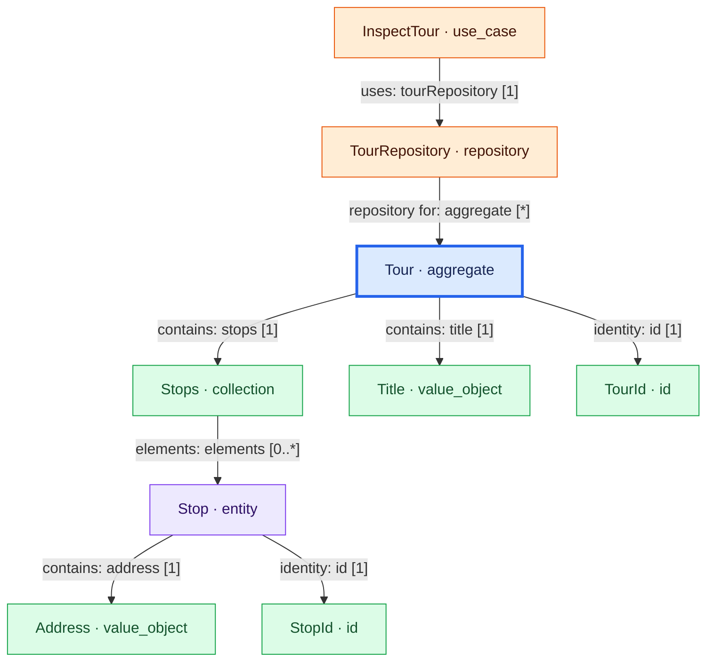

# See the architecture you are modeling

A source file explains individual definitions. A diagram makes their relationships
visible: which objects belong to a Tour, which repository provides access to it, and
which usecase depends on that repository.

```vernac
namespace example.diagrams;

term Tour {
    description "A planned delivery route with an ordered sequence of stops.";
}
id TourId;
id StopId;
value Title(String);
value Address(String);
entity Stop[StopId](Address) list Stops;
aggregate Tour[TourId](Title, Stops);
repository TourRepository for Tour {}
usecase InspectTour(TourId) returns Title uses TourRepository behavior {
    execute {return self.tourRepository().byId(tourId).title();}
}
```

Place this complete model under `src/main/vernac/example/diagrams`. Build after adding
or changing Maven module dependencies so the editor sees the resolved module index.

The generated view for this model:



## From IntelliJ

Open a Vernac source file, then select **Tools → Vernac → Show Domain Diagram**.
The same action is available in the source editor and on a namespace directory in the
Project view. It exports that namespace and opens its generated Markdown page.

Choose the Markdown preview or split editor/preview view. Enable the Mermaid extension
in IntelliJ's Markdown settings if diagrams are not yet rendered. The action does not
install another plugin, bundle a renderer or send the model to a remote server.

Unsaved Vernac documents belonging to this Maven source root are included without
saving your files. Generation runs in a background task. This initial action is a
snapshot: run it again after editing; it is not an automatically refreshed model explorer.

## From Maven

Export every local namespace:

```text
mvn vernac:diagram
```

Or select one namespace in IntelliJ's Maven command window:

```text
mvn vernac:diagram -Dvernac.diagramNamespace=example.diagrams
```

In PowerShell, quote the entire property argument:

```powershell
mvn vernac:diagram '-Dvernac.diagramNamespace=example.diagrams'
```

The output is `target/vernac-diagrams` by default. `vernac.diagramOutput` overrides it.
The all-namespace goal writes an `index.md`; a single-namespace export updates only its
own files. Each namespace produces:

| File | Use |
| --- | --- |
| `.md` | Mermaid preview plus a catalog of declared members and vocabulary |
| `.mmd` | Standalone Mermaid source for documentation and other renderers |
| `.puml` | PlantUML source using its Smetana layout option |
| `.json` | Versioned, deterministic graph data for later tooling |

The exporter does not generate SVG/PNG, install Graphviz/Node or start a rendering server.
Use an existing Mermaid/PlantUML renderer for image export. Diagram output can be produced
without generating Java, running the application or connecting to its database.

## Read the graph

Aggregates are blue, entities purple, values/IDs/collections green and application or
integration operations orange. Definitions from other namespaces have a dashed outline
and qualified names. Actual Maven dependency types are additionally marked as modules.

An aggregate field points to its declared type. A collection points to its element type;
`0..*` belongs to that element relationship, while a required collection field itself
contains one collection value. Optional fields have `0..1`. Shared entities are not drawn
with UML composition diamonds: a field does not prove exclusive parent ownership.

`uses`, repository targets, adapter implementation and listener subscriptions are explicit
relationships. An ID's name does not imply a foreign aggregate or database foreign key.
Java bodies are not analyzed: the graph does not infer calls, emit order, branching or
runtime behavior. Referenced boundary nodes are not expanded recursively. Technical
Read/Write/Access, behavior and JDBC implementation classes are intentionally absent.

The catalog contains domain members and associated term descriptions. It describes the
public model shape, not every generated getter/factory or private implementation detail.
Generated files are disposable and are overwritten on export. Older namespace files can
remain until `mvn clean`; the latest all-namespace index lists the current namespaces.

For an existing application, try the delivery example's namespace:

```text
mvn -f examples/persistence-demo/pom.xml vernac:diagram -Dvernac.diagramNamespace=org.example.delivery
```

Choose a compact namespace for screenshots and videos. Show the source beside its preview,
then highlight how the generated graph and vocabulary follow the model. Large-project
filtering, clickable graph navigation and live layout belong to a later model explorer.
