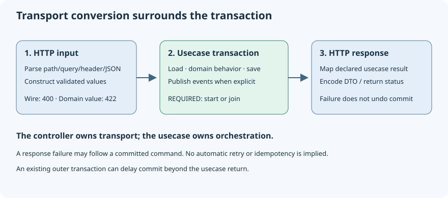

# Put your domain behind an HTTP API

A web request is not a domain object. An inbound adapter makes that boundary visible:
read transport data, construct validated domain values, call a usecase and map its
answer. Vernac generates the Spring MVC plumbing while the application contract stays
in your usecase.

This exercise does not persist tasks. Start with the [basic Maven template](your-first-domain-model.md),
which already configures Vernac generation and the Spring Boot dependency versions.
The usecases still require a transaction manager; below we supply one through
Spring JDBC and a disposable in-memory H2 datasource. No Docker or external database
is needed. Use a separate namespace from any earlier Task exercise. Save this as
`src/main/vernac/example/tasks/api.vernac`:

```vernac
namespace example.tasks;

id TaskId;
value Title(String) validates {
    require(!self.string().isBlank(), "Title must not be blank");
};
usecase CreateTask(Title) returns TaskId behavior {
    execute { return TaskId.create(); }
}
usecase CompleteTask(TaskId) behavior {
    execute { System.out.println("Completed " + taskId.asString()); }
}

adapter TaskApi inbound http uses CreateTask createTask, CompleteTask completeTask {
    base "/api/tasks";
    create {
        POST "/";
        body CreateTaskRequest;
        execute createTask { title <- body.title; }
        respond 201 CreatedTaskResponse using toResponse;
    }
    complete {
        POST "/{taskId}/complete";
        path UUID taskId;
        execute completeTask { taskId <- path.taskId; }
        respond 204;
    }
    schema CreateTaskRequest(String title);
    schema CreatedTaskResponse(UUID taskId);
    mapping toResponse: CreatedTaskResponse <- TaskId { taskId <- source; }
}
```

The tiny usecases demonstrate transport wiring; they do not store a task. Add the
existing aggregate/repository patterns when building a persistent application. The
[Dispatch showcase](https://github.com/DannyReinhold/vernac/tree/main/examples/dispatch)
uses generated create/release endpoints against its actual persistence usecases.

## Wire the application

Add these dependencies to the template's existing `<dependencies>` (its Spring
Boot parent manages all except the Vernac version):

```xml
<dependency>
    <groupId>org.springframework.boot</groupId>
    <artifactId>spring-boot-starter-web</artifactId>
</dependency>
<dependency>
    <groupId>org.springframework.boot</groupId>
    <artifactId>spring-boot-starter-jdbc</artifactId>
</dependency>
<dependency>
    <groupId>com.h2database</groupId>
    <artifactId>h2</artifactId>
    <scope>runtime</scope>
</dependency>
<dependency>
    <groupId>org.vernac</groupId>
    <artifactId>vernac-runtime-http</artifactId>
    <version>${vernac.version}</version>
</dependency>
```

Add `org.springframework.boot:spring-boot-maven-plugin` to `<build><plugins>`.
Create `src/main/java/example/tasks/TaskApplication.java`:

```java
package example.tasks;

import org.springframework.boot.SpringApplication;
import org.springframework.boot.autoconfigure.SpringBootApplication;

@SpringBootApplication
public class TaskApplication {
    public static void main(String[] args) {
        SpringApplication.run(TaskApplication.class, args);
    }
}
```

Its package makes component scanning include the generated controller and usecases.
With H2 and Spring JDBC present, Boot supplies the datasource and transaction manager.
This is transaction infrastructure for the exercise, not a generated Task repository.
For a real persistent application, follow the [PostgreSQL tutorial](database-persistence.md).

## Call the generated endpoints

From the application directory, run `mvn clean spring-boot:run`. In another terminal:

```powershell
$created = Invoke-RestMethod -Method Post -Uri 'http://localhost:8080/api/tasks' `
    -ContentType 'application/json' -Body '{"title":"Try the generated API"}'
$created.taskId
Invoke-WebRequest -Method Post -Uri "http://localhost:8080/api/tasks/$($created.taskId)/complete"
```

The first response is 201 with `{"taskId":"..."}`. The completion response is 204
with no body, and the application logs the ID. The title is wrapped through Title.of;
the returned ID is unwrapped into the response UUID field. Neither the controller
nor the mapping starts a transaction: the usecase already owns it.



## Explore failures and results

Try a blank title (422), a malformed UUID (400) and an additional JSON property
(accepted). Missing required JSON fields produce 400. Responses contain a stable
code and safe public message; your internal exception text stays out of the body.

For an operation declared `returns (TaskId, Title)`, map from `CreateTask.Result` and
assign DTO fields from `source.taskId`/`source.title`. This is the usecase's explicit
Result, not another response invented by the adapter. Optional single results require
an explicit absence response such as `on absent respond 404;`.

Read the [HTTP inbound contract](../contracts/inbound-http.md) for wire formats,
query/header declarations, error customization and the deliberately limited scope.
Business orchestration belongs in the usecase; this adapter remains a transport/ACL
boundary. Configure Spring Security normally when exposing a protected application.

## Return independent pages

A GET can return multiple materialized page components together with ordinary values.
Use declared `offset`, `counted offset` or `cursor` usecase results and corresponding
page fields in a named local DTO. The entry mapping keeps metadata intact, and JSON
serialization performs no repository work. The [board tutorial](pagination.md) shows
the complete model, separate query page numbers, cursor continuation and safe
400/INVALID_CURSOR handling.
