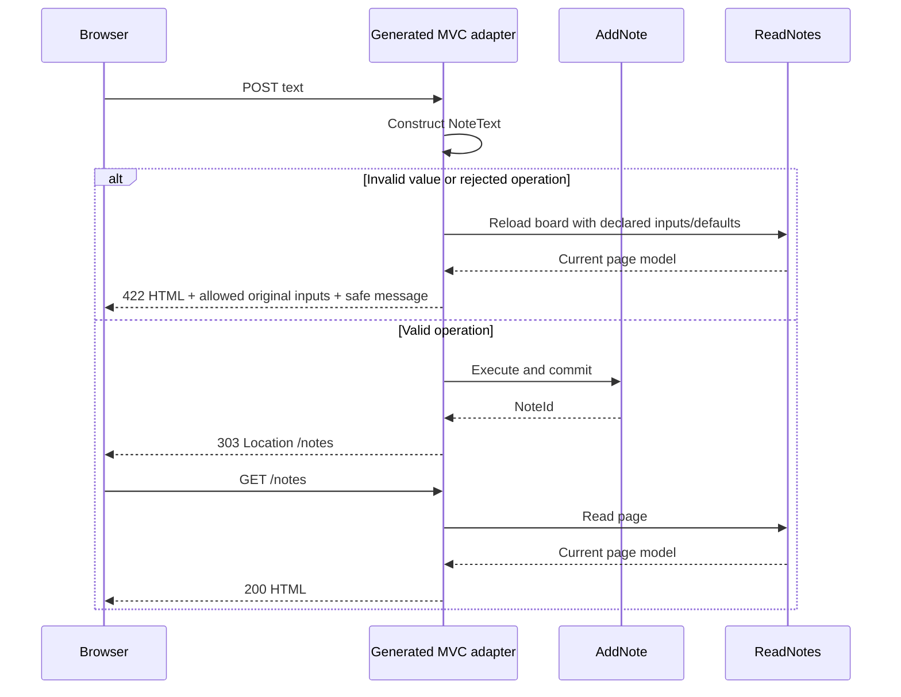

# Serve a real page from your domain model

A JSON endpoint is a useful boundary, but it is not the only way to deliver an
application. For a small product or an internal tool, a server-rendered page can
be a simpler, durable starting point: one application, ordinary HTML forms and no
JavaScript build pipeline.

The **0.5.0 development** MVC adapter connects those pages directly to Vernac
usecases. It generates the Spring controller and its scoped error handling; you
write the templates and the domain decisions. The published 0.4.0 release does not
support this syntax. The [Spring Boot wizard starter](spring-boot-starter.md) is the
ready-to-run version of this approach.

## Model the operation, then the page

This is a complete alternative model. Put it in
`src/main/vernac/example/notes/notes.vernac`; do not mix it into a namespace that
already defines these types.

```vernac
namespace example.notes;

id NoteId;
value NoteText(String) validates {
    require(!self.string().isBlank(), "A note needs meaningful text.");
    require(self.string().length() <= 120, "Keep notes to 120 characters.");
};
value PageNumber(int) validates {
    require(self.intValue() > 0, "Page numbers start at one.");
};
value NoteCard(NoteId, NoteText) list NoteCards;
aggregate Note[NoteId](NoteText) list Notes;

repository NoteRepository for Note {
    find offset Notes latest() order by createdAt desc, id asc counting;
}
usecase ReadNotes(PageNumber) returns counted offset NoteCards uses NoteRepository behavior {
    java imports { org.vernac.runtime.pagination.OffsetRequest; }
    execute {
        return self.noteRepository().latest()
            .page(OffsetRequest.ofPage(pageNumber.intValue(), 12))
            .mapItems(NoteCards::of, note -> NoteCard.of(note.id(), note.noteText()));
    }
}
usecase AddNote(NoteText) returns NoteId uses NoteRepository behavior {
    execute {
        var note = Note.create(noteText);
        self.noteRepository().save(note);
        return note.id();
    }
}

adapter NoteWeb inbound mvc uses ReadNotes, AddNote {
    base "/notes";
    error view "problem";

    board {
        GET "/";
        query int page default "1";
        execute readNotes { pageNumber <- query.page; }
        render "notes/board" model notes;
    }
    add {
        POST "/";
        form String text;
        execute addNote { noteText <- form.text; }
        redirect "/notes" message "Note added.";
        errors {
            when invalid request then redisplay board status 400
                "INVALID_FORM" "Send one note text and try again.";
            when validation then redisplay board status 422
                "INVALID_NOTE" "Write a meaningful note of up to 120 characters.";
        }
    }
    errors {
        when optimistic conflict then render "problem" status 409
            "NOTE_CHANGED" "Reload the page before trying again.";
    }
}
```

The `uses` clause is identical to that of the JSON adapter. Wire inputs remain
ordinary scalars; `noteText <- form.text` uses the existing exact String-to-value
conversion and calls `NoteText.of(...)`. There is no implicit trimming or
normalization. Every write still passes through the usecase transaction and the
aggregate repository.

## Give the result a home

`render "notes/board" model notes;` names both the logical template and its typed
model attribute. With Spring Boot/Thymeleaf's normal configuration, put this file
at `src/main/resources/templates/notes/board.html`:

```html
<!doctype html>
<html lang="en" xmlns:th="http://www.thymeleaf.org">
<head><meta charset="utf-8"><title>Your notes</title></head>
<body>
<h1>Your notes</h1>
<p role="status" th:if="${notice}" th:text="${notice}"></p>
<p role="alert" th:if="${error}" th:text="${error.message()}"></p>
<form th:action="@{/notes}" method="post">
    <label for="text">One small thing worth remembering</label>
    <input id="text" name="text" required maxlength="120"
           th:value="${inputs['form.text'] ?: ''}">
    <button type="submit">Add note</button>
</form>
<ul>
    <li th:each="note : ${notes.items()}" th:text="${note.noteText().string()}"></li>
</ul>
<a th:if="${notes.hasNext()}"
   th:href="@{/notes(page=${notes.pageNumber().orElseThrow() + 1})}">Next page</a>
</body>
</html>
```

The usecase returns a completed page of values, not a live database cursor. A
usecase with several Result fields can return the whole Result under one model
name; templates then access its components. There is no automatic field flattening.

`inputs` contains only declared, permitted raw path/query/form values, keyed by
binding group and local name. It never contains the entire request. Headers and
bindings marked sensitive are excluded. For example:

```vernac
sensitive form String? password;
```

That is a binding fragment for an endpoint that actually needs a password. It does
not add authentication to this notes application. Its value can reach the declared
usecase input but cannot appear in the generated public input model. Do not place
passwords in template values or exception messages yourself.

Defaults also work for non-optional form scalars. A checkbox can send `value="true"`
and declare `form boolean subscribed default "false";`. An absent checkbox then
means false. Empty supplied values are parsed as supplied, not replaced with the
default. Repeated scalar values are rejected rather than silently choosing one.

## Follow a failed submission



A conversion failure may occur before the write usecase is invoked at all. A
usecase rejection ends its transaction before the page is loaded again. In either
case `redisplay board` calls the named GET page loader, **not** the failed POST.
The original permitted form values replace the loader's public `inputs` map.

If the loader needs a required path/query/header value, declare it on the POST too,
or provide an appropriate query default. The compiler rejects a loader it cannot
supply. A loader failure ends on the safe fallback error view with status 500;
there is no recursion or automatic retry. GET loaders must be designed for reading:
the compiler cannot prove arbitrary Java bodies free of side effects.

A committed write is not undone if later redirect/view processing fails. The MVC
adapter does not invent distributed rollback or idempotency behavior.

## Separate the failure from its public explanation

Error selectors are shared with the [JSON HTTP error contract](../contracts/inbound-http.md).
Endpoint rules precede adapter rules, then safe defaults: transport errors 400,
domain validation/rejection 422, not found 404, optimistic conflict 409 and unknown
technical failure 500. Typed rejection codes retain their enum identity.

A remote technical failure can be made explicit without exposing its internals:

```vernac
when integration remote TIMEOUT then render "problem" status 503
    "DEPENDENCY_UNAVAILABLE" "A required service is temporarily unavailable.";
```

This is an error-rule fragment. Use it inside the endpoint or adapter `errors`
block, not at top level. The selected template receives a safe `error` value with
`code()` and `message()` plus permitted `inputs`. A minimal `problem.html` is:

```html
<!doctype html>
<html lang="en" xmlns:th="http://www.thymeleaf.org">
<head><meta charset="utf-8"><title>Unable to finish</title></head>
<body>
<h1 th:text="${error.code()}"></h1>
<p th:text="${error.message()}"></p>
<a th:href="@{/notes}">Back to notes</a>
</body>
</html>
```

The first version offers form-wide public messages. It does not guess a field name
from an arbitrary domain exception. Use escaped text/values; `th:utext` would bypass
escaping. Technical failures are logged, and underlying exceptions are not rendered
implicitly. A Java error handler can still supply the existing HTTP `Reply` contract
through `errors implemented by ...`; MVC renders it using the fallback error view.

Optional usecase results require an explicit absent template with status 404 or 410.
Redirects are static application-local targets; they never automatically append
model values. Template names are logical names, not redirect/forward expressions.

## Infrastructure stays explicit

Add `spring-boot-starter-web`, `spring-boot-starter-thymeleaf` and matching
`vernac-runtime-http` artifacts, plus the JDBC starter for this persistent example.
Configure authentication/CSRF in Spring Security; Vernac does not disable those
filters. Thymeleaf `th:action` integrates with Spring's form handling. The wizard
starter includes the tested security configuration and uses no JavaScript framework.

Prepare/review the initial migration and history before starting against PostgreSQL;
see [schema tooling](postgresql-migrations.md). MVC adapters can also be internal
entrypoints of explicitly activated modules. The host application supplies the view
engine and resources; use template prefixes such as `billing/invoices` to keep
module resources distinct.

LSP completion/navigation covers dependencies, form paths and `redisplay` loaders;
loader hover explains the retry boundary. Type/Java mapping navigation uses the
existing plugin integration. Inline mapping assignments retain Vernac debugger
locations. Editing and debugging Thymeleaf expressions remains framework tooling.

The first version supports GET/POST and URL-encoded scalar forms. Multipart uploads,
repeated collection fields, dynamic redirects, template fragments and automatic
field-level validation metadata remain explicit future work.

[All tutorials](index.md) · [Formal MVC contract](../contracts/inbound-mvc.md)
