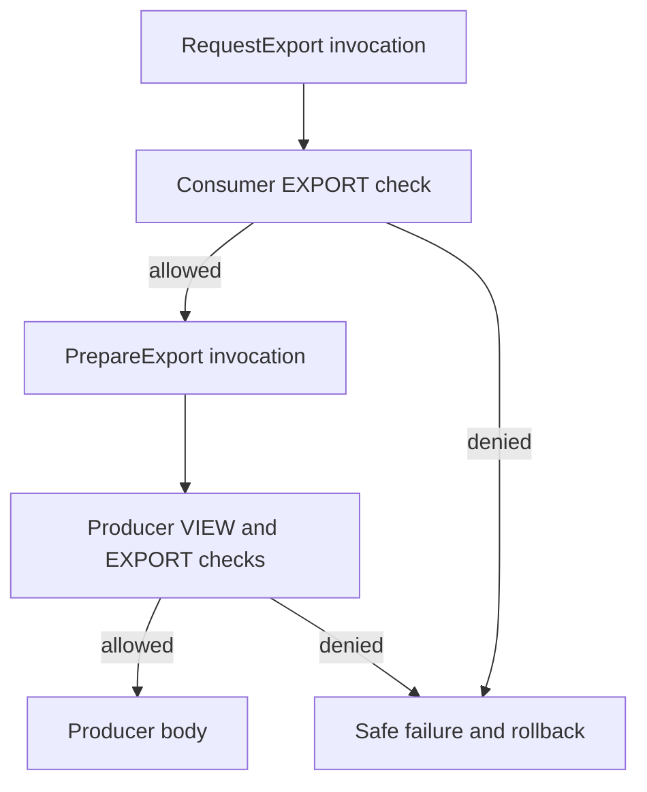

# Carry access requirements across module boundaries

A reusable library should carry its access contract with it. Calling an invoice
operation through another application must not erase the checks written by its author.
This walkthrough builds on [local usecase authorization](usecase-authorization.md) and
[type modules](type-modules.md). It requires matching **0.6.0-SNAPSHOT** artifacts using
module-contracts-11; it is not available in the published 0.5.x release.

## Put the requirement in the producer

Save this complete model in the producer's `src/main/vernac/example/invoices/model.vernac`:

```vernac
namespace example.invoices;

id InvoiceId;
term InvoicePermissions {
    description "Capabilities for working with invoices in the selected tenant.";
}
permission InvoicePermissions {
    VIEW;
    EXPORT;
}

usecase PrepareExport(InvoiceId) returns InvoiceId
    requires all {
        permission InvoicePermissions.VIEW on invoiceId;
        permission InvoicePermissions.EXPORT on invoiceId;
    }
behavior {
    execute { return invoiceId; }
}
```

The identity-returning body keeps the example focused: it does not generate a real
invoice export. In a real module, the body would call repositories or a domain service.
The `on invoiceId` binding tells the policy which nominal resource to evaluate. The
policy decides how to read tenant-scoped facts; no ownership grant is inferred from a UUID.

Place this manifest beside the producer POM as `vernac-module.vmodule`:

```vernac-module
module example.invoice.library {
    export example.invoices.InvoiceId;
    export example.invoices.InvoicePermissions;
    export example.invoices.PrepareExport;
}
```

All three exports are intentional. The usecase exposes an ID and permission contract,
so they must be public too. Omitting the permission export produces a compilation
error rather than a hidden export or a stripped requirement. Install the module with
`mvn clean install`, using the normal module POM described in the type-module tutorial.
The JAR contains Java implementations and data-only Vernac contracts.

## Consume it without copying its model

Add the producer's ordinary Maven dependency. Then save this complete consumer model
in `src/main/vernac/example/shop/model.vernac`:

```vernac
namespace example.shop;

import example.invoices.InvoiceId;
import example.invoices.InvoicePermissions;
import example.invoices.PrepareExport;

usecase RequestExport(InvoiceId) returns InvoiceId
    requires permission InvoicePermissions.EXPORT on invoiceId
    uses PrepareExport prepareExport
behavior {
    execute { return self.prepareExport().execute(invoiceId); }
}
```

Import names remain Vernac identities. You do not write the generated `.authorization`
Java package in a Vernac import. In injected Java, the compiler supplies the normal
Java type context. Imported permission vocabulary is available on hover even without
a producer source attachment.

Activate the functional module in the application's `vernac-application.vapplication`:

```vernac-application
application example.shop {
    activate example.invoice.library;
}
```

The consumer wrapper has its own requirement; the producer retains its original two.
Calling RequestExport checks EXPORT first, then the reached PrepareExport checks VIEW
and EXPORT. The actor, tenant and REQUIRED transaction remain the same. A denied inner
call prevents its body and normally rolls back the usecase transaction. Activation
itself asks no user for rights and makes no policy decision.



Explicitly bind the Spring actor resolver, permission evaluator and configuration as
shown in the local authorization tutorial. The publisher does not ship a blanket grant
and the compiler does not invent a policy. Protected activated beans fail startup when
the guard is missing. Spring Security still protects login, transport entry and CSRF.

If the application imports only InvoiceId or InvoicePermissions, omit activation.
No producer operation is registered merely because you reuse its vocabulary or keys.
If another dependency exports an operation that refers to these keys, ordinary Maven
transitive resolution supplies this library; that dependency must not reexport its types.

## Upgrade the library deliberately

Adding a new permission key is structurally compatible. It does not give that key to
existing users. Changing PrepareExport's requirement is different: a dependent built
against the old functional contract must be reviewed and rebuilt. The diagnostic names
the operation, dependent module and built/resolved provider versions. Internal usecase
headers are also retained, so a new private security boundary cannot disappear merely
because a public facade kept its Java signature.

Comments, formatting, resolved import aliases and private Java helper changes do not
cause this review. Existing requirement modes, group order and `on` bindings do.
The checker intentionally does not guess whether an arbitrary security change is safe.
After reviewing, rebuild and test the dependents against the new provider. Do not edit
metadata hashes or frozen migrations. This metadata upgrade alone needs no SQL migration;
changed persisted values still follow the normal [migration workflow](postgresql-migrations.md).

## Run the executable integration proof

The repository's ModuleAuthorizationPostgresTest creates a producer JAR, reads its
metadata, compiles a consumer, generates explicit activation and loads the actual JAR.
It checks denials, public/authenticated behavior, missing-guard startup, cross-tenant
reads, nested checks and rollback. Follow the disposable PostgreSQL
[experiment setup](https://github.com/DannyReinhold/vernac/blob/feature/0.6.0/experiments/tenant-isolation-spike/README.md), then run:

```shell
mvn -B -ntp -f experiments/tenant-isolation-spike/pom.xml -Dtest=ModuleAuthorizationPostgresTest test
```

Expect seven tests and zero skips. The full experiment currently executes 43 tests.
This verifies the module boundary, not a finished SaaS identity system. Roles, membership,
subscription entitlements, quotas and the final exposure audit remain separate work.
For exact compatibility rules, read the [module authorization contract](../contracts/module-authorization.md).
