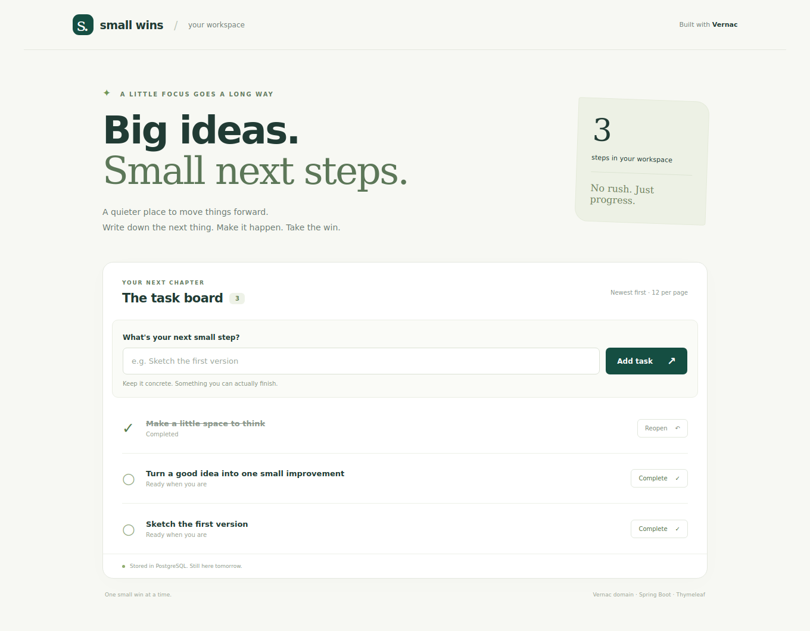
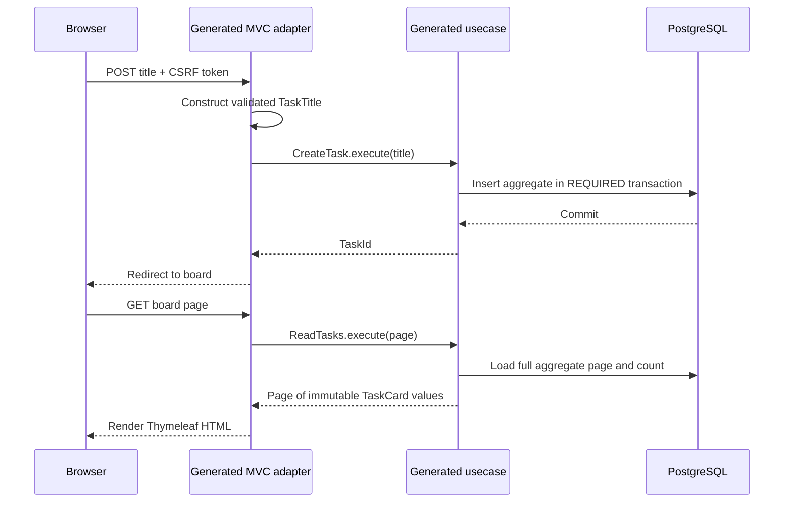

# From New Project to a working application

An empty project leaves a surprisingly large question unanswered: how does a domain
model become something a person can actually use? The **0.5.0 development wizard**
can now answer that with a small, complete application.

Choose **Spring Boot Web Application** under **New Project → Vernac**. The generated
*Small wins* workspace has a responsive Thymeleaf interface, a PostgreSQL database,
Flyway migrations, real usecases and a small test suite. It contains one aggregate,
not an entire example platform. Rename it, change its model and make it your own.
The released 0.4.0 wizard does not contain this template.



*The actual Thymeleaf view rendered with sample tasks from the test fixture; this
image illustrates the UI, not a completed PostgreSQL deployment test.*

## Start with a small win

Install the development plugin and matching `0.5.0-SNAPSHOT` Maven artifacts as
explained in the [IntelliJ guide](intellij-plugin.md). Select a JDK 25, enter your
Maven coordinates and namespace, and keep **Spring Boot Web Application** selected.
Docker with Compose v2 must be running. Nothing is started during project creation.

After creation, open `TasksApplication` and click **Run**. Keep the project root
as the working directory; no profile selection is required. Alternatively, open
the new project's Maven tool window and run:

```text
spring-boot:run
```

In PowerShell from the generated project root, the equivalent is:

```powershell
.\mvnw.cmd spring-boot:run
```

The wizard delegates IDE builds/runs to Maven, which generates Vernac Java sources
before compiling them. Wait for the initial Maven import to finish and leave the
Run configuration’s Build step enabled. Subsequent `.vernac` edits participate
in that same lifecycle.

`local` is the default when no active profile is configured. Docker with Compose
must be running.

Open **http://localhost:8080**. The local profile starts PostgreSQL through Compose,
Flyway applies the prepared baseline, and Spring serves an empty task board. Add a
concrete next step, complete it, and reopen it. Restart the application: the task
is still there. Add more than twelve tasks to try the numbered pages.

If the database port is occupied, choose another `LOCAL_DB_PORT`; `PORT` changes
the web port. Set these variables in the run environment, not in the domain model.
The generated README contains platform-specific commands and database reset advice.

## Follow one form submission



The controller adapts HTTP; it does not own transactions or business rules. The
Vernac `TaskTitle` rejects meaningless titles, the `Task` aggregate owns its status,
and each generated usecase owns its transaction. The repository persists complete
aggregates; the read usecase projects them to values before passing results to the
UI. No database connection or lazy-loaded object escapes into a template.

Open `tasks.vernac` and inspect both the `Task` behavior and the `TaskWeb inbound mvc`
adapter. Then open `templates/board.html`. The request bindings, usecase argument
conversions, view/redirect decisions and error redisplay are all declared in Vernac.
The generated controller lives under `target`, not in handwritten application code.
Spring Security configuration remains a small Java infrastructure class.

There is no JavaScript bundle or npm toolchain, and the assets need no external
service. The exact namespace and source paths follow the wizard values. If you
later need JSON endpoints, add a [declarative inbound HTTP adapter](inbound-http.md)
calling the same usecases. The [MVC tutorial](inbound-mvc.md) explains the HTML
boundary, safe form inputs, status codes and page reload behavior in detail.

## Test the seams

Run `clean test` in the generated project's Maven window. No Docker is needed.
Domain tests cover title rules and task transitions. The web slice exercises actual
HTML rendering, generated usecases, CSRF, escaping, validation, pagination and form
submissions, using a test-only repository. It makes no JDBC/transaction claim.

For a separate disposable PostgreSQL database, provide `DB_URL`, `DB_USERNAME` and
`DB_PASSWORD`, then run `-Pdatabase-tests verify`. This explicitly enabled test boots
the complete application and exercises its real Flyway/JDBC lifecycle. It fails if
the database cannot be reached. Do not point it at production or private user data.

## Keep the first migration, then evolve

Project creation prepares the initial SQL **and** matching source-controlled schema
history for your namespace. Later migrations therefore start from a known baseline.
The wizard performs no database operation and does not execute the migration.

Try adding an optional field to the model, then run:

```text
vernac:migration -Dvernac.migrationDescription=add_task_details
```

Review the SQL and history snapshot together; run a disposable replay and a test
against representative existing data before deployment. You alone are responsible
for reviewing, testing and approving migrations before applying them. Generated
candidates and automated verification do not guarantee correctness or deployment
safety. The [schema-tooling tutorial](postgresql-migrations.md) explains backfills,
data-loss guards and `schema-check` configuration.

## Prepare deployment without mixing it into the model

Set `SPRING_PROFILES_ACTIVE=production` for deployment. Any explicit active profile
replaces the `local` default. Deployment reads the database connection and
credentials from `DB_URL`, `DB_USERNAME` and `DB_PASSWORD`, leaves Compose disabled
and keeps secure cookies enabled. Build once with `clean package`; the artifact is
`target/application.jar`. The included Dockerfile runs that artifact as a non-root
user, selects `production` and sets `SERVER_ADDRESS=0.0.0.0`. Supply secrets externally.

The starter includes stdout logging, configurable ports and pool size, health and
readiness endpoints, graceful shutdown, and secure-cookie defaults outside local
development. These are foundations for twelve-factor deployment, not a claim that
every operational concern has already been solved.

The board is intentionally public. Add authentication, authorization and tenant
boundaries before sharing private data. CSRF and flash messages use HTTP session
state; choose a shared session store or another deliberate strategy when running
multiple instances. The generated README identifies these boundaries explicitly.

Next, implement one real rule in Vernac and extend the UI to make it useful. Keep
business decisions in the model, request adaptation in Java and generated output
under `target`.

[All tutorials](index.md) · [IntelliJ setup](intellij-plugin.md)

## Troubleshoot an empty web boundary

If the application starts but `/` returns 404, check that
`target/generated-sources/vernac` contains `TaskWeb.java`. The Java application
class can compile on its own even when no Vernac controller was generated.

In an older project or a checkout, enable **Delegate IDE build/run actions to
Maven** in **Settings → Build, Execution, Deployment → Build Tools → Maven →
Runner**. Then run `clean compile` once in that application's Maven window and
restart. The wizard configures delegation for new projects; opening existing
projects does not overwrite your chosen build settings.
