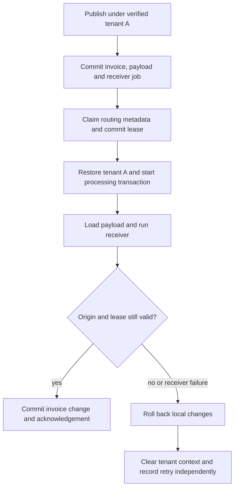

# Deliver domain events in the tenant that published them

An invoice is issued for tenant A. Its deferred receiver must load **A's invoice**,
even after a restart and even while another worker processes tenant B. A failed
receiver must roll back its own database changes and retry with the same origin.

The 0.6.0 development runtime provides this routing for current generated storage.
It does not authenticate a user, choose a tenant from a request or capture a human's
permissions. Those decisions belong to trusted application/security infrastructure.
Read [tenant persistence](tenant-persistence.md) first if verified selection and RLS
roles are new to you.

## Keep the business model ordinary

The event needs the invoice's nominal ID, not a technical tenant field. The repository
uses the current verified context when the receiver runs:

```vernac
namespace tutorial.delivery;

id InvoiceId;
value Title(String) validates {
    require(!self.string().isBlank(), "Title must not be blank");
};
value DeliveryState = WAITING | OBSERVED;

tenant aggregate Invoice[InvoiceId](Title, mut DeliveryState) behavior {
    modify void markObserved() {
        self.deliveryState(DeliveryState.OBSERVED);
    }
};
repository InvoiceRepository for Invoice {}
recorded event InvoiceIssued(InvoiceId);

usecase IssueInvoice(Title) returns InvoiceId
    uses InvoiceRepository invoiceRepository behavior {
    execute {
        var invoice = Invoice.create(title, DeliveryState.WAITING);
        self.invoiceRepository().save(invoice);
        self.emit(InvoiceIssued.create(invoice.id()));
        return invoice.id();
    }
}

deferred listener ObserveInvoice on InvoiceIssued
    uses InvoiceRepository invoiceRepository behavior {
    execute {
        var invoice = self.invoiceRepository().byId(event.invoiceId());
        invoice.markObserved();
        self.invoiceRepository().save(invoice);
    }
}
```

A trusted caller establishes selection before invoking the generated usecase bean:

```java
// verifiedTenant came from trusted membership/selection infrastructure or a test fixture.
// Never pass an unverified HTTP/header value straight into this API.
try (var selection = TenantContext.openVerified(verifiedTenant)) {
    var invoiceId = issueInvoice.execute(Title.of("Example invoice"));
}
```

`IssueInvoice` opens or joins its REQUIRED transaction. Its aggregate write, recorded
payload and initial receiver job commit together. A failure rolls them back together.
The listener does not run in this call; Boot's worker processes it later. Without
`recorded`, a deferred receiver still causes payload persistence. Immediate synchronous
listeners instead retain the publisher's current transaction and selection.

## Follow one delivery



The job stores nullable internal `tenantId`; NULL explicitly means GLOBAL. The payload
has scope-qualified storage throughout its VO/collection graph. Loading checks the
exact claimed origin; a forged tenant or GLOBAL routing value cannot make the receiver
read another tenant's payload. Global delivery never invents a tenant.

The worker rechecks the physical connection/context binding after the listener, then
acknowledges only with the same origin, token and live lease. A replacement worker can
finish an expired claim; the older worker's local writes roll back when it loses that
claim. External calls already made cannot be undone: delivery is at-least-once, so
use idempotency keys or reconciliation for external effects.

## Use separate migration and runtime credentials

Configure the usual Spring Boot DataSources for the same PostgreSQL writer database:

```yaml
spring:
  datasource:
    url: ${APP_DB_URL}
    username: ${APP_DB_USER}
    password: ${APP_DB_PASSWORD}
  flyway:
    url: ${APP_DB_URL}
    user: ${MIGRATION_DB_USER}
    password: ${MIGRATION_DB_PASSWORD}
```

The runtime role must be nonowner, NOSUPERUSER and NOBYPASSRLS, without schema CREATE
or table TRUNCATE. The event coordinator verifies the exact mixed-origin policy,
ENABLE/FORCE RLS, schema USAGE and payload SELECT/INSERT privileges before tenant SQL.
It shares transaction-local binding with tenant aggregate repositories. A role that
can run a global example as database owner is therefore not sufficient for tenant
publication. Do not weaken policies to make a failing configuration pass.

Provision grants as part of your deployment process; Vernac does not create roles or
credentials for you. For this model, after the reviewed schema is available, the
relevant grants include (adapt the role and provisioning order):

```sql
GRANT USAGE ON SCHEMA "tutorial.delivery", "vernac" TO app_runtime;
GRANT SELECT, INSERT, UPDATE, DELETE
    ON "tutorial.delivery"."Invoice" TO app_runtime;
GRANT SELECT, INSERT
    ON "tutorial.delivery"."@event:InvoiceIssued" TO app_runtime;
GRANT SELECT, INSERT, UPDATE
    ON "vernac"."@delivery" TO app_runtime;
```

Owned aggregate/entity/value tables need the normal repository privileges too; owned
event collection tables need payload SELECT/INSERT. No broad payload BYPASSRLS worker
role is required. Worker claims and failure bookkeeping use only unscoped control-plane
metadata, without readable business payload, credentials or permission snapshots.

## Upgrade before admitting tenant traffic

1. Rebuild producer modules and the application with matching current compiler/runtime
   artifacts. Generated storage declares tenant delivery SPI version 1; older adapters
   remain GLOBAL-only. Tenant emission through one fails with
   `TENANT_EVENT_STORAGE_REBUILD_REQUIRED`; an existing tenant job is BLOCKED with a
   rebuild diagnostic instead of being loaded through that adapter.
2. Review the payload-origin migration if upgrading from the older layout. Historical
   payload tables require explicit `'GLOBAL'` backfills; do not infer tenants from
   business values. See the [origin schema guide](../development/event-origin-schema.md).
3. Review the queue migration adding nullable `tenantId`. Existing pending jobs remain
   GLOBAL. Stop older worker versions before enabling tenant publication; mixed worker
   protocols are not a supported rolling deployment. New producers/workers refuse an
   unmigrated queue before payload writes/claims.
4. Run `schema-check` on a disposable server and test representative populated data,
   role grants, deployment order and recovery. Do not rewrite applied SQL/snapshots.
   You alone review, test and approve each candidate; generation/replay checks are no
   guarantee of deployment safety.

Current global applications and modules still work. The regular examples remain
simple global applications and include the forward queue migration. The automated
`TenantEventWorkerPostgresTest` additionally builds modules into a real JAR, starts
Boot with restricted Hikari pools and exercises tenant routing, retries and fencing.

## Understand retry and operational results

Each receiver has its own job and retry state. Other due jobs may progress while a
failed receiver waits for backoff; this is not a strict per-tenant ordering guarantee.
Expired final attempts become terminal. Missing/incompatible receivers are BLOCKED.
A successful local acknowledgement and business write commit together.

Failure bookkeeping retains safe exception classifications rather than arbitrary
messages, event data, tokens or tenant values. Technical SQL failure diagnostics are
sanitized. A worker must start outside an application transaction and tenant selection;
it will not suspend or borrow a caller's tenant. Selection, pins and pooled database
settings are cleaned after processing and before recording failure.

Routing is not a replacement for authentication, membership checks or the forthcoming
actor/permission/quota integration. Event evolution remains an explicit deployment
contract: changes to event payloads or nested value types can affect already stored
events. This feature completes neither that migration decision nor the full SaaS
identity/subscription/payment/UI acceptance gates.
