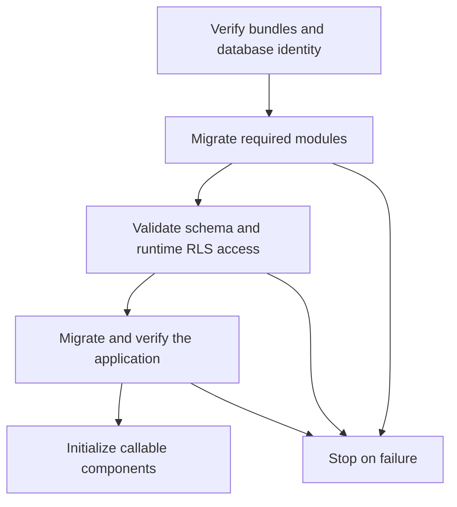

# Run tenant-aware modules together

A reusable module can manage its own tenant-bound aggregates and migrations while
participating in the application's transaction. The application supplies the verified
tenant selection; the module does not choose a customer or start an independent
business transaction.

This walkthrough requires matching **0.6.0 development artifacts**. It demonstrates
persistence and activation, not a complete billing, identity or SaaS system. Authentication,
membership verification and provisioning remain separate work. Start with
[local tenant persistence](tenant-persistence.md) and [module basics](type-modules.md)
if these concepts are new.

## Publish a small domain module

The producer owns invoices and exposes an operation rather than its repository or
aggregate. Save this model under the producer's `src/main/vernac/example/billing`:

```vernac
namespace example.billing;

id InvoiceId;
value CustomerName(String text, String? alias);
tenant aggregate Invoice[InvoiceId](CustomerName);
repository InvoiceRepository for Invoice {}

usecase IssueInvoice(CustomerName) returns InvoiceId uses InvoiceRepository behavior {
    execute {
        var invoice = Invoice.create(customerName);
        self.invoiceRepository().save(invoice);
        return invoice.id();
    }
}
```

Beside its POM, create `vernac-module.vmodule`:

```vernac-module
module example.billing {
    tenancy explicit;
    export example.billing.InvoiceId;
    export example.billing.CustomerName;
    export example.billing.IssueInvoice;
}
```

The export closure includes the operation's parameter and result types. Invoice and
InvoiceRepository remain internal to the module. Module identity and source namespace
happen to match here; imports always use the type's original qualified name.

Configure the producer as a normal Vernac Maven project, for example with coordinates
`org.example:billing-domain:1.0.0`. Generate its first migration candidate:

```shell
mvn vernac:migration "-Dvernac.migrationDescription=initial_billing"
mvn clean install
```

**Review, test and approve the migration before deployment. You alone are responsible
for its suitability, operation ordering and effect on existing data.** Packaging verifies
the SQL/snapshot chain; it does not approve or apply the candidate. The JAR contains
compiled code, module-contracts-10 metadata and an isolated migration bundle. Its schema
contains `@tenantId`, qualified relationships and ENABLE/FORCE RLS policies. Existing
module-contracts-10 type artifacts remain usable; no metadata-version bump is needed
for activation itself.

## Compose an application

Add the published Maven dependency and the Vernac JDBC Spring Boot starter. The
consumer defines its own aggregate and calls the module's exported usecase:

```vernac
namespace example.shop;

import example.billing.CustomerName;
import example.billing.InvoiceId;
import example.billing.IssueInvoice;

id OrderId;
tenant aggregate Order[OrderId](CustomerName, InvoiceId);
repository OrderRepository for Order {}

usecase Purchase(CustomerName) returns OrderId
    uses IssueInvoice issueInvoice, OrderRepository orderRepository behavior {
    execute {
        var invoiceId = self.issueInvoice().execute(customerName);
        var order = Order.create(customerName, invoiceId);
        self.orderRepository().save(order);
        return order.id();
    }
}
```

Here the application deliberately adopts the module's CustomerName value type. It
stores an InvoiceId, not a contained foreign aggregate. Invoice persistence belongs
to the producer; the flattened CustomerName columns in Order belong to the consumer.

Create the consumer's `vernac-application.vapplication` beside its POM:

```vernac-application
application example.shop {
    tenancy explicit;
    activate example.billing;
}
```

Generate/review the consumer's initial migration, then build it:

```shell
mvn vernac:migration "-Dvernac.migrationDescription=initial_shop"
mvn clean verify
```

A type import alone does not activate anything. Explicit activation registers the
module's internal repository/usecase implementations and initializes its persistent
history. Functional dependencies bring in the required modules in dependency order.

## Give each connection the appropriate rights

Use one PostgreSQL writer database, with separate migration and runtime logins:

```yaml
spring:
  main:
    lazy-initialization: false
  datasource:
    url: ${DB_URL}
    username: ${DB_RUNTIME_USER}
    password: ${DB_RUNTIME_PASSWORD}
  flyway:
    url: ${DB_URL}
    user: ${DB_MIGRATION_USER}
    password: ${DB_MIGRATION_PASSWORD}
```

Keep application migrations in `classpath:db/migration`. Do not add module migration
locations to Flyway: the coordinator owns those locations and their independent
histories. Use the same writer endpoint for both connections; the preflight rejects
a different database/instance before migration writes.

Provision reviewed runtime USAGE and SELECT/INSERT/UPDATE/DELETE grants on every owned
domain table. Grants/default privileges must apply before callable components start,
including newly created tables, for the role that creates those tables. The runtime
role must not own the tables, inherit owner roles, bypass RLS, create objects in their
schemas or have TRUNCATE rights. It needs no access to Flyway history tables. The
migration role needs the intentionally reviewed DDL/backfill privileges; table ownership
alone does not bypass FORCE RLS. Generated candidates do not create users or grants.

Startup proceeds through the verified dependency graph:



Every activated tenant graph is checked, including private aggregate/entity tables.
Disabled RLS, missing FORCE, a changed or extra policy, unsafe runtime privileges or
missing DML access abort startup before module components initialize. Structural
checks remain complemented by schema-check; they do not prove every possible CHECK,
trigger or operational deployment property.

## Execute with a verified tenant

Trusted request infrastructure must authenticate the caller, verify membership and
select the tenant before executing Purchase. The low-level integration shape is:

```java
try (var selection = TenantContext.openVerified(verifiedTenantId)) {
    OrderId orderId = purchase.execute(CustomerName.of("Ada"));
}
```

`openVerified` does not perform those checks for you. Never pass an unchecked header
or request parameter into it. No default tenant is inferred from module activation.

Purchase and IssueInvoice use REQUIRED propagation: both writes share the runtime
transaction and selected tenant. An uncaught inner failure rolls back both writes;
the same applies when several required modules and the application write together.
Loading by a different tenant returns the usual not-found result. Parallel requests
keep independent physical transactions and tenant bindings.

## Evolve a shared value

Suppose the producer adds a required `String origin` component to CustomerName. This
changes the public value contract: version/rebuild the producer and any dependent
modules together, and update consumer construction/mapping code to supply the value.
Do not just replace a JAR under an old compiled application.

Generate an additive migration in the producer and one in the consumer. Required
columns need explicit reviewed backfills. For this model their transformation files
have different owned keys:

Producer:

```json
{"backfills":{"example.billing/Invoice/customerName.origin":"'LEGACY'"},"conversions":{}}
```

Consumer:

```json
{"backfills":{"example.shop/Order/customerName.origin":"'LEGACY'"},"conversions":{}}
```

Pass each project's own file through `-Dvernac.transformations=...` when generating
its next migration. Unused keys are rejected. Choose a business-appropriate backfill;
LEGACY is only an illustration. Review and test each candidate with representative
existing data. The migration role must deliberately be able to update all affected
tenants; the runtime role must not gain that capability.

At the next startup, the new module history runs before the consuming application's
history. Their flattened copies are updated separately. Earlier successful histories
remain recorded if a later migration fails; application startup stops and retry resumes
from Flyway's state. Never edit a published/applied migration to hide drift or failure.

Changing an existing table between tenant/global remains blocked even with force until
an explicit conversion workflow is implemented. This walkthrough covers fresh tenant
graphs and ordinary additive upgrades, not that boundary conversion. Recorded/deferred
events emitted under tenant selection remain unsupported until tenant envelopes and
worker routing are implemented; synchronous immediate listeners keep the transaction.
