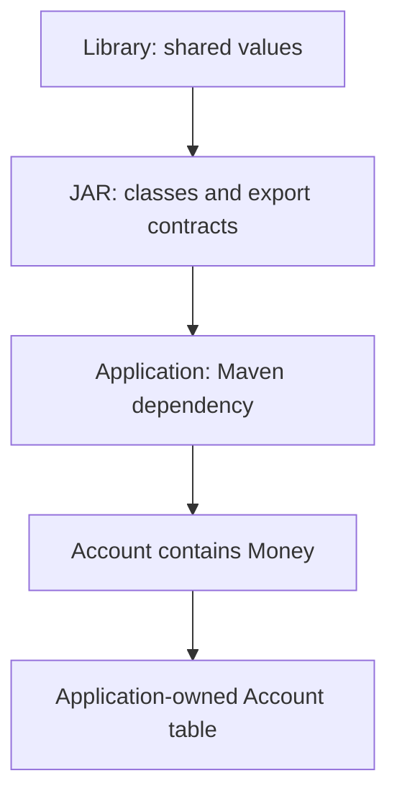
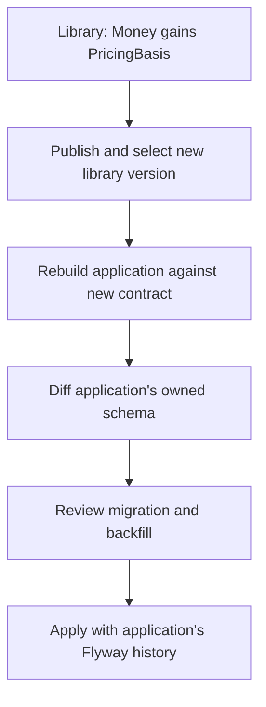
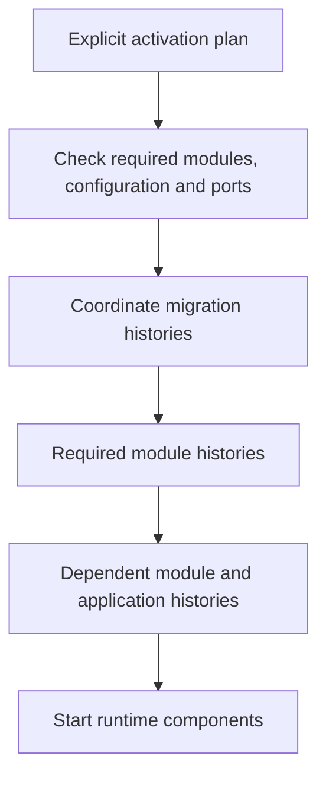

# Reuse a domain model without losing control of your database

A shared module can give several applications the same vocabulary: an external
reference, a money value, a label or a closed set of kinds. Each application still
owns its aggregates, their tables and the decisions about deploying changes.

This tutorial follows the separate `examples/type-modules` reactor from its first
build through an exported value change and the application's next migration. It
then explains how activation and independent migration histories will extend that
lifecycle for functional modules.

**Availability:** the executable steps require the type-module implementation in
**0.4.0-SNAPSHOT**. IDs, value objects, enums and their value collections are
supported. Functional-module activation, exported usecases/repositories and the
coordinator for module-owned migration histories are **planned, not executable
features**. There is no activation command or configuration syntax to copy yet.

**Migration responsibility:** you alone must review, test and approve every
migration before applying it. Candidates and successful automated checks do not
guarantee correctness for existing data, deployment order, locking or recovery.

## 1. Understand the three names

The example library has three identities serving different purposes:

| Identity | Example | Purpose |
| --- | --- | --- |
| Maven artifact | `org.vernac:vernac-example-shared-values:0.4.0-SNAPSHOT` | Select and distribute a compiled version |
| Logical module | `example.shared.values` | Identify the module and its contracts in diagnostics |
| Vernac type | `example.shared.Money` | Name the type in an import and in the model |

The module name does not prefix imports. `example.shared.values.Money` would be
wrong. The generated Java type remains `example.shared.domain.Money`.



This is intentional reuse of a shared domain vocabulary. When a vendor's model
should remain outside your domain, use an ACL mapping instead of importing it as
your application's vocabulary.

## 2. Publish an explicit surface

Open `examples/type-modules/library/src/main/vernac/example/shared/values.vernac`.
The library defines, among other values:

```vernac
namespace example.shared;
value Amount(BigDecimal);
value Money(Amount, Currency);
```

The complete file also defines ExternalRef, Label, Labels, Kind and InternalNote.
Its project-level `library/vernac-module.vmodule` selects the public surface:

```vernac-module
module example.shared.values {
    export example.shared.ExternalRef;
    export example.shared.Label;
    export example.shared.Labels;
    export example.shared.Amount;
    export example.shared.Money;
    export example.shared.Kind;
}
```

Amount must be exported because Money exposes it. Label must be exported because
Labels exposes its element type. Collections are separate contracts: exporting
Label alone does not export Labels. InternalNote is compiled into the JAR for the
library's own implementation, but another Vernac project cannot import it.

Keep `vernac-module.vmodule` beside the library POM. It is a module declaration,
not a model file in a namespace directory. IntelliJ's **New → Vernac Module
Definition** creates that project-level file.

## 3. Consume the actual compiled types

The application's ordinary Maven dependency selects the library. No additional
module registration is required for type imports. Its model is:

```vernac
namespace example.app;
import example.shared.ExternalRef;
import example.shared.Money;
import example.shared.Labels;
import example.shared.Kind;

id AccountId;
aggregate Account[AccountId](ExternalRef, Money, Labels, Kind) list Accounts;
repository AccountRepository for Account {}
```

Account is generated in the application. Money and the other imported types are
used from the library JAR; they are not regenerated or extended locally. Maven's
resolved compile dependencies, including transitive ones, supply available module
contracts. A library cannot re-export another module's types under its own identity.

From the repository root, using the current JDK 25 environment:

```text
mvn clean install
mvn -f examples/type-modules/pom.xml clean install
```

These are full Maven invocations; in Danny's IntelliJ Maven command field they
include `mvn` and use unquoted arguments. In a PowerShell terminal, quote complete
dotted `-Dproperty=value` arguments where needed.

`TypeModuleDemoTest` constructs an Account using the library's factories. Inspect:

- `library/target/classes/META-INF/vernac/module.json`: exports and contract metadata;
- the library JAR: implementation classes, including internal ones;
- its sources JAR: original Vernac sources for navigation;
- `application/target/vernac-module-index.json`: the consumer's resolved contracts.

Rebuild the consumer after changing dependencies. The IDE uses this resolved index;
it does not independently choose a Maven version. Go To Declaration opens an
available matching sources attachment or a marked read-only contract view.

## 4. Generate the application's first migration

Work in a disposable checkout or keep the exercise changes separate from a release.
All commands in this section run from the **repository root**:

```text
mvn -f examples/type-modules/application/pom.xml vernac:schema
mvn -f examples/type-modules/application/pom.xml vernac:migration -Dvernac.migrationDescription=initial_accounts
```

`schema` writes an expected schema and initial DDL candidate under
`application/target/vernac-schema`. It does not update a database or create source
history. `migration` creates a paired SQL candidate and JSON snapshot:

```text
application/src/main/resources/db/migration/V<timestamp>__initial_accounts.sql
application/src/main/vernac-schema/history/V<timestamp>__initial_accounts.json
```

Review and commit the pair together. Timestamp versions use UTC
`yyyyMMddHHmmssSSS`. Keep published migrations immutable.

Money is flattened into Account's table. Its nested Amount produces
`"money.amount"` and its Currency produces `"money.currency"`. BigDecimal's scale
is preserved through the technical `"@scale:money.amount"` column. Labels are
stored through an application-owned collection table with list positions.

**The type library has no tables and no initial migration of its own.** A VO
factory does not need a database. The repository declaration is what makes Account
part of the application's persisted model.

## 5. Check, then apply with Flyway

The example's default test is database-free; it is not a Spring Boot application
and does not automatically apply migrations. Use a dedicated development database
and your application's Flyway integration for this part of the exercise.

For structural verification, you can use the repository's disposable test server.
From the repository root, start it:

```powershell
docker compose -f .\examples\persistence-demo\compose.yaml --profile test up -d postgres-test
$env:VERNAC_CHECK_URL = 'jdbc:postgresql://localhost:55434/postgres'
$env:VERNAC_CHECK_USER = 'delivery'
$env:VERNAC_CHECK_PASSWORD = 'local-demo-only'
mvn -f examples/type-modules/application/pom.xml vernac:schema-check
```

The password above belongs only to the supplied local fixture. Use your own
credentials outside source control for any other environment. The Maven process
must receive these environment variables; setting them in a terminal does not
change an already-running IntelliJ process's environment.

`schema-check` replays the migrations in one temporary database and builds the
expected schema in another. It compares owned structures and removes those temporary
databases. **It does not apply the migration to your application database.**

A minimal explicit Java integration with Flyway looks like this:

```java
import org.flywaydb.core.Flyway;

public final class MigrateAccounts {
    public static void main(String[] args) {
        Flyway.configure()
                .dataSource(required("APP_DB_URL"), required("APP_DB_USER"),
                        required("APP_DB_PASSWORD"))
                .locations("classpath:db/migration")
                .load()
                .migrate();
    }

    private static String required(String name) {
        String value = System.getenv(name);
        if (value == null || value.isBlank()) {
            throw new IllegalStateException("Missing environment variable: " + name);
        }
        return value;
    }
}
```

Put this in your application integration, add `flyway-core`,
`flyway-database-postgresql` and the PostgreSQL JDBC driver using your application's
managed compatible versions, and run it with application resources on the classpath.
Supply `APP_DB_URL` for your dedicated application database, not the administrative
schema-check URL. This is standard Flyway integration, not module activation.
A Spring Boot application can instead use its existing Flyway startup integration;
[the Flyway walkthrough](flyway-workflow.md) demonstrates that runnable approach.

After applying the initial migration, inspect the **same application database**:

```sql
SELECT version, description, success FROM public.flyway_schema_history;
SELECT column_name FROM information_schema.columns
WHERE table_schema = 'example.app' AND table_name = 'Account';
```

For the next exercise, retain this database and representative Account data.
Starting with an empty database checks installation, not conversion of old values.

## 6. Change the library, then rebuild its consumer

Suppose Money needs a required pricing basis. In the library, add:

```vernac
value PricingBasis(String);
```

Replace the existing Money declaration with:

```vernac
value Money(Amount, Currency, PricingBasis);
```

Also add `export example.shared.PricingBasis;` to the module declaration. Do not
paste a second Money definition next to the existing one.

The factory now requires the new value. Update the example test's price creation:

```java
var price = Money.of(Amount.of(new BigDecimal("12.30")),
        Currency.getInstance("EUR"), PricingBasis.of("STANDARD"));
```

Build the example reactor again:

```text
mvn -f examples/type-modules/pom.xml clean install
```

The exercise reuses a local SNAPSHOT. For a published library, create a new artifact
version, publish it and explicitly update the application's dependency. Never
replace a released JAR with different contents under the same coordinates.

Adding a field is a structural contract change, not a compatible additive behavior
method. Other modules compiled against the old Money contract may be rejected until
rebuilt and adapted. Comments and private implementation edits do not change the
public contract fingerprint. A matching API fingerprint is not a database
compatibility guarantee.

## 7. Migrate the application's flattened value

Account's source definition has not changed, but its resolved Money shape has.
The application owns the resulting new `"money.pricingBasis"` TEXT column.



First try generating the next migration:

```text
mvn -f examples/type-modules/application/pom.xml vernac:migration -Dvernac.migrationDescription=add_pricing_basis
```

Generation should stop: an existing row needs a value for the required column.
Decide what historical pricing basis actually means. If STANDARD is correct for
**your exercise data**, create
`application/src/main/vernac-schema/transformations.json` containing:

```json
{
  "backfills": {
    "example.app/Account/money.pricingBasis": "'STANDARD'"
  },
  "conversions": {}
}
```

The file path below is relative to the application project:

```text
mvn -f examples/type-modules/application/pom.xml vernac:migration -Dvernac.migrationDescription=add_pricing_basis -Dvernac.transformations=src/main/vernac-schema/transformations.json
```

Review the candidate: add the column, backfill existing rows, then make it NOT NULL.
Run `vernac:schema-check` again with the test-server environment. Test the migration
on a copy of representative historical data as well: empty replay databases cannot
validate the meaning of STANDARD or prove that all old Accounts can be reconstructed.

Apply the reviewed SQL through the **same application Flyway integration** used in
step 5. It sees the initial migration already installed and applies only the new
version. Verify the new column and retained IDs:

```sql
SELECT "id", "money.pricingBasis" FROM "example.app"."Account";
SELECT version, description, success FROM public.flyway_schema_history;
```

Commit the library change, its export declaration, the consumer adaptation and the
application's SQL/snapshot pair through your normal release process. Published
migration files stay unchanged. Do not regenerate an initial schema over an existing
database, repair checksums to hide divergence, or delete data to make an upgrade pass.

## 8. Where activation fits: the planned functional-module lifecycle

A future billing module may expose a usecase, require a payment port and own Invoice
tables. That is a different lifecycle from importing Money. The current producer
accepts only type definitions; this scenario is architectural guidance, not a
supported export or configuration example.

| Action | Type module today | Functional module target |
| --- | --- | --- |
| Add Maven dependency | Makes exported types available | Makes exported contracts available |
| Import a VO | Uses compiled value classes | Uses compiled value classes |
| Activate functionality | Unnecessary | Explicit choice, with required dependency closure |
| Start module beans/workers | None | After configuration, ports and migration checks |
| Apply internal migrations | None | Module's own reviewed history, coordinated before dependants |
| Migrate local flattened VOs | Application's history | Still application's history |



Selecting a library must not accidentally start adapters or workers. Using only
Billing's Money requires no billing beans or Invoice tables. Calling Billing's
usecase requires its functionality and any declared required functional modules.
Missing mandatory ports, ambiguous wiring and activation cycles must stop startup.

Activated persistent modules will normally share the application's DataSource and
transaction manager. REQUIRED usecases join an outer transaction. Deployment
migrations are separate from these usecase transactions.

Each owner needs an isolated migration resource location **and a distinct Flyway
history identity**. Directories alone do not isolate version numbers. The planned
coordinator applies required modules before dependants and the application, then
starts runtime components. Exact activation syntax, resource paths and history
names remain to be specified; do not simulate this by broad component scanning or
combining all module SQL files into the application's migration directory.

If Billing changes both its internal Invoice storage and an exported Money shape,
there are two independent responsibilities:

1. Billing publishes reviewed migrations for its own Invoice tables.
2. Each consumer resolves the new Money shape and generates/reviews migrations for
   its own flattened columns, supplying its own historical-data transformations.

There is no automatic copying of Billing's migration into an application's history
and no promise of atomic rollback across all migration streams. An earlier stream
may succeed before a later one fails. Operators must plan recovery and retries from
recorded installed state. API compatibility alone does not permit running old code
against a changed schema.

## Troubleshoot the lifecycle

| Symptom | Check |
| --- | --- |
| Type is not exported | Export its original qualified identity and all required local public types |
| IDE cannot see an installed library | Rebuild the consumer; inspect the resolved index and Maven dependency graph |
| Contract changed after upgrading a dependency | Adapt/rebuild dependent modules; do not bypass a structural diagnostic |
| Migration asks for a backfill | Decide a valid historical value and supply an explicit SQL expression |
| Flyway says a column already exists | Inspect history in the correct database; check for a previously applied experiment |
| Schema-check passes but deployment fails | Test real data, permissions, ordering and runtime constraints separately |
| Imported value seems to require activation | Type-only use needs none; functional activation remains a future feature |

Restore exercise source changes and remove only unpublished exercise candidates
when returning to the original example. A Git reset does not undo applied database
migrations. Keep an experimental database separate from other walkthroughs.

Continue with the [module contract](../contracts/modules.md),
[schema tooling](postgresql-migrations.md), and
[the runnable database walkthrough](database-persistence.md).
