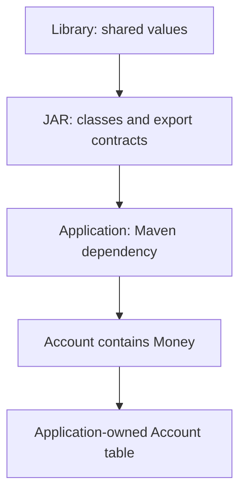
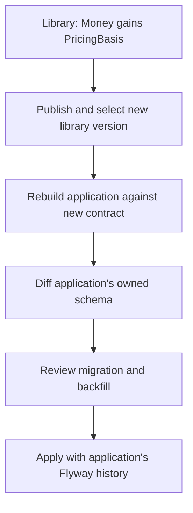
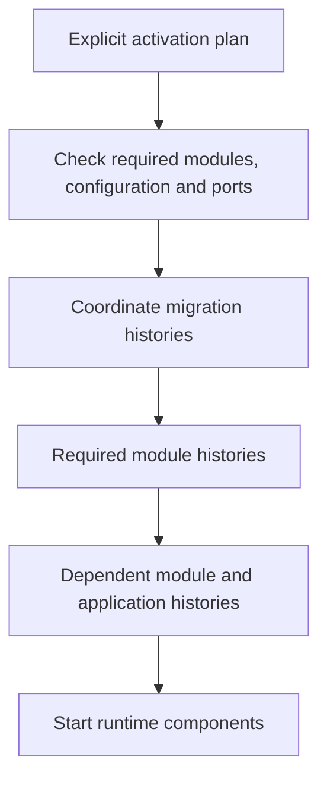
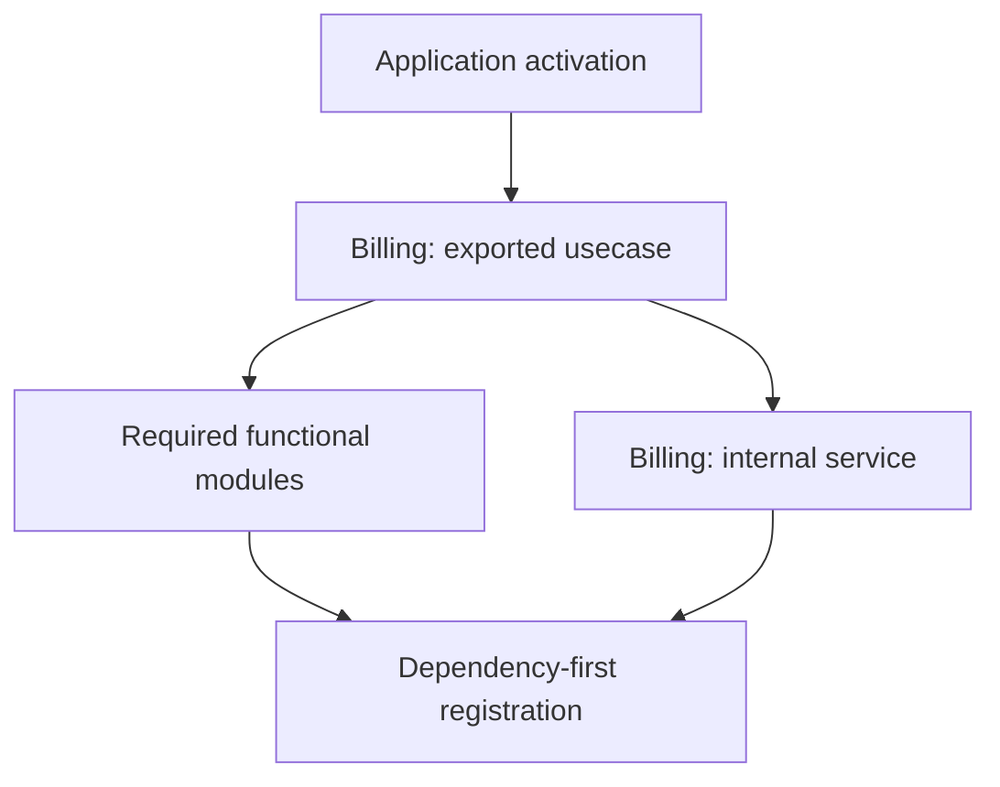
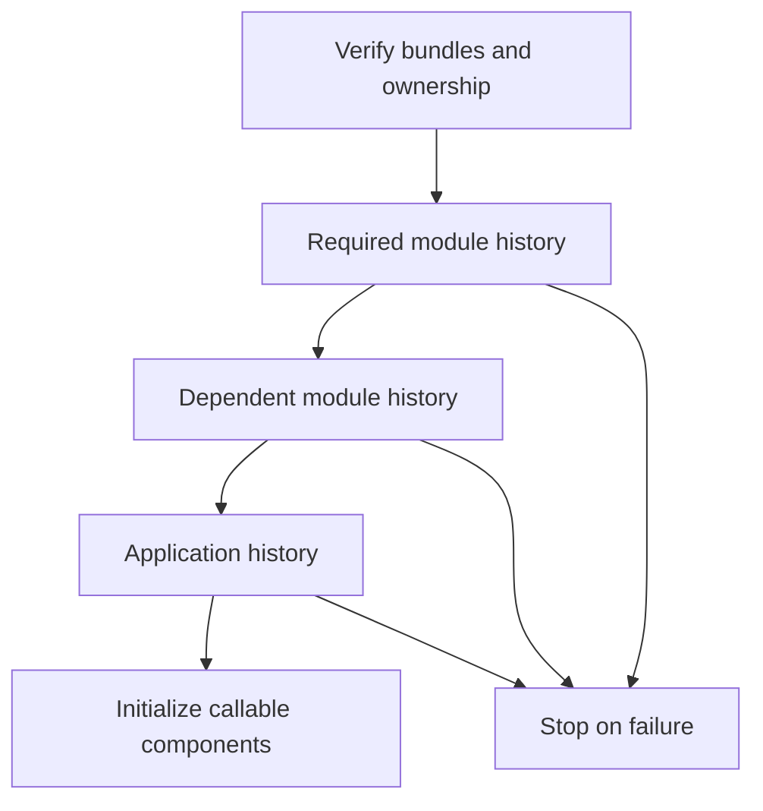

# Reuse a domain model without losing control of your database

A shared module can give several applications the same vocabulary: an external
reference, a money value, a label or a closed set of kinds. Each application still
owns its aggregates, their tables and the decisions about deploying changes.

This tutorial follows the separate `examples/type-modules` reactor from its first
build through an exported value change and the application's next migration. It
then demonstrates nonpersistent functional activation and explains how independent
migration histories will extend the lifecycle for persistent modules.

**Availability:** the executable steps require **0.4.0-SNAPSHOT**. Values, collections,
ports, adapters, nonpersistent domain services and usecases are supported. Nonpersistent functional activation is described below. Persistent contract publication
and bundle verification are supported; coordinated runtime migration execution is supported; the initial migration exercise here concerns application-owned data.

**Migration responsibility:** you alone must review, test and approve every
migration before applying it. Candidates and successful automated checks do not
guarantee correctness for existing data, deployment order, locking or recovery.

## 1. Understand the three names

The example library has three identities serving different purposes:

| Identity | Example | Purpose |
| --- | --- | --- |
| Maven artifact | `org.vernac:vernac-example-shared-values:0.4.0-SNAPSHOT` | Select and distribute a compiled version |
| Logical module | `example.shared.values` | Identify the module and its contracts in diagnostics |
| Vernac type | `example.shared.Money` | Name the type in an import and in the model |

The module name does not prefix imports. `example.shared.values.Money` would be
wrong. The generated Java type remains `example.shared.domain.Money`.



This is intentional reuse of a shared domain vocabulary. When a vendor's model
should remain outside your domain, use an ACL mapping instead of importing it as
your application's vocabulary.

## 2. Publish an explicit surface

Open `examples/type-modules/library/src/main/vernac/example/shared/values.vernac`.
The library defines, among other values:

```vernac
namespace example.shared;
value Amount(BigDecimal);
value Money(Amount, Currency);
```

The complete file also defines ExternalRef, Label, Labels, Kind, PaymentProvider
and InternalNote.
Its project-level `library/vernac-module.vmodule` selects the public surface:

```vernac-module
module example.shared.values {
    export example.shared.ExternalRef;
    export example.shared.Label;
    export example.shared.Labels;
    export example.shared.Amount;
    export example.shared.Money;
    export example.shared.Kind;
    export example.shared.PaymentProvider;
}
```

Amount must be exported because Money exposes it. Label must be exported because
Labels exposes its element type. Collections are separate contracts: exporting
Label alone does not export Labels. InternalNote is compiled into the JAR for the
library's own implementation, but another Vernac project cannot import it.

Keep `vernac-module.vmodule` beside the library POM. It is a module declaration,
not a model file in a namespace directory. IntelliJ's **New → Vernac Module
Definition** creates that project-level file.

## 3. Consume the actual compiled types

The application's ordinary Maven dependency selects the library. No additional
module registration is required for type imports. Its model is:

```vernac
namespace example.app;
import example.shared.ExternalRef;
import example.shared.Money;
import example.shared.Labels;
import example.shared.Kind;

id AccountId;
aggregate Account[AccountId](ExternalRef, Money, Labels, Kind) list Accounts;
repository AccountRepository for Account {}
```

Account is generated in the application. Money and the other imported types are
used from the library JAR; they are not regenerated or extended locally. Maven's
resolved compile dependencies, including transitive ones, supply available module
contracts. A library cannot re-export another module's types under its own identity.

From the repository root, using the current JDK 25 environment:

```text
mvn clean install
mvn -f examples/type-modules/pom.xml clean install
```

These are full Maven invocations; in Danny's IntelliJ Maven command field they
include `mvn` and use unquoted arguments. In a PowerShell terminal, quote complete
dotted `-Dproperty=value` arguments where needed.

`TypeModuleDemoTest` constructs an Account using the library's factories. Inspect:

- `library/target/classes/META-INF/vernac/module.json`: exports and contract metadata;
- the library JAR: implementation classes, including internal ones;
- its sources JAR: original Vernac sources for navigation;
- `application/target/vernac-module-index.json`: the consumer's resolved contracts.

Rebuild the consumer after changing dependencies. The IDE uses this resolved index;
it does not independently choose a Maven version. Go To Declaration opens an
available matching sources attachment or a marked read-only contract view.

## 4. Generate the application's first migration

Work in a disposable checkout or keep the exercise changes separate from a release.
All commands in this section run from the **repository root**:

```text
mvn -f examples/type-modules/application/pom.xml vernac:schema
mvn -f examples/type-modules/application/pom.xml vernac:migration -Dvernac.migrationDescription=initial_accounts
```

`schema` writes an expected schema and initial DDL candidate under
`application/target/vernac-schema`. It does not update a database or create source
history. `migration` creates a paired SQL candidate and JSON snapshot:

```text
application/src/main/resources/db/migration/V<timestamp>__initial_accounts.sql
application/src/main/vernac-schema/history/V<timestamp>__initial_accounts.json
```

Review and commit the pair together. Timestamp versions use UTC
`yyyyMMddHHmmssSSS`. Keep published migrations immutable.

Money is flattened into Account's table. Its nested Amount produces
`"money.amount"` and its Currency produces `"money.currency"`. BigDecimal's scale
is preserved through the technical `"@scale:money.amount"` column. Labels are
stored through an application-owned collection table with list positions.

**The type library has no tables and no initial migration of its own.** A VO
factory does not need a database. The repository declaration is what makes Account
part of the application's persisted model.

## 5. Check, then apply with Flyway

The example now includes a database-free Spring Boot profile-selection runner.
It does not configure a DataSource or automatically apply migrations. Use a dedicated development database
and your application's Flyway integration for this part of the exercise.

For structural verification, you can use the repository's disposable test server.
From the repository root, start it:

```powershell
docker compose -f .\examples\persistence-demo\compose.yaml --profile test up -d postgres-test
$env:VERNAC_CHECK_URL = 'jdbc:postgresql://localhost:55434/postgres'
$env:VERNAC_CHECK_USER = 'delivery'
$env:VERNAC_CHECK_PASSWORD = 'local-demo-only'
mvn -f examples/type-modules/application/pom.xml vernac:schema-check
```

The password above belongs only to the supplied local fixture. Use your own
credentials outside source control for any other environment. The Maven process
must receive these environment variables; setting them in a terminal does not
change an already-running IntelliJ process's environment.

`schema-check` replays the migrations in one temporary database and builds the
expected schema in another. It compares owned structures and removes those temporary
databases. **It does not apply the migration to your application database.**

A minimal explicit Java integration with Flyway looks like this:

```java
import org.flywaydb.core.Flyway;

public final class MigrateAccounts {
    public static void main(String[] args) {
        Flyway.configure()
                .dataSource(required("APP_DB_URL"), required("APP_DB_USER"),
                        required("APP_DB_PASSWORD"))
                .locations("classpath:db/migration")
                .load()
                .migrate();
    }

    private static String required(String name) {
        String value = System.getenv(name);
        if (value == null || value.isBlank()) {
            throw new IllegalStateException("Missing environment variable: " + name);
        }
        return value;
    }
}
```

Put this in your application integration, add `flyway-core`,
`flyway-database-postgresql` and the PostgreSQL JDBC driver using your application's
managed compatible versions, and run it with application resources on the classpath.
Supply `APP_DB_URL` for your dedicated application database, not the administrative
schema-check URL. This is standard Flyway integration, not module activation.
A Spring Boot application can instead use its existing Flyway startup integration;
[the Flyway walkthrough](flyway-workflow.md) demonstrates that runnable approach.

After applying the initial migration, inspect the **same application database**:

```sql
SELECT version, description, success FROM public.flyway_schema_history;
SELECT column_name FROM information_schema.columns
WHERE table_schema = 'example.app' AND table_name = 'Account';
```

For the next exercise, retain this database and representative Account data.
Starting with an empty database checks installation, not conversion of old values.

## 6. Change the library, then rebuild its consumer

Suppose Money needs a required pricing basis. In the library, add:

```vernac
value PricingBasis(String);
```

Replace the existing Money declaration with:

```vernac
value Money(Amount, Currency, PricingBasis);
```

Also add `export example.shared.PricingBasis;` to the module declaration. Do not
paste a second Money definition next to the existing one.

The factory now requires the new value. Update the example test's price creation and the runner's money creation
(`TypeModuleDemoTest` and `ModuleDemoApplication`). Keep each local variable's
existing name; both calls now need PricingBasis:

```java
var price = Money.of(Amount.of(new BigDecimal("12.30")),
        Currency.getInstance("EUR"), PricingBasis.of("STANDARD"));
```

Build the example reactor again:

```text
mvn -f examples/type-modules/pom.xml clean install
```

The exercise reuses a local SNAPSHOT. For a published library, create a new artifact
version, publish it and explicitly update the application's dependency. Never
replace a released JAR with different contents under the same coordinates.

Adding a field is a structural contract change, not a compatible additive behavior
method. Other modules compiled against the old Money contract may be rejected until
rebuilt and adapted. Comments and private implementation edits do not change the
public contract fingerprint. A matching API fingerprint is not a database
compatibility guarantee.

## 7. Migrate the application's flattened value

Account's source definition has not changed, but its resolved Money shape has.
The application owns the resulting new `"money.pricingBasis"` TEXT column.



First try generating the next migration:

```text
mvn -f examples/type-modules/application/pom.xml vernac:migration -Dvernac.migrationDescription=add_pricing_basis
```

Generation should stop: an existing row needs a value for the required column.
Decide what historical pricing basis actually means. If STANDARD is correct for
**your exercise data**, create
`application/src/main/vernac-schema/transformations.json` containing:

```json
{
  "backfills": {
    "example.app/Account/money.pricingBasis": "'STANDARD'"
  },
  "conversions": {}
}
```

The file path below is relative to the application project:

```text
mvn -f examples/type-modules/application/pom.xml vernac:migration -Dvernac.migrationDescription=add_pricing_basis -Dvernac.transformations=src/main/vernac-schema/transformations.json
```

Review the candidate: add the column, backfill existing rows, then make it NOT NULL.
Run `vernac:schema-check` again with the test-server environment. Test the migration
on a copy of representative historical data as well: empty replay databases cannot
validate the meaning of STANDARD or prove that all old Accounts can be reconstructed.

Apply the reviewed SQL through the **same application Flyway integration** used in
step 5. It sees the initial migration already installed and applies only the new
version. Verify the new column and retained IDs:

```sql
SELECT "id", "money.pricingBasis" FROM "example.app"."Account";
SELECT version, description, success FROM public.flyway_schema_history;
```

Commit the library change, its export declaration, the consumer adaptation and the
application's SQL/snapshot pair through your normal release process. Published
migration files stay unchanged. Do not regenerate an initial schema over an existing
database, repair checksums to hide divergence, or delete data to make an upgrade pass.

## 8. Separate functional activation from module migrations

A billing module can now expose a nonpersistent usecase and require a payment port.
That lifecycle is demonstrated below. A module owning Invoice tables additionally
uses the startup migration coordinator described below.

| Action | Type module today | Functional module target |
| --- | --- | --- |
| Add Maven dependency | Makes exported types available | Makes exported contracts available |
| Import a VO | Uses compiled value classes | Uses compiled value classes |
| Activate functionality | Unnecessary | Explicit choice, with required dependency closure |
| Start module beans/workers | None | After configuration, ports and migration checks |
| Apply internal migrations | None | Module's own reviewed history, coordinated before dependants |
| Migrate local flattened VOs | Application's history | Still application's history |



Selecting a library must not accidentally start adapters or workers. Using only
Billing's Money requires no billing beans or Invoice tables. Calling Billing's
usecase requires its functionality and any declared required functional modules.
Missing mandatory ports, ambiguous wiring and activation cycles must stop startup.

Activated persistent modules will normally share the application's DataSource and
transaction manager. REQUIRED usecases join an outer transaction. Deployment
migrations are separate from these usecase transactions.

Each owner needs an isolated migration resource location **and a distinct Flyway
history identity**. Directories alone do not isolate version numbers. The startup
coordinator applies required modules before dependants and the application, then
starts runtime components. Persistence bundle resource paths and history identities are now fixed in the contract; do not bypass the coordinator through broad component scanning or
combining all module SQL files into the application's migration directory.

If Billing changes both its internal Invoice storage and an exported Money shape,
there are two independent responsibilities:

1. Billing publishes reviewed migrations for its own Invoice tables.
2. Each consumer resolves the new Money shape and generates/reviews migrations for
   its own flattened columns, supplying its own historical-data transformations.

There is no automatic copying of Billing's migration into an application's history
and no promise of atomic rollback across all migration streams. An earlier stream
may succeed before a later one fails. Operators must plan recovery and retries from
recorded installed state. API compatibility alone does not permit running old code
against a changed schema.

## Troubleshoot the lifecycle

| Symptom | Check |
| --- | --- |
| Type is not exported | Export its original qualified identity and all required local public types |
| IDE cannot see an installed library | Rebuild the consumer; inspect the resolved index and Maven dependency graph |
| Contract changed after upgrading a dependency | Adapt/rebuild dependent modules; do not bypass a structural diagnostic |
| Migration asks for a backfill | Decide a valid historical value and supply an explicit SQL expression |
| Flyway says a column already exists | Inspect history in the correct database; check for a previously applied experiment |
| Schema-check passes but deployment fails | Test real data, permissions, ordering and runtime constraints separately |
| Imported value seems to require activation | Type-only use needs none; usecases/services require explicit activation |

Restore exercise source changes and remove only unpublished exercise candidates
when returning to the original example. A Git reset does not undo applied database
migrations. Keep an experimental database separate from other walkthroughs.

Continue with the [module contract](../contracts/modules.md),
[schema tooling](postgresql-migrations.md), and
[the runnable database walkthrough](database-persistence.md).

## Share a capability contract as well as values

The example now exports `example.shared.PaymentProvider` with a `charge(Money)`
operation returning ExternalRef. Both argument and result types are explicit exports.
Its application defines DevelopmentPaymentProvider and invokes it through the
library's compiled interface. This fixture does not call an external provider.

A port interface owns no beans or tables and requires no activation. Its inclusion
in a contract module does not mean functional-module activation is available. The separate `providers` artifact now exports two local fixture implementations
selected by the application binding. This is adapter selection, not activation of
a whole billing implementation with usecases, repositories and migrations. Rebuild existing
module JARs after this compiler update (`module-contracts-9` metadata).

## Run profile-driven selection

The reactor now contains `library`, `providers` and `application`. The providers
artifact depends on the library's PaymentProvider contract. It exports
NoopPaymentProvider and ConfiguredTestPaymentProvider; neither makes network calls
or payments. The application selects one through `billing.payment-provider`.

From the repository root:

```text
mvn -f examples/type-modules/pom.xml clean install
mvn -f examples/type-modules/application/pom.xml spring-boot:run
```

The default dev profile uses Noop without credentials. For the prod-profile fixture,
supply a development-only value in the terminal that starts Maven:

```powershell
$env:PAYMENT_FIXTURE_API_KEY = 'local-fixture-only'
mvn -f examples/type-modules/application/pom.xml spring-boot:run "-Dspring-boot.run.profiles=prod"
```

In IntelliJ's Maven field, omit quotes and pass the variable in that run configuration.
The runner logs the selected provider and a generated reference. Production here
means the Spring profile name, not a real payment integration or production credential.

ProfileBindingTest verifies that Boot discovers the generated configuration without
an explicit Java Import. The application remains database-free; its Account migrations
are still applied through the explicit Flyway workflow earlier in this chapter.

## Activate a reusable usecase without exposing its helpers

For a small, database-independent billing module, use this complete model in
`src/main/vernac/example/billing/model.vernac`:

```vernac
namespace example.billing;
value Receipt(String);
service ReceiptFactory behavior {
    public Receipt accepted() { return Receipt.of("accepted"); }
}
usecase ConfirmPayment() returns Receipt uses ReceiptFactory receiptFactory behavior {
    execute { return self.receiptFactory().accepted(); }
}
```

Publish only the caller's contract in the producer's `vernac-module.vmodule`:

```vernac-module
module example.billing {
    export example.billing.Receipt;
    export example.billing.ConfirmPayment;
}
```

Build/install the producer, add its Maven dependency to your application, then write
`vernac-application.vapplication` beside the application's POM:

```vernac-application
application example.shop {
    activate example.billing;
}
```

The application's model can now call the published operation:

```vernac
namespace example.shop;
import example.billing.ConfirmPayment;
import example.billing.Receipt;
usecase Checkout() returns Receipt uses ConfirmPayment confirmPayment behavior {
    execute { return self.confirmPayment().execute(); }
}
```

Spring Boot discovers the generated configuration automatically. Keep the existing
application setup that supplies its transaction manager. A plain Spring context must
import `example.shop.configuration.__VernacApplication` and supply a
`PlatformTransactionManager`. Nonpersistent means the module owns no tables; its
usecase still participates in the application's transaction.

ReceiptFactory is registered as an internal module bean without exporting it or
scanning the dependency. Checkout and ConfirmPayment join the same REQUIRED
transaction. Removing `activate example.billing;` produces a targeted diagnostic
rather than leaving an unresolved constructor dependency for later.



A declared dependency on another module's service/usecase extends activation
transitively. A dependency on its Money value or PaymentProvider interface does not.
Selected adapters still come from fixed or profile-based bindings. Binding a payment
adapter does not by itself activate Billing merely because Billing owns the port.

Invoice aggregates and repository contracts can now be published as described below.
Explicit activation now coordinates their independent histories at startup.

## Prepare a persistent module's migration contract

This step prepares an artifact, **not an executable persistent module**. Normal publication now accepts entity/aggregate/repository contracts and automatically
prepares/verifies their persistence bundle. Do not use
broad component scanning or manually combine SQL histories to bypass that boundary.
The next implementation stage connects persistent exports and this bundle to coordinated startup.

For a module prototype, keep `vernac-module.vmodule` beside its POM. Existing schema
and migration tooling now selects `src/main/vernac-schema/migration` for that project,
keeping module SQL outside ordinary Maven resources. Snapshot JSON files remain in
`src/main/vernac-schema/history`. Application projects retain `db/migration` under
`src/main/resources`.

Run these goals in the module project, using the current Maven plugin:

```text
mvn vernac:schema
mvn vernac:migration -Dvernac.migrationDescription=initial_billing
mvn vernac:schema-check
mvn vernac:module-persistence
```

Use the previously described disposable PostgreSQL configuration for schema-check.
Review the candidate **before applying it**, including testing on representative
historical data. You remain solely responsible for approval and deployment safety.
The preparation goal does not establish that human review happened.

The last goal requires the current model to match the source-controlled history. A
model change without a matching next migration stops preparation. Missing snapshots,
unpaired SQL and duplicate version numbers also stop it. The generated target contains
`META-INF/vernac/modules/<module>/persistence.json`, original SQL and original snapshots,
and is registered as a Maven resource for packaging. It contains no absolute paths or
credentials. The existing module-definition contract is not changed by this goal.

Inspect `persistence.json`: it records each file hash, the expected schema, the future
Flyway location, and an isolated technical history schema. Billing and Identity can
use the same timestamp; their Flyway histories will still be independent. The history
schema name is stable across releases, so upgrading a Maven version cannot create a
new history that accidentally replays old migrations.

No SQL has been applied by module-persistence. No module migration runs automatically
at application startup yet. Continue with the [module completion checklist](../development/module-completion-roadmap.md)
for the remaining activation and upgrade tests.

## Publish an Invoice contract without transferring table ownership

This complete producer model can be placed in
`src/main/vernac/example/billing/invoice.vernac`:

```vernac
namespace example.billing;
id InvoiceId;
value InvoiceReference(String);
aggregate Invoice[InvoiceId](InvoiceReference) list Invoices;
repository InvoiceRepository for Invoice {
    find offset Invoices all() order by createdAt desc, id counting;
}
```

Export the entire public type closure in `vernac-module.vmodule`:

```vernac-module
module example.billing {
    export example.billing.InvoiceId;
    export example.billing.InvoiceReference;
    export example.billing.Invoice;
    export example.billing.Invoices;
    export example.billing.InvoiceRepository;
}
```

Use the producer's normal JDBC runtime dependencies. Generate/review the initial
migration with the tooling above, run schema-check on a disposable PostgreSQL server,
then build/install the module. Compile checks that the migration head matches the
model and packages the verified bundle automatically; no additional execution of
module-persistence is required for publication.

A consumer can import these types by their original identities after adding the Maven
dependency. InvoiceRepository refers to the producer's Invoice and uses its existing
compiled JDBC implementation. Importing it does not generate an application-owned
Invoice table. A local `repository ... for Invoice` is rejected because that aggregate
belongs to the dependency. InvoiceReference can still be embedded in a local VO or
aggregate; those local flattened columns belong to the consuming application's history.

You can publish a second module whose usecase declares the imported repository through
`uses`. The compiled dependency and contract checks work now. Executing that operation
in an application requires explicit activation and the shared JDBC/Flyway infrastructure.
The coordinator migrates the required module before its dependant, then your application.
Do not compensate with manual component scanning.

## Start an application using persistent modules

Add the Vernac JDBC Spring Boot starter and the module Maven dependencies. Configure
your application's usual `spring.datasource` connection and keep application migrations
in `classpath:db/migration`. Do not add module SQL directories to `spring.flyway.locations`:
the coordinator selects them from verified module bundles. Keep Flyway enabled and
provide the application transaction manager. Separate `spring.flyway.url` connections
and a custom FlywayMigrationStrategy are not supported by this integration.

Explicitly activate the module in your existing `.vapplication` file. Functional
dependencies participate transitively; a type import alone does not activate a module.
The same migration version can exist in two modules because their history schemas differ.



Each history is followed by an owned-schema structural check. Unexpected owned columns,
missing tables or incompatible keys stop startup before module operations become callable.
This check does not replace schema-check or migration review; exact CHECK expression
semantics and arbitrary triggers are outside its scope.

If a later history fails, an earlier completed history can remain applied. Correct the
unpublished candidate or deploy an appropriate reviewed follow-up, then restart. Do not
edit published migrations or assume one transaction spans every owner's deployment.
Normal module usecases continue to join REQUIRED application transactions.

The automated `ModuleMigrationPostgresTest` exercises fresh installation, restart,
independent history versions, nested transaction joining/rollback, partial failure/retry
and owned-schema drift. Set the usual VERNAC_PG_TEST_URL, VERNAC_PG_TEST_USER and
VERNAC_PG_TEST_PASSWORD for a disposable PostgreSQL server and run:

```text
mvn -pl vernac-maven-plugin -am test -Dtest=ModuleMigrationPostgresTest -Dsurefire.failIfNoSpecifiedTests=false
```

All eight tests should run without skips. The database account must be able to create
and remove disposable databases. The additional upgrade scenario covers existing module/application rows and a required
external-VO field backfill, followed by rejection of old artifacts.

For a complete runnable reactor and step-by-step version upgrade, follow
[the persistent module example](../../examples/persistent-modules/README.md). It keeps
Billing, Receipts and application migrations separate and shows why an exported value
change can require all three owners to migrate.

## Receive a public module event synchronously

The persistent example now exports Billing's plain InvoiceOpened event. Receipts has
an internal synchronous listener; the application has another. Both log the same
EventId during the purchase. Neither receives an independently committed notification:
the rejected-purchase demonstration still rolls back, although its synchronous logs
already exist. A log line is not a transaction commit acknowledgment.

Export the event plus all local payload types. Keep receivers internal; activate their
module rather than importing or exporting listener classes. Event imports alone do
not install receivers. A receiver-only module may have an empty export declaration
and can still be explicitly activated. Its declared functional dependencies activate
transitively, while merely knowing another module's event does not activate the emitter.

Use this mode only for immediate transactional participation. Deferred module delivery and recorded storage are now supported. The producer owns
the prepared payload; the application owns shared delivery jobs. The runnable example
also shows two deferred recipients and a deliberate first-attempt rollback/retry. Metadata
is module-contracts-9, so rebuild all producers and consumers after updating the tools.


## Add a module-owned HTTP API

A capability can supply an HTTP entrypoint in a separate module. This keeps its domain
usable from non-web applications. The standalone persistent-modules example now includes
`api`, which imports Billing values and the Receipts `RecordPurchase` usecase. Its inbound
adapter maps a request DTO to `CustomerName`, invokes the usecase and maps `InvoiceId`
to a response DTO. No application registration code or copied module sources are needed.

The API has an empty export list: controllers are entrypoints, not types to import.
The application activates `example.api`; its functional dependencies activate Receipts
and Billing. Their histories run before requests can reach the usecase. Without that
activation, the API's presence on the Maven classpath does not expose its routes.

Follow [the executable HTTP walkthrough](../../examples/persistent-modules/README.md#call-the-module-owned-http-api)
to start the servlet profile and try a request. Its transport and validation failures
use the API producer's declarative error policy. The application adds the HTTP runtime
and Spring MVC explicitly. Activation does not configure authentication or authorization.
