# Put access requirements beside the operation

A private endpoint is only one way to reach an operation. The same operation might
also be called by another usecase, a listener or handwritten Java. Put its business
access requirement on the usecase, while keeping login and transport protection at
the web boundary.

This tutorial requires matching **0.6.0-SNAPSHOT** compiler/runtime/tooling. It covers
local application declarations, not the complete forthcoming SaaS identity system.
The ordinary starter remains unchanged and does not become private merely by upgrading.

## Describe the operation and its access contract

The complete model below asks an outbound capability to prepare an invoice export.
The port deliberately hides whether the export is a file, a remote document or another
implementation. Its permission keys describe who may request the operation.

```vernac
namespace example.billingaccess;

id InvoiceId;
value ExportLocation(String);
permission InvoicePermissions {
    VIEW;
    EXPORT;
}
port InvoiceExporter {
    ExportLocation export(InvoiceId);
}

usecase ExportInvoice(InvoiceId) returns ExportLocation
    requires all {
        permission InvoicePermissions.VIEW on invoiceId;
        permission InvoicePermissions.EXPORT on invoiceId;
    }
    uses InvoiceExporter
behavior {
    execute {
        return self.invoiceExporter().export(invoiceId);
    }
}

usecase LandingPage() returns ExportLocation
    requires public
behavior {
    execute { return ExportLocation.of("/"); }
}
```

Save it under `src/main/vernac/example/billingaccess/`. The model generates Java;
running it also requires an InvoiceExporter adapter/bean and the trusted actor/policy
bindings described below. It is an access-contract example, not a supplied payment,
login or invoice-export service. The examples are checked by the documentation suite.

`on invoiceId` supplies the actual InvoiceId to a policy. It does not look up an invoice
by convention or derive a tenant from the UUID. A policy can load its facts through a
tenant repository after trusted tenant selection, then decide whether the actor has
VIEW/EXPORT rights for that resource. Two distinct ID types with equal UUIDs remain
distinct policy inputs. Do not use this resource check instead of tenant isolation.

## Understand where a request stops

```mermaid
flowchart TD
    A[Spring REQUIRED] --> B[Required-input checks]
    B --> C{Access requirement}
    C -->|public| D[Validate and execute]
    C -->|protected| E[Resolve actor and check access]
    E -->|allow| D
    E -->|deny or technical failure| F[Exception and rollback]
    D --> G[Outer transaction commit]
```



The generated wrapper checks rights before validates and the implementation. A denied
operation cannot reach the export port. Inline Java and implemented-by code follow
the same wrapper. There is no separate permission formula to repeat inside the body.

The diagram omits cleanup for readability: scopes close on success and failure. If a
configured public operation has an authorization context, it preserves it; public does
not grant anything to protected operations reached later.

## Supply trusted facts, not request claims

Vernac does not guess a user model, tenant membership, role hierarchy or subscription
policy. Use the application's Spring Security integration to authenticate, then map a
verified enabled human/technical subject through ActorResolver. Bind one PermissionEvaluator
that combines the application's verified grants and resource facts without side effects.

Import VernacAuthorizationConfiguration explicitly. Its binding validation rejects
missing or multiple actor/policy providers; it installs no replacement SecurityFilterChain
or default allow provider. The [runtime configuration example](../contracts/usecase-authorization-runtime.md#explicit-spring-configuration)
shows the actual Java SPI and the application's own mapping/policy interfaces.
A protected generated bean requires the Guard; an explicit public operation can start
without one. No permission declaration grants a right by itself.

Continue to configure login/session or token validation, CSRF and URL access in Spring
Security. Public in the usecase does not make a private URL accessible. A public URL
also does not bypass a protected usecase. Worker actors must be selected intentionally;
there is no automatic all-powerful system user.

## Choose the right requirement

- Use `requires public` for intentionally public operations such as a landing page.
  Registration/recovery tokens still need their own validation.
- Use `requires authenticated` when a verified enabled actor is enough. It does not
  imply tenant membership, a role or a paid subscription.
- Use a permission leaf for a specific business capability. Add on only when the
  decision needs one required ID/VO input.
- Use all when every visited requirement must allow, or any when one alternative is
  enough. Declaration order matters; both short-circuit. A technical policy failure
  aborts even inside any.

A missing clause retains existing behavior; it is not an explicit public classification.
The planned SaaS exposure audit is not implemented yet, so review reachable usecases
rather than assuming an omitted clause is detected automatically.

## Nested operations and failures

A public outer usecase can conditionally call a protected inner operation. Only a call
that is actually reached checks that inner requirement. The inner call receives the
same actor/tenant and performs a fresh decision for its own operation/resource.

If it denies, its runtime exception normally aborts the usecase transaction. Catching
an inner proxied REQUIRED failure does not undo Spring's rollback-only state. Do not
promise the user success after swallowing a denied operation, and do not retry external
effects automatically. Java object state is not rewound by rollback.

HTTP/MVC returns safe, distinguishable outcomes: 401 for no verified actor, 403 for
insufficient rights or missing required scope, 500 for broken configuration/context and
503 for explicitly unavailable authorization infrastructure. These are terminal before
generic error rules and Java hooks; MVC does not invoke a redisplay loader. Configured
browser login redirects and the complete SaaS UI are later integration work.

## Try the executable proof and know the current limits

The standalone `experiments/tenant-isolation-spike` project includes
GeneratedAuthorizationPostgresTest. It compiles real .vernac files, creates Spring
proxies and reads/writes through restricted PostgreSQL roles. Tests show denied
operations leave validation/body counters untouched, external implementations use the
same guard, and caught inner denials roll back outer writes.

Follow its [setup instructions](https://github.com/DannyReinhold/vernac/blob/feature/0.6.0/experiments/tenant-isolation-spike/README.md).
With the configured disposable database and installed local artifacts, run:

```shell
mvn -B -ntp -f experiments/tenant-isolation-spike/pom.xml -Dtest=GeneratedAuthorizationPostgresTest test
```

You can also publish these contracts in reusable modules. Follow
[Carry access requirements across module boundaries](module-authorization.md) for
explicit exports, activation and security-aware upgrades. Module artifacts must use
module-contracts-11. Local and imported declarations have compiler diagnostics and
key/resource completion and navigation. The final packaged-plugin acceptance remains
a release check.

Next read the [exact language contract](../contracts/usecase-authorization.md) and
[runtime/Spring contract](../contracts/usecase-authorization-runtime.md). Identity,
roles, plans, quotas and payment modules remain separate 0.6.0 work.


## Edit the contract without a generate/build cycle

Inside `requires`, type `permission InvoicePermissions.EX` and invoke completion
(Ctrl+Space in IntelliJ). The editor offers the declared EXPORT key, including inside
nested all/any groups. Selecting it replaces the partial reference. A fully qualified
permission name works too. Simple names require the normal local namespace/import
visibility; completion does not silently add imports or resolve ambiguous names.

After `on`, completion offers only required nominal usecase inputs. For the introductory
ExportInvoice signature that is `invoiceId`. Optional values, collections and uses
dependencies are not authorization resource candidates. Navigate a resource reference
to its explicit parameter name; an implicit parameter navigates to the type token that
introduces that input. The hover explains that the resource is policy input, not proof
of ownership.

Navigate the permission type or its member independently. Permission hover includes
the type's associated ubiquitous-language description. This also works for exported
module permissions without source attachments; member navigation uses the read-only
contract view. Unsaved changes update suggestions and diagnostics. Generation is not
needed for these source-level operations. The final packaged-plugin acceptance remains
a release check; automated compiler/LSP coverage does not replace it.
