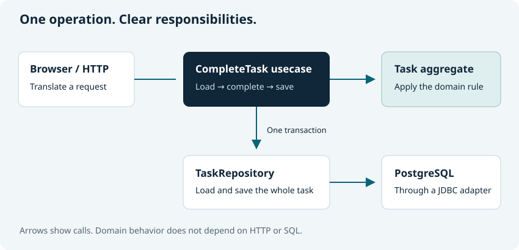

# What is Domain-Driven Design?

A task board seems simple: store a title, show a list and let someone mark a task
complete. Then the questions arrive. Can a task have a blank title? Does renaming
it create a new task? Who decides whether completion is allowed? Which changes
must be saved together?

**Domain-Driven Design (DDD) starts with those business questions.** It develops a
shared language with the people who understand the work, then uses that language
in a model that expresses the rules. A domain is the area of activity the software
serves: planning deliveries, managing tasks, settling invoices or something else.
DDD is a design approach, not a framework, database schema or requirement to build
microservices.

This chapter introduces the vocabulary. No DDD experience, database or installation
is needed. Next, [apply it to a small project](ddd-for-small-projects.md), or open
[your first executable domain model](your-first-domain-model.md).

## Start with the language people use

Suppose the team says: “A task has a title. Completing a task keeps the same task;
it changes its status.” These words are the beginnings of a **ubiquitous language**:
a vocabulary used in conversation, examples, tests and code. Ask what “complete”
means instead of assuming it means setting a boolean.

This is collaborative work. A compiler cannot discover the right business rule
for you. It can help keep an agreed rule visible and consistently applied. Vernac
can also keep [glossary terms beside the model](ubiquitous-language.md).

## A small model you can read

The following is one complete, alternative model. Read it here first; the
[first-model tutorial](your-first-domain-model.md) explains how to build one.
Do not paste it alongside another Task definition in the same namespace.

```vernac
namespace example.tasks;

term Task {description "A piece of work that can be marked complete.";}
id TaskId;
value Title(String) validates {
    require(!self.string().isBlank(), "A task needs a title");
};
value Status = PENDING | COMPLETED;

aggregate Task[TaskId](Title, mut Status) behavior {
    modify void complete() {
        self.status(Status.COMPLETED);
    }
};
```

The Java inside `behavior` is ordinary Java. The surrounding declarations describe
what the objects mean and which structure the compiler should provide.

## Values describe; identities distinguish

A **value object** is defined by its value. Two `Title` instances containing the
same text represent the same title. They have no separate identity, and changing
a title means constructing another value. Validation belongs with the value:
`Title.of(" ")` fails rather than creating a blank title.

An **entity** has an identity that survives changes. Two tasks can have the same
title and still be different tasks. `Task.create(...)` creates a new TaskId;
`task.complete()` keeps that identity. Vernac's generated equality follows these
choices: values compare their contents; entities and aggregates compare identity.

A string or integer is not inherently bad. Use a named value when it communicates
a role or protects a rule: `Title` says more than an unrelated `String` passed to
the wrong operation. Vernac makes these small types inexpensive to introduce.

## An aggregate sets a consistency boundary

An **aggregate** groups domain state that should be treated as a unit when applying
business changes. Its root is the object through which the application works with
that group. Our Task has no children, so the task itself is the entire aggregate.
An aggregate need not contain a complicated graph to be useful.

For a larger model, a delivery Tour could contain Stops. The Tour decides rules
that span its stops; a repository loads and saves the complete Tour. Another Tour
is a separate aggregate. Refer to it by its ID instead of embedding and persisting
one aggregate inside another.

This is a modeling decision, not a synonym for “every table.” Vernac implements
containment rules and complete-aggregate persistence. It does not claim complete
runtime isolation of mutable children or rollback of Java objects after validation
fails; see the [aggregate contract](../contracts/entities-and-aggregates.md) for the
precise guarantees.

## Behavior names a business action

`complete()` tells a reader why state changes. A public `setStatus(...)` would only
say how the state is represented. An **invariant** is a rule that valid state must
satisfy; a transition rule describes which action is allowed from a given state.

Our example deliberately allows repeated completion: assigning COMPLETED again is
harmless. If the business needs a different policy, write it and test it. Neither
DDD nor Vernac invents that decision. A list of architectural keywords is not a
substitute for understanding the work.

## A usecase connects the rule to the application

A **usecase** coordinates one application operation: load a task, complete it and
save it. A **repository** supplies the aggregate without making business behavior
understand SQL. An **adapter** translates an HTTP request, form or other external
interaction into that application operation.



The domain does not need to know whether the request came from a browser or a test.
Vernac usecases provide the transaction boundary; repositories require an active
transaction. These are implementation choices aligned with the design, rather
than the definition of DDD itself.

## Where bounded contexts fit

A **bounded context** is a boundary within which a particular model and vocabulary
have a clear meaning. “Customer” in billing may not mean the same thing as
“Customer” in delivery planning. Keeping that distinction explicit is strategic
DDD. Values, entities, aggregates and repositories are tactical modeling patterns.

A bounded context is not automatically a microservice. It may live inside one
application or be independently deployed. Vernac namespaces organize type names;
they do not automatically create deployment or security boundaries. Ports,
adapters and explicit mappings help when crossing a boundary. You do not need
several contexts to build your first useful task board.

## Use the ideas where they help

DDD is especially useful when rules and terminology matter and evolve. A small
product can have those needs. A large data-import utility might have very little
domain behavior. Start with the actual problem; do not create services, events,
ports or modules simply to fill out a diagram.

**Next:** [DDD for a small project](ddd-for-small-projects.md) shows what to adopt
first and what to leave out. Already comfortable with the vocabulary? Build
[your first domain model](your-first-domain-model.md), or start the
[working Spring Boot application](spring-boot-starter.md).
