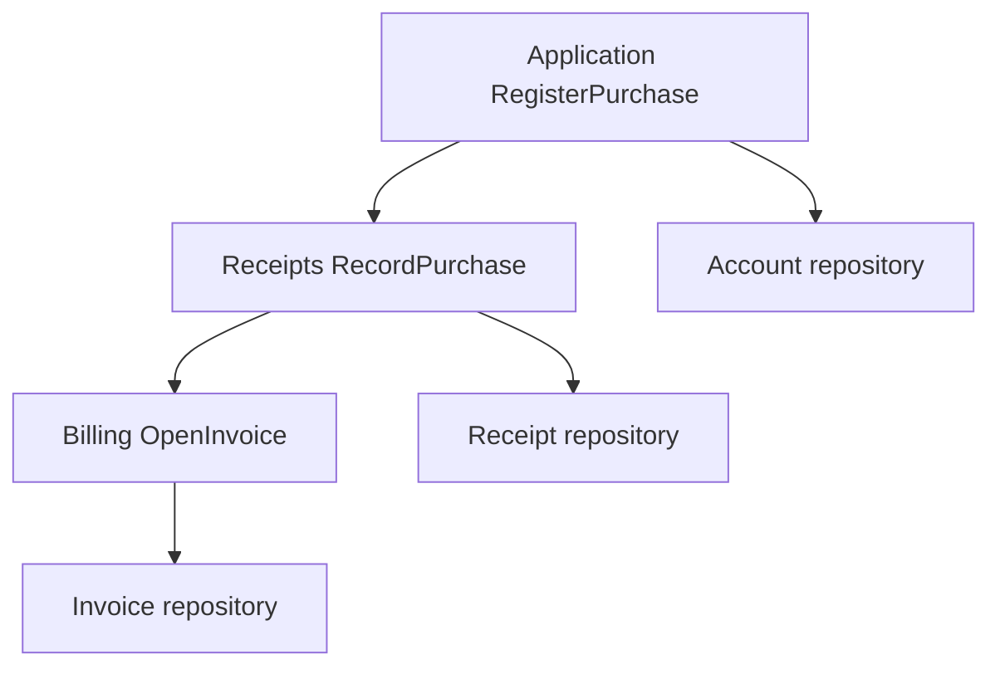
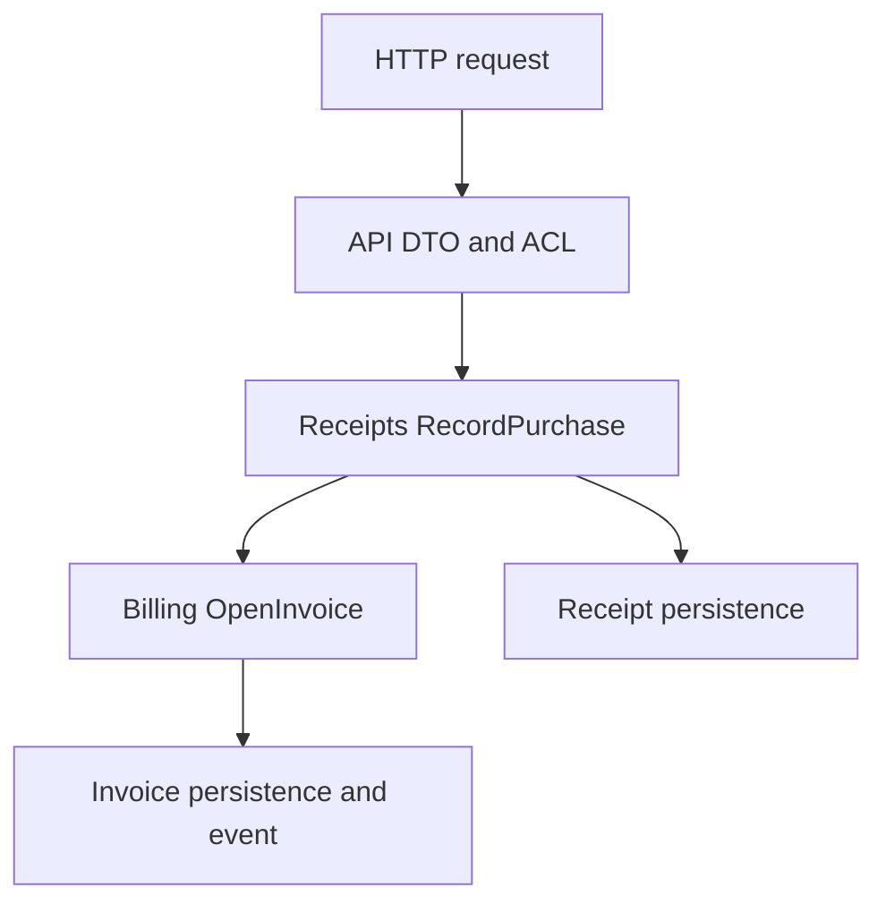

# Versioned modules, one coherent application

This standalone Maven reactor demonstrates real module-owned persistence. It is not a
child module of the Vernac build. There are no payments or external network calls.

| Artifact | Public API | Owned data |
| --- | --- | --- |
| billing | CustomerName, InvoiceId, InvoiceOpened, OpenInvoice | Invoice |
| receipts | RecordPurchase | Receipt, including a Billing value |
| api | Internal PurchaseApi HTTP entrypoint | None |
| application | RegisterPurchase, ReadCustomer | Account, including the same Billing value |

Billing also emits its exported recorded InvoiceOpened event. One synchronous receiver belongs
to the activated Receipts module; another belongs to the application. Their log lines
show the same EventId. Receipts' receiver is internal and needs no export or hand-written
Spring registration. If a synchronous receiver fails, it fails the calling transaction.
An observation logged during a subsequently rejected purchase does not imply a commit.
Billing owns @event:InvoiceOpened, while the application owns vernac.@delivery.
Receipts also has a deferred NotifyInvoiceOpened listener, which persists Notification.
The application has a second deferred recipient, RecordInvoiceObservation. Each has its
own delivery job and confirmation. The Receipts fixture deliberately fails after its
first notification INSERT, then retries; only the successful notification remains.

The Runner waits up to ten seconds for both jobs and verifies one notification.
The short polling/backoff configuration and in-memory deliberate failure are local demo
instrumentation, not production retry/idempotency logic. Restarting before the fixture's
retry resets its deliberate first-attempt marker. SQL rollback cannot undo external effects.

Internal aggregates and repositories are deliberately not exported. An ordinary Maven
dependency supplies both Java implementations and explicit Vernac contracts. The
application activates the API; its usecase dependency requires Receipts and Billing transitively.
Importing CustomerName alone would not activate Billing or create its tables.



All three writes join one REQUIRED usecase transaction. Deployment migrations are
separate: Billing history first, Receipts history second, application history last.
The application supplies one DataSource and transaction manager. Producer JDBC starters
are optional dependencies; type-only consumers retain the core runtime without pulling
in a database auto-configuration. An activating application adds the JDBC starter itself. There is no hand-written
module registration, migration strategy or dependency component scan.

## Build and run version 1

From the Vernac repository root, with Java 25 available, install the compiler/runtime:

```text
mvn clean install
mvn -f examples/persistent-modules/pom.xml clean install
```

Start the dedicated local PostgreSQL database in PowerShell:

```powershell
docker compose -f .\examples\persistent-modules\compose.yaml up -d --wait
```

Then run through IntelliJ's Maven window:

```text
mvn -f examples/persistent-modules/application/pom.xml spring-boot:run
```

The Runner creates an invoice, receipt and account, then reloads the external value
from the account. It then deliberately rejects a second purchase after all three
writes and verifies that no rows survived the cross-module rollback. Its log explains
the completed flow. Leave this database intact for
the upgrade: deleting it would hide whether existing rows migrate successfully.
Each run intentionally adds one purchase, rather than resetting the application data.

The demo listens on localhost:55435, independently of the persistence-demo database.
The password in compose.yaml is an explicitly local fixture, never a production secret.
MODULE_DEMO_DB_URL/USER/PASSWORD can override the application connection.

## Inspect the three independent histories

Module SQL lives under each producer's `src/main/vernac-schema/migration`; application
SQL lives under `application/src/main/resources/db/migration`. Each has matching,
source-controlled snapshots under `src/main/vernac-schema/history`.

All three initial migrations deliberately use version 20261012090000000.
The subsequent payload/notification/delivery migrations use 20261013190000000;
they extend each owner's history without rewriting the initial files. There is
no version collision: the modules use different stable `vernac_module_<hash>` history
schemas, while the application uses public.flyway_schema_history.

In the `module_demo` database, inspect:

```sql
SELECT table_schema, table_name
FROM information_schema.tables
WHERE table_name = 'flyway_schema_history'
ORDER BY table_schema;

SELECT "customerName.text", "customerName.alias"
FROM "example.shop"."Account";
```

In IntelliJ, inspect module.json and persistence.json under the modules' target/classes
META-INF/vernac directories. These contain export contracts and checksummed migration
bundles. The module name controls activation/history identity, not type import paths.

## Upgrade the exported value with existing data

Use a temporary branch or commit the unchanged example first. Stop the application,
keep PostgreSQL and its volume running, and perform this deliberate local experiment.
The checked-in example stays at version 1; do not commit experiment files accidentally.

### 1. Change the producer and consumer Java call

In Billing's model, replace the CustomerName declaration with:

```vernac
value CustomerName(String text, String? alias, String origin) validates {
    require(!self.text().isBlank(), "Customer name must not be blank");
};
```

This is an intentional breaking factory/shape change. In ModuleLifecycleApplication,
replace the customer factory call with:

```java
var customer = CustomerName.of("Module lifecycle customer", "LOCAL");
```

The convenience factory supplies null for the optional alias. The two required
arguments are text and origin. Billing's public usecase signature remains unchanged,
but its dependent modules must be rebuilt against the new value contract.

The API's input mapping also constructs this value. In `api` add `String origin` to
`PurchaseRequest` and `origin <- source.origin;` to the `customer` mapping. Include
`"origin":"HTTP"` in successful/blank-name HTTP request fixtures in
`ModuleLifecycleBootTest` and in manual HTTP requests. Keep `{}` unchanged: it must
remain an invalid-request test. This explicitly chooses where the new required value
comes from instead of silently inventing it.

Change this reactor's version to 1.1.0: the root project version and the parent version
in each of its four child POMs. Dependencies already use ${project.version}; no
independent dependency-version edits are needed. Leave the Boot parent and vernac.version
unchanged. Install the updated parent:

```text
mvn -f examples/persistent-modules/pom.xml -N install
```

### 2. Generate and review Billing's migration

A required origin has no meaningful automatic value for old rows. The migration generator
requires an explicit backfill. Create `billing/upgrade-backfills.json`:

```json
{
  "backfills": {
    "example.billing/Invoice/customerName.origin": "'LEGACY'",
    "example.billing/@event:InvoiceOpened/customerName.origin": "'LEGACY'"
  },
  "conversions": {}
}
```

From the repository root in IntelliJ Maven:

```text
mvn -f examples/persistent-modules/billing/pom.xml vernac:migration -Dvernac.migrationDescription=add_customer_origin -Dvernac.transformations=examples/persistent-modules/billing/upgrade-backfills.json
```

Review the candidate: add the nullable column, backfill old rows, then require it.
The new SQL/snapshot pair extends the original history; it does not replace V1.
Review and test each candidate before any application startup that would apply it.
You alone are responsible for approval, existing data, operation order, deployment
compatibility and recovery. Automated verification supplies evidence, not a guarantee.

Publish the reviewed producer locally:

```text
mvn -f examples/persistent-modules/billing/pom.xml clean install
```

### 3. Migrate and rebuild the dependent module

Receipts embeds CustomerName in its own Receipt. Billing's migration cannot update
this other owner's table. Create `receipts/upgrade-backfills.json`:

```json
{
  "backfills": {
    "example.receipts/Receipt/customerName.origin": "'LEGACY'",
    "example.receipts/Notification/customerName.origin": "'LEGACY'"
  },
  "conversions": {}
}
```

Generate, review and install Receipts in that order:

```text
mvn -f examples/persistent-modules/receipts/pom.xml vernac:migration -Dvernac.migrationDescription=add_customer_origin -Dvernac.transformations=examples/persistent-modules/receipts/upgrade-backfills.json
mvn -f examples/persistent-modules/receipts/pom.xml clean install
```

### 4. Migrate the application's copy

Create `application/upgrade-backfills.json`:

```json
{
  "backfills": {"example.shop/Account/customerName.origin": "'LEGACY'"},
  "conversions": {}
}
```

Generate and review the local migration, then rebuild:

```text
mvn -f examples/persistent-modules/application/pom.xml vernac:migration -Dvernac.migrationDescription=add_customer_origin -Dvernac.transformations=examples/persistent-modules/application/upgrade-backfills.json
mvn -f examples/persistent-modules/pom.xml clean install
mvn -f examples/persistent-modules/application/pom.xml spring-boot:run
```

Startup applies Billing, Receipts and application upgrades through their own histories.
Old rows remain present with origin LEGACY; the Runner adds a new row with origin LOCAL.
Inspect all owners:

```sql
SELECT 'billing' AS owner, "customerName.text", "customerName.origin"
FROM "example.billing"."Invoice"
UNION ALL
SELECT 'receipts', "customerName.text", "customerName.origin"
FROM "example.receipts"."Receipt"
UNION ALL
SELECT 'application', "customerName.text", "customerName.origin"
FROM "example.shop"."Account";
```

Do not run the old artifacts against the upgraded database. A downgrade needs its own
reviewed compatibility/recovery plan. Never edit applied SQL or repair checksums to
make an incompatible version appear valid. Histories are not globally atomic: if a
later owner fails, completed earlier histories can remain applied.

## Automated lifecycle verification

With your disposable PostgreSQL test URL/user/password variables configured:

```text
mvn -pl vernac-maven-plugin -am test -Dtest=ModuleMigrationPostgresTest -Dsurefire.failIfNoSpecifiedTests=false
```

Expect eight tests without skips. The upgrade scenario seeds old rows in two modules
and an application, adds/backfills the exported value's required field, verifies all
three independent histories and rejects restarting the older artifacts. Existing
scenarios cover restart, partial failure/retry, REQUIRED rollback, synchronous listener
failure rollback and manual schema drift. The durable scenario proves pending jobs
survive restart, two module receivers confirm independently, and a failed first
processing attempt does not duplicate committed SQL on retry.

The application also includes a real Spring Boot integration test. With the same
PostgreSQL variables, after installing the example reactor, run:

```text
mvn -f examples/persistent-modules/application/pom.xml test -Dtest=ModuleLifecycleBootTest
```

Expect one test without skips. It starts through generated Boot auto-configuration,
executes the Runner, verifies one worker/storage instance, two successful delivery jobs,
one notification, and one purchase row per owner plus three history tables.
Without the PostgreSQL variables this test skips explicitly; a database-free example
build proves generation/compilation, not runtime database behavior.

## Finish the experiment

Restore the example sources/POMs and remove only the uncommitted upgrade SQL, snapshots
and transformation files. To return the dedicated demo database to V1 as well, this
command deliberately deletes **all data in this example's Compose volume**:

```powershell
docker compose -f .\examples\persistent-modules\compose.yaml down --volumes
docker compose -f .\examples\persistent-modules\compose.yaml up -d --wait
```

Rebuild the restored version-1 example before running it. Source rollback alone does
not undo database migrations. None of these commands targets other examples' volumes.

See [the module tutorial](../../docs/tutorials/type-modules.md) and
[the module contract](../../docs/contracts/modules.md) for the broader model and current limits.

## Inspect durable jobs and evolve recorded payloads deliberately

```sql
SELECT "eventType", "listenerId", status, attempts, "lastError"
FROM "vernac"."@delivery" ORDER BY "createdAt", id;
SELECT "@eventId", "invoiceId", "customerName.text"
FROM "example.billing"."@event:InvoiceOpened";
```

Recorded events remain as protocol rows. Updating CustomerName also changes these
persisted payloads; the upgrade exercise therefore supplies a reviewed backfill for
the producer's event table and the receiver's Notification table. This is an explicit
example decision, not an automatic evolution policy. If historical meaning/structure
must remain frozen, introduce a new event type and retain the old model/handler until
its pending work is resolved. Applied migration review and deployment remain your responsibility.


## Call the module-owned HTTP API

The `api` artifact contains `PurchaseApi`, its DTOs, mappings and scoped error policy.
It exports no callable types. Activating `example.api` registers the controller and
requires Receipts and Billing transitively. Removing that activation and avoiding any
other activation of the API module leaves its routes absent, even under component scanning.
No extra migration is necessary for this transport-only module.



After installing the reactor, run the application with its HTTP profile through IntelliJ's
Maven window. The existing Runner executes first; then the HTTP server remains available.

```text
mvn -f examples/persistent-modules/application/pom.xml spring-boot:run -Dspring-boot.run.profiles=http
```

In a separate PowerShell terminal, send a JSON file to avoid shell quoting differences:

```powershell
'{"text":"HTTP module customer","alias":"LOCAL"}' | Set-Content -Encoding utf8 .\purchase-request.json
curl.exe -i http://localhost:8089/api/module-purchases -H "Content-Type: application/json" --data-binary '@purchase-request.json'
Remove-Item .\purchase-request.json
```

Expect `201` with an `invoiceId`. The request invokes the module-owned usecase; invoice
and receipt writes share one REQUIRED transaction, and recorded/deferred event handling
uses the already demonstrated infrastructure. This route does not create the application's
Account: it deliberately calls the reusable module operation directly.

Send `{}` for `400 INVALID_PURCHASE_REQUEST`, or `{"text":""}` for
`422 INVALID_CUSTOMER`. The producer defines these public messages; internal validation
messages are not exposed. The Boot test now checks these three responses on a real HTTP
server and verifies the successful request's persistent writes. The separate compiler/JAR
MVC test also proves that inactive entrypoints remain absent under dependency scanning.

The API producer marks web infrastructure dependencies optional. The application explicitly
provides the HTTP runtime and Spring MVC. This local demonstration has no authentication;
production applications must supply their own access control and exposure policy.
