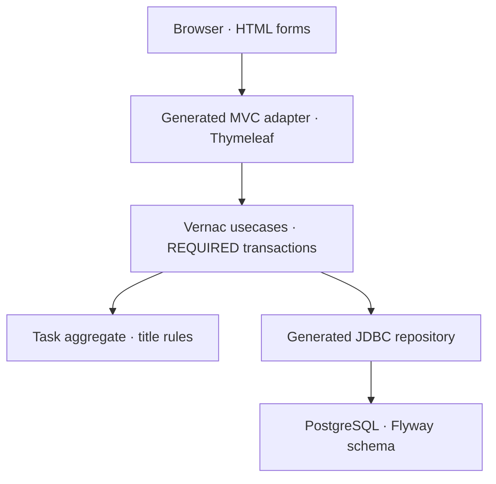

# super\-new\-starter

A real, deliberately small starting point: **Small wins**, a calm task workspace.
Create a task, complete it, reopen it, and browse numbered pages. Every change goes
through a generated transactional usecase and a JDBC repository into PostgreSQL.
No JavaScript framework, Node build, CDN, ORM or hand-written persistence glue.

Coordinates: `org.example:super-new-starter` · Namespace: `org.example.tasks`
Vernac: `0.5.0-SNAPSHOT` · Generated Java: 21

If this Vernac version ends in `-SNAPSHOT`, first install matching Vernac artifacts
from its source repository with `mvn clean install`. Published versions come from
Maven Central. The Maven Wrapper is included; use JDK 25 for the supplied build.
Docker with Compose v2 must be running for local PostgreSQL.

## Start locally

With Docker running, open `TasksApplication` in IntelliJ and click **Run**.
No active-profile setting is needed: `local` is the default when none is selected.
Keep the generated project root as the working directory so Compose can find `compose.yaml`.

Alternatively, in the project's IntelliJ Maven tool window, run:

```text
spring-boot:run
```

Or in PowerShell, from this directory:

```powershell
.\mvnw.cmd spring-boot:run
```

Linux/macOS:

```shell
./mvnw spring-boot:run
```

Open **http://localhost:8080**. Spring Boot starts PostgreSQL via `compose.yaml`,
waits for it to become healthy, and applies the included Flyway baseline before
serving requests. The database uses port **55439** on loopback and a named volume.
The application starts with an empty board: enter your first task in the form.
There is no login; the board is intentionally shared by all visitors.

An explicitly active profile replaces the `local` default. No IDE-specific files
are required.
If a second project uses the same database port, set `LOCAL_DB_PORT` to another
free port before starting; `PORT` changes the web port.

Stopping the app leaves local PostgreSQL running (`start-only`). From this directory:

```shell
docker compose stop
docker compose up -d
```

`docker compose down` removes the container but retains its named data volume.
**`docker compose down --volumes` destroys this local project's database data.**
Use it only when you intentionally want a fresh development database.

## Understand the application



| File | Responsibility |
| --- | --- |
| `src/main/vernac/org/example/tasks/tasks.vernac` | Terms, values, aggregate, repository queries, usecases and MVC endpoints |
| `adapter TaskWeb inbound mvc` inside `tasks.vernac` | Request bindings, typed usecase calls, views, redirects and safe redisplay |
| `src/main/resources/templates/board.html` | Server-rendered UI, escaped task titles and POST forms |
| `src/main/resources/static/app.css` | Responsive layout using local assets and system fonts |
| `src/main/java/org/example/tasks/adapter/inbound/web/WebSecurity.java` | Public routes, CSRF protection and response headers |
| `src/main/resources/db/migration/` | Flyway SQL; applied at startup |
| `src/main/vernac-schema/history/` | Versioned Vernac schema snapshots used to generate later migrations |
| `vernac-application.vapplication` | Application composition; ready for future module activations |

Repositories load full aggregates. `ReadTasks` projects the completed page to
immutable `TaskCard` values before it leaves the usecase. Thymeleaf receives these
values rather than JDBC rows or live database connections. All mutations are POST
requests followed by a 303 redirect on success, so browser refresh does not repeat a successful submission.
The generated MVC controller contains no handwritten business logic. Invalid forms
reload the board with safe, original input values and a public error message;
malformed/missing inputs use 400, domain validation uses 422. Technical exceptions
are not rendered. `inputs` contains only declared, non-sensitive form/query/path
values. Titles are HTML-escaped; forms retain Spring Security's CSRF protection. Validation,
missing tasks and concurrent updates have explicit UI responses. Invariants and
transaction boundaries remain in Vernac, not the controller.

## Test without a database

```shell
./mvnw clean test
```

On Windows use `.\mvnw.cmd clean test` (or `clean test` in IntelliJ's Maven window).
`TaskTest` verifies the domain. `TaskWebTest` renders the actual Thymeleaf templates
and exercises real generated usecases with a **test-only in-memory repository**:
create, complete, reopen, invalid input, escaping, CSRF and pagination. It does not
claim to verify JDBC or transactions. No Docker is needed for these tests.

## Check real persistence

Create a separate disposable PostgreSQL database, set `DB_URL`, `DB_USERNAME` and
`DB_PASSWORD`, and run `./mvnw -Pdatabase-tests verify` (Windows: `.\mvnw.cmd`).
The opt-in `TaskPersistenceIT` selects `persistence-test` explicitly and boots the
application, applies Flyway, and exercises generated repositories and usecases.
It intentionally fails if the database is not configured; it is never silently
skipped. Use a disposable database: this test leaves its task behind.

## Evolve the schema

The wizard generated both the initial SQL candidate and its matching schema
snapshot for **your chosen namespace**. Do not delete just one half of this pair.
Before first deployment, review the SQL in `src/main/resources/db/migration`.
You alone are responsible for reviewing, testing and approving migrations before
applying them. Generation and automated checks do not guarantee production safety.

1. Modify the Vernac model, for example by adding an optional value to `Task`.
2. Generate a migration candidate (IntelliJ Maven window):

   ```text
   vernac:migration -Dvernac.migrationDescription=add_task_details
   ```

3. Review the new SQL **and** history snapshot; provide explicit backfills if a
   new required field needs values for existing rows. Do not rewrite applied SQL.
4. Use `vernac:schema-check` with the disposable-server configuration described
   at https://vernac.org/tutorials/postgresql-migrations.html, then test a copy of
   representative existing data. An empty replay alone cannot validate a backfill.
5. Commit the model, SQL and history together. Flyway applies pending SQL at the
   next application startup. Never commit credentials or local database files.

## Build once, configure per environment

For deployment, explicitly set `SPRING_PROFILES_ACTIVE=production`. This replaces
the development default: Compose is disabled, cookies require HTTPS, and database
credentials come from the environment. Supply:

| Environment variable | Purpose |
| --- | --- |
| `SPRING_PROFILES_ACTIVE` | Set to `production` (or another explicit deployment profile) |
| `DB_URL` | JDBC PostgreSQL URL |
| `DB_USERNAME`, `DB_PASSWORD` | Database credentials; inject through your deployment's secret mechanism |
| `SERVER_ADDRESS` | Defaults to loopback; use `0.0.0.0` inside a container |
| `PORT` | HTTP port, default 8080 |
| `DB_POOL_SIZE` | Connection pool bound, default 10 |
| `LOG_LEVEL` | Root log level, default INFO; logs go to stdout |
| `COOKIE_SECURE` | Defaults to true; use HTTPS in deployment |

`./mvnw clean package` produces `target/application.jar`. Run it with
`java -jar target/application.jar`, or build the included runtime-only Dockerfile
with `docker build -t my-tasks .`. The Dockerfile already selects `production` and
binds HTTP to `0.0.0.0`. Runtime images exclude development Compose support;
provision PostgreSQL independently. Use the same JAR/image across stages.

Health probes are available at `/actuator/health/liveness` and
`/actuator/health/readiness`. Shutdown is graceful. The task state is in PostgreSQL,
assets are local, and no writable application filesystem is needed.

This is a public starter, **not a finished SaaS security model**: add authentication,
authorization and tenant isolation before using private data. Browser flash/CSRF
state uses Spring's HTTP session; for multiple app instances, configure a shared
session store or another deliberate session strategy. Do not enable the `local`
profile in production. Keep framework/image versions patched for your deployment.

Next: add a field or behavior in Vernac, extend `TaskWeb` bindings/mappings as needed,
regenerate Java, and extend the HTML view. The generated controller and advice live
under `target/generated-sources/vernac`; do not copy them into your source tree.
Generated Java belongs under `target`; edit the model and your Java adapter instead.
